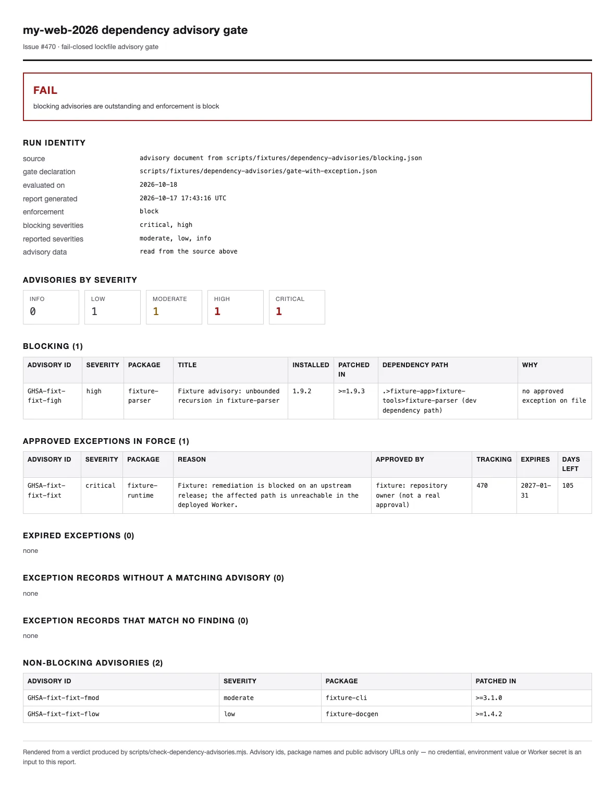
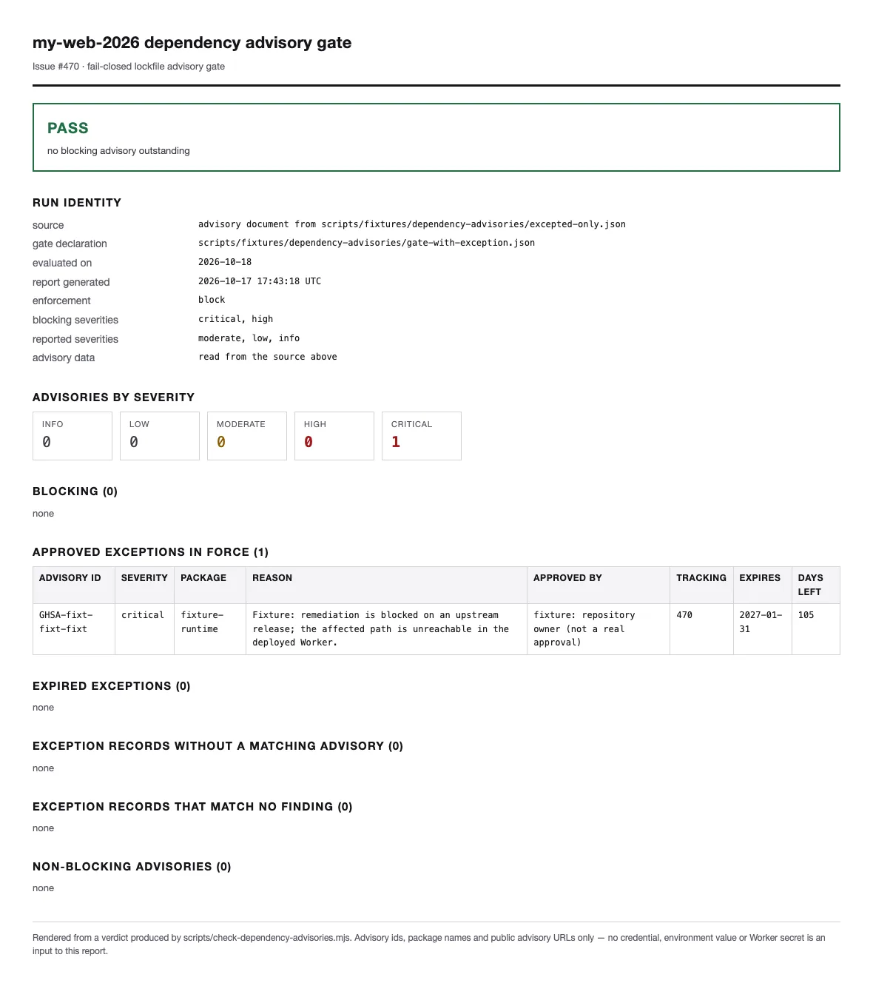

# Dependency advisory runbook

> Lockfile advisory gate for `my-web-2026` (Issue #470). Canonical
> operator reference for the `pnpm audit`-based CI gate. Cross-linked
> from [`AGENTS.md §5`](../../AGENTS.md),
> [`quality/profile.yaml`](../../quality/profile.yaml) and
> [`docs/security.md`](../security.md).
>
> **Scope.** This runbook answers four operator questions:
>
> 1. *Which severities stop the build, and which are only recorded?*
> 2. *How does an approved exception work, and when does it expire?*
> 3. *What does each failure mean, and how is it repaired?*
> 4. *How do I reproduce a verdict without touching the registry?*

The mechanical contract lives in
`scripts/_dependency-advisories.mjs` (decision),
`scripts/check-dependency-advisories.mjs` (acquisition + exit code)
and `scripts/render-dependency-audit-report.mjs` (inspection report).
This file explains what those scripts print.

## 1. What the gate covers

| Source                                        | What it contributes                                                                                      |
| --------------------------------------------- | -------------------------------------------------------------------------------------------------------- |
| `pnpm-lock.yaml`                               | the resolved `name@version` set that is checked, indirectly, through the advisory endpoint                 |
| `quality/dependency-advisory-gate.json`        | the reviewed policy: enforcement mode, blocking severities, reported severities, exception ledger, expiries |
| `pnpm audit --json`                            | the advisory document: advisory id, package, severity, vulnerable/patched ranges, dependency paths          |

Nothing else is an input. In particular the gate never reads
`node_modules`, a deployment configuration, `.dev.vars`, Infisical or a
Worker secret value (see [§7](#7-secret-posture)).

`pnpm audit` exits `1` whenever advisories exist. That exit code is
**not** this gate's failure signal — it is data. The gate decides from
the parsed document, and treats anything that is not an advisory
document as *unavailable data* rather than as "no advisories".

## 2. Commands

```bash
pnpm run dep-audit:check                 # the gate (registry)
pnpm run dep-audit:report                # the gate + .tmp/dependency-audit-report.html
pnpm run dep-audit:check -- --enforce    # same data, decided as `block`
pnpm run dep-audit:check -- --format json
pnpm run dep-audit:check -- --input <file|->     # fixture / captured document
pnpm run dep-audit:check -- --now 2026-10-18     # pin the expiry evaluation date
```

### Exit codes

| Code | Meaning                                                                                                 |
| ---- | ------------------------------------------------------------------------------------------------------- |
| `0`  | pass, **or** blocking findings recorded while the declaration says `enforcement: audit`                 |
| `1`  | blocking advisories outstanding under `enforcement: block`                                             |
| `2`  | usage error, unreadable `--input` path, or a broken/undeclared gate declaration                       |
| `3`  | **advisory data unavailable — fail closed**                                                             |

`3` is the contract that matters most. A registry outage, a rate limit,
an error document or an unparsable response produces `DATA UNAVAILABLE`
with every count rendered as `unknown`; there is no code path from
unreadable data to a pass, and the output never contains a zero-finding
claim. That is why the CI step is not `continue-on-error`.

`3` describes the **registry**, never the reviewed declaration. A
mistyped `--now`, a missing `--input` path and a malformed declaration
are operator mistakes, so they exit `2` with one line on stderr. A
declaration whose *content* contradicts the document (see
[§3](#exceptions)) is neither: the document was read, the verdict is
computed normally, and the record is reported as not covering anything.

### Where this runs

This gate is a **CI step**, not part of `validate:fast` /
`validate:integration` / `validate:release`: it needs the registry
advisory endpoint, and the fast path is offline and read-only by
contract (AGENTS.md §5). Its decision logic lives in
`scripts/check-dependency-advisories.mjs` — not in workflow YAML — so
the same verdict is produced by `pnpm run dep-audit:check` locally. That
divergence is a stated open decision, recorded in
`quality/profile.yaml#security_gates.dependency_review`.

Because the declaration is `block` ([§6](#6-the-live-state--block)),
this step is now a hard gate in CI: a `critical` / `high` advisory that
no approved exception covers fails the `validate` job, and unreadable
advisory data fails it with exit `3`.

## 3. The declaration

[`quality/dependency-advisory-gate.json`](../../quality/dependency-advisory-gate.json):

```json
{
  "enforcement": "block",
  "blockingSeverities": ["critical", "high"],
  "reportedSeverities": ["moderate", "low", "info"],
  "dataUnavailable": "fail",
  "exceptions": []
}
```

That is the shape the repository ships today: the gate is **blocking**
(Issue #645) and it carries **no exception at all**, so every
`critical` / `high` finding blocks the build
([§6](#6-the-live-state--block)). An empty ledger is the strictest
state; a record may only be added with an owner approval, and it has to
name its grounds, an approver, a tracking Issue and an expiry date.

- `blockingSeverities` / `reportedSeverities` — the severity policy. A
  severity has exactly one meaning; listing it in both is rejected. An
  empty `blockingSeverities` is rejected. Both lists are **enforced**,
  not documentation: a finding whose severity is in neither list fails
  closed as blocking (`severity "…" is declared neither blocking nor
  reported; failing closed`) instead of quietly landing in the
  non-blocking list.
- `enforcement` — `block` stops the build on a blocking finding; `audit`
  records it and exits `0`. It never changes what counts as blocking.
  The repository runs `block` ([§6](#6-the-live-state--block)).
- `dataUnavailable` — only `fail` is accepted. A policy that tolerates
  unreadable data would reintroduce the false green this gate exists to
  prevent.
- Unknown keys are rejected, so a typo cannot silently empty the
  blocking set.

### Exceptions

One exception is one reviewed record **for one advisory in one package**,
and it expires. A registry advisory frequently names several affected
packages — `pnpm audit` then reports one finding per package under the
same GHSA id — so the ledger is keyed by the pair
`(advisoryId, package)`: one record per package, not one record per
advisory id. Two records that differ only in `package` are valid and are
what a two-package advisory needs; the same pair twice is a copy-paste
error.

```json
{
  "advisoryId": "GHSA-xxxx-xxxx-xxxx",
  "package": "some-package",
  "severity": "critical",
  "reason": "why the risk is accepted for now, in one sentence",
  "approvedBy": "who accepted it",
  "trackingIssue": 470,
  "expiresOn": "2027-01-31"
}
```

Behaviour:

| Case                                             | Verdict                                                                                        |
| ------------------------------------------------ | ---------------------------------------------------------------------------------------------- |
| record covers the advisory **in that package**, unexpired | `approved exceptions in force`; it stops blocking, and stays visible                |
| `expiresOn` is today                             | still covered (`daysRemaining: 0`)                                                              |
| `expiresOn` is in the past                       | **blocking again**; also listed under `expired exceptions`                                       |
| record matches no advisory id in the data        | listed under `exception records with no matching advisory`, remove it                            |
| `package` / `severity` contradict the advisory    | the record **suppresses nothing**; listed under `exception records that match no finding`, with the package/severity the document actually reports |
| same advisory id, two different packages          | two records, one per package — this is the supported way to approve a multi-package advisory    |
| duplicated `(advisoryId, package)`                | the declaration is rejected (exit `2`)                                                           |

A contradiction is never a data failure. The advisory document *was*
read, so the verdict stays a verdict: the uncovered finding keeps
blocking, and the output points at the declaration that needs fixing
rather than at the network.

## 4. Normal observation

A healthy run of the committed declaration, with no findings:

```console
$ pnpm run dep-audit:check -- --input scripts/fixtures/dependency-advisories/clean.json --now 2026-10-18 --enforce
dependency advisory gate: PASS
  source:              advisory document from scripts/fixtures/dependency-advisories/clean.json
  gate declaration:    quality/dependency-advisory-gate.json
  evaluated on:        2026-10-18
  blocking severities: critical, high
  enforcement:         block
  advisories reported: 0
  by severity:          (none)
  blocking after exceptions: 0

remediation: docs/runbook/dependency-advisories.md
```

(`--now` is passed so the transcript is reproducible; without it the
gate prints today's UTC date.)

A healthy run with an approved exception keeps the acceptance record in
the output — the pass is never silent:

```console
$ node scripts/check-dependency-advisories.mjs \
    --input scripts/fixtures/dependency-advisories/blocking.json \
    --gate scripts/fixtures/dependency-advisories/gate-with-exception.json \
    --now 2026-10-18 --enforce
dependency advisory gate: FAIL          # the unexcepted high finding still blocks
  advisories reported: 4
  blocking after exceptions: 1
blocking advisories (1):
  - [high] GHSA-fixt-fixt-figh fixture-parser (installed: 1.9.2; patched: >=1.9.3)
approved exceptions in force (1):
  - [critical] GHSA-fixt-fixt-fixt fixture-runtime — approved by … until 2027-01-31 (105 day(s) left)
      reason: …
      tracking: 470
non-blocking advisories (2):
  - [moderate] GHSA-fixt-fixt-fmod fixture-cli
  - [low] GHSA-fixt-fixt-flow fixture-docgen

remediation: docs/runbook/dependency-advisories.md
```



The committed screenshot is the *fixture* verdict (public-safe dummy
advisories, `example.invalid` URLs), so the artifact can be committed
without leaking anything about the real dependency tree. The real run
is reproducible with the same command and no `--input`.

The passing state, with the approved-exception record the gate keeps in
its output:



Both images are WebP (quality 80, width 1180, 53–69 KiB) rendered from
the HTML report the gate writes, not hand-made; the PNG capture stays in
`.tmp/` and is not committed.

## 5. Abnormal observation and repair

| Observation                                                | Cause                                                     | Repair                                                                                                                                                                       |
| ---------------------------------------------------------- | --------------------------------------------------------- | ----------------------------------------------------------------------------------------------------------------------------------------------------------------------------- |
| `dependency advisory gate: FAIL`, exit `1`                  | a `critical`/`high` advisory is in the lockfile            | upgrade or pin the package (`pnpm why <pkg>`), or open an exception record ([§3](#exceptions)) if the risk is knowingly accepted                                       |
| `expired exceptions treated as blocking`                    | a record outlived its `expiresOn`                         | remediate, or renew the record with a new date **and** a fresh approval — never extend it silently                                                                            |
| `exception records with no matching advisory`               | the advisory was fixed or renamed                         | delete the record; a stale exception is not a free pass                                                                                                                      |
| `exception records that match no finding`                   | the record names a `package`/`severity` the document does not report for that advisory | fix the record to the package and severity actually reported, or delete it; a one-package approval does **not** cover the advisory's other packages |
| `dependency advisory gate: DATA UNAVAILABLE`, exit `3`      | registry unreachable, rate-limited, error document, or an unparsable response | re-run; if it persists the CI runner or the local network is blocking the advisory endpoint. **Never** add `--ignore-registry-errors`: that flag converts an outage into an empty advisory set |
| `gate declaration …` error, exit `2`                        | unreadable/invalid declaration, an unreadable `--input` path, or bad CLI usage (`--now`, `--format`) | fix the declaration against [§3](#the-declaration); `pnpm exec biome check quality/dependency-advisory-gate.json` covers formatting                              |
| severity reported as unknown                                | the registry added a severity this gate does not know      | add it to the declaration explicitly, in review; the gate refuses to guess a ranking for it                                                                                  |
| `severity "…" is declared neither blocking nor reported`     | the declaration leaves a known severity unclassified       | classify it in `blockingSeverities` or `reportedSeverities`; the gate fails closed rather than assuming it is non-blocking                                                    |

Reproduction recipes that need no registry access (fixtures are
synthetic; ids and URLs are `example.invalid`):

```bash
node scripts/check-dependency-advisories.mjs \
  --input scripts/fixtures/dependency-advisories/blocking.json \
  --gate  scripts/fixtures/dependency-advisories/gate-with-exception.json \
  --now 2026-10-18 --enforce                              # exit 1
node scripts/check-dependency-advisories.mjs \
  --input scripts/fixtures/dependency-advisories/blocking.json \
  --gate  scripts/fixtures/dependency-advisories/gate-with-expired-exception.json \
  --now 2026-10-18 --enforce                              # exit 1, expired
node scripts/check-dependency-advisories.mjs \
  --input scripts/fixtures/dependency-advisories/registry-error.json \
  --now 2026-10-18                                        # exit 3, unknown
node scripts/check-dependency-advisories.mjs \
  --input scripts/fixtures/dependency-advisories/clean.json --enforce   # exit 0
```

One advisory, several packages — the case an id-keyed ledger cannot
express:

```bash
# one approved record for fixture-runtime; fixture-server-core keeps blocking
node scripts/check-dependency-advisories.mjs \
  --input scripts/fixtures/dependency-advisories/multi-package.json \
  --gate  scripts/fixtures/dependency-advisories/gate-with-split-exception.json \
  --now 2026-10-18 --enforce                              # exit 1, second package uncovered
# a record that names a package the advisory does not report
node scripts/check-dependency-advisories.mjs \
  --input scripts/fixtures/dependency-advisories/multi-package.json \
  --gate  scripts/fixtures/dependency-advisories/gate-with-mismatched-exception.json \
  --now 2026-10-18 --enforce                              # exit 1, record suppressed nothing
```

Usage mistakes, which are exit `2` and never a security verdict:

```bash
node scripts/check-dependency-advisories.mjs --input /nope        # exit 2, ENOENT
node scripts/check-dependency-advisories.mjs --now garbage        # exit 2, YYYY-MM-DD expected
```

## 6. The live state: `block`

The escalation happened in Issue #645. The declaration now ships
`"enforcement": "block"`, so the `Dependency advisory audit` step of the
`validate` job **fails the build** on any `critical` / `high` advisory
that no approved exception covers. `audit` remains available as a
declaration value (and as the `--enforce` preview switch in the other
direction), but it is no longer what the repository runs.

### What was remediated

| advisory                                            | package         | remediation                                                              |
| --------------------------------------------------- | --------------- | ------------------------------------------------------------------------ |
| `GHSA-f2ph-cmg5-wxc8` (critical)                    | `storybook`, `@storybook/core` | the whole `@storybook/*` set moved to `8.6.19` (patched `>=8.6.19`)     |
| `GHSA-587h-7wmj-h5pm` (high)                        | `vite`          | `7.3.6` → `7.3.7` (patched `>=7.3.7`), inside the `7.x` line the tree already runs |
| `GHSA-965c-763c-88jm` (critical), `GHSA-r4xp-prcw-77qf` (high) | `better-auth` | runtime dependency, `1.7.5` → `1.7.7` floor (the tree resolves `1.7.14`) |
| `GHSA-mrhx-c7xc-m3w5` (high)                        | `zod`           | runtime dependency, `4.6.5` → `4.6.6` floor; the two `@cloudflare/config` copies that pin `zod` exactly are lifted by the `zod` override |
| `GHSA-834v-8h66-3h79` (high)                        | `happy-dom`     | devDependency (Vitest's DOM implementation), `20.8.9` → `21.0.4` (patched `>=21.0.4`) |
| `GHSA-2m5v-pch6-74hx`, `GHSA-4w7w-5xrc-9h26`, `GHSA-qrxm-fqhp-jwvm`, `GHSA-xjj6-f33q-929c` (high) | `undici` | dev-dependency path only, `7.29.1` → `7.30.1` (patched `>=7.30.1`) through the `undici` override, because every `miniflare` copy in the tree pins `undici` exactly |

### No exception is on record

The declaration carries **no exception**, so every `critical` / `high`
finding blocks the build. The one record it used to carry — listed here
so the decision stays auditable — was retired on 2026-10-28 (Issue
#704):

| field          | value                                                                                     |
| -------------- | ----------------------------------------------------------------------------------------- |
| `advisoryId`  | `GHSA-vfj7-8cjw-p6xm`                                                                      |
| `package`      | `braces`                                                                                  |
| `severity`     | `high`                                                                                    |
| `approvedBy`   | `repository owner (Issue #645)`                                                            |
| `trackingIssue`| `669`                                                                                     |
| `expiresOn`    | `2027-01-31`                                                                              |

The record was retired because the advisory it accepted **was withdrawn
upstream**: the GitHub Advisory Database lists `GHSA-vfj7-8cjw-p6xm` as
a *Withdrawn Advisory* (`withdrawn_at: 2026-10-23`), so the registry
advisory endpoint no longer returns it and `pnpm audit --json` reports no
`braces` advisory at all. The gate listed the record under `exception
records with no matching advisory`, and the repair table in
[§5](#5-abnormal-observation-and-repair) answers that observation with
"delete the record; a stale exception is not a free pass".

Retiring the record does not soften the gate — an empty ledger is the
strictest state. If the advisory is published again, the gate fails
closed on `braces` and a new record needs a fresh owner approval, with
grounds, an approver, a tracking Issue and an expiry date: this
repository writes no approval on the owner's behalf.

### When an exception expires

An expired record is not an exception any more. On the evaluation date
past `expiresOn` the gate reports the finding under `expired exceptions
treated as blocking`, counts it in `blocking after exceptions`, and
**exits `1`** — the build is red. The operator's options, in order:

1. **Remediate.** Upgrade or drop the dependency (`pnpm why <pkg>`),
   refresh the lockfile, and delete the record. A stale record is not a
   free pass: the gate also lists a record that matches no advisory
   under `exception records with no matching advisory`.
2. **Renew, with a decision.** If the risk is still knowingly accepted,
   update `expiresOn` to a new date **and** re-state the grounds, and
   renew the tracking issue. A silent date extension is exactly what
   the expiry is there to prevent.
3. **Narrow the policy** by editing `blockingSeverities` in review — a
   reviewable one-line diff, not a code change.

Renewing an exception is an **owner decision**, not a code one: this
repository writes no approval on the owner's behalf, and the gate never
creates a record by itself.

### If a new blocking advisory appears

Under `block` enforcement the gate simply fails. The repair path is the
one above: remediate, or record an exception with grounds, an approver,
a tracking issue and an expiry date — one record **per affected
package**, because the ledger is keyed by `(advisoryId, package)`.

`pnpm run dep-audit:check -- --enforce` previews the `block` verdict
without editing the reviewed file; with the declaration already at
`block`, the plain `pnpm run dep-audit:check` produces the same
verdict.

## 7. Secret posture

AGENTS.md §4 forbids listing real secret values. This gate has no code
path that could do it:

- Inputs are the advisory document (package names, versions, advisory
  ids, public URLs) and the reviewed declaration. Both are committed
  files or registry metadata.
- The inherited environment is used only to locate `pnpm` on `PATH`; no
  value from it is printed, and the HTML report renders the same
  verdict fields as the text output.
- An upstream failure is reported as a fixed message plus the endpoint's
  own error **code**. The response body is never echoed into stdout, into
  the 90-day CI artifact or into the report, so an endpoint that answers
  with a token-shaped string cannot plant it in either
  (`scripts/fixtures/dependency-advisories/upstream-echo.txt` is the
  regression fixture for this).
- No Infisical command, no Wrangler secret subcommand, no `.dev.vars`
  read, no remote D1/R2 mutation, no deployment.

`scripts/check-dependency-advisories.test.mjs` asserts this
structurally: the gate runs with secret-shaped variables present in its
environment and none of them may appear in stdout, stderr or the report.

## 8. Evidence

| Evidence                                               | Where                                                                    |
| ------------------------------------------------------ | ------------------------------------------------------------------------ |
| CI run                                                 | `validate` job → `Dependency advisory audit` step of every CI run        |
| Local reproduction                                     | `pnpm run dep-audit:check -- --input <fixture> --now 2026-10-18 --enforce` (no registry access) |
| HTML inspection report                                 | artifact `dependency-advisory-report-<sha>` (90 day retention)           |
| Committed fixture verdict screenshot                    | [`docs/verification/supply-chain/dependency-audit-report.webp`](../verification/supply-chain/dependency-audit-report.webp) |
| Passing-with-exception screenshot                      | [`docs/verification/supply-chain/dependency-audit-report-excepted.webp`](../verification/supply-chain/dependency-audit-report-excepted.webp) |
| Unit / CLI / render tests                              | `pnpm test` (`scripts/_dependency-advisories.test.mjs`, `scripts/check-dependency-advisories.test.mjs`, `scripts/render-dependency-audit-report.test.mjs`) |

This gate is a dependency check only. It does not change the runtime
secret SoT (Infisical, ADR-0015), the production delivery path
(Cloudflare Workers Builds), or the release-merge human gate — see
[`docs/release.md`](../release.md).
