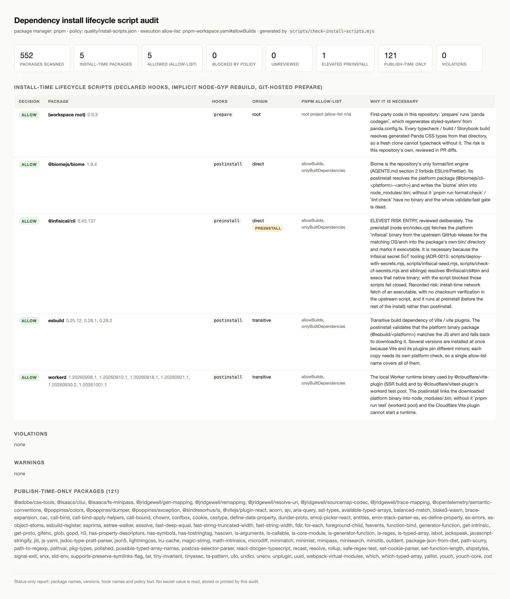

# 依存 install lifecycle script 監査 runbook (Issue #474)

> `pnpm install` が実行できる third-party code の実行許可を、
> 「暗黙のリスト」から「理由つきのレビュー記録」へ変えるための
> 正本。Source-controlled by Issue #474。
> Cross-linked from
> [`quality/profile.yaml`](../../quality/profile.yaml#security_gates)、
> [`docs/security.md`](../security.md)、
> [`pnpm-workspace.yaml`](../../pnpm-workspace.yaml)。

## 1. 何を監査しているか

`pnpm install` は、リポジトリのコードを 1 行も検証する前に
third-party の `preinstall` / `install` / `postinstall` を実行しうる。
pnpm 12 はこれを **default-deny** にしていて、
`pnpm-workspace.yaml#onlyBuiltDependencies` /
`#allowBuilds` に書かれた名前だけが実行される。

この default-deny が security boundary だが、それ自体は無口である。
「なぜそのエントリが必要なのか」を記録する場所が無かったため、

- ビルド 不要になったエントリが残り続ける
- 実行権限がいつ・なぜ与えられたのかを差分から読み取れない
- レビューする側も「許可してよいか」を毎回ゼロから判断する

という状態になっていた。この runbook が導入する gate は、その
「無口」を検査可能な契約に変える。

### hook の分類（監査の判断基準）

| 分類 | hook | fires | policy entry |
| --- | --- | --- | --- |
| install-time | `preinstall` / `install` / `postinstall` | `pnpm install` 中（許可された場合） | **必須** |
| root-only | `prepare` | workspace root project の `pnpm install` 時のみ | **必須** |
| publish-time | `prepublish` / `prepublishOnly` / `prepack` / `postpack` | その package を publish / pack する時のみ | 不要（報告のみ） |

pnpm は registry dependency の `prepare` を実行しない。
`prepublishOnly` を持つ package が 121 個あるが、
そのどれかが install 時に走ることはないため、121 個の記録条目を作っても
セキュリティ上の価値はゼロである。報告に数えるだけにする。

## 2. 3 つのファイルの責務

| file | 責務 | 変更の 合否 |
| --- | --- | --- |
| `pnpm-workspace.yaml` | **実行許可**（実際に何が走るか） | `allow` 判断と同期が必須 |
| `quality/install-scripts.json` | **判断記録**（何を許可/拒否したか、なぜ） | gate が読む |
| `scripts/check-install-scripts.mjs` | **検査**（両者の不一致を失敗させる） | `validate:fast` で実行 |

2 つのファイルは **別々** に drift しうる。だから gate は両方を読み、
矛盾するどちらの向きでも失敗する。

## 3. 実行方法

```bash
# gate（validate:fast に含まれる。exit 1 = violation）
pnpm run install:scripts:check

# 機械可読（CI の集約ログなど）
node scripts/check-install-scripts.mjs --json

# 検証用 HTML レポート（runbook のスクリーンショット生成にも使う）
pnpm run install:scripts:html   # -> .tmp/install-script-audit.html
```

Exit codes: `0` = 監査済み・clean / `1` = violation / `2` = 入力不備
（policy / allow-list / `package.json` が読めない、または policy が不正）。

### 既存 secret SoT / Cloudflare Workers Builds / リリース承認への影響

**なし**。この gate は

- `node_modules` の package manifest と policy ファイル 2 個だけを読む
- secret 値（`.dev.vars` / Infisical / Worker secret）を一切読まない
- `pnpm install` 中のローカル実行を記述するもので、runtime / deploy /
  本番データに触れない

ので、ADR-0015 の secret SoT、Cloudflare Workers Builds による本番配信
(AGENTS.md §4)、release PR の human gate (AGENTS.md §6) はそのまま
維持される。ADR-0015 が定めた「status-only 出力で比較する」という
方針と同じ思想で、**名前・バージョン・hook 名・判断理由だけ**を出す。

## 4. 正常時の観測

Issue #474 の実行時点（head = 本 runbook の導入 PR）で
`pnpm run install:scripts:check` は **violation 0 / warning 0** で通る。

| package | hooks | 判断 | 許可 | 理由の要約 |
| --- | --- | --- | --- | --- |
| `.`（root） | `prepare` | allow | n/a | 自前コードの `panda codegen`（generated Panda types が無ければ typecheck 不可） |
| `@biomejs/biome` | `postinstall` | allow | yes | platform binary の解決。無いと `format:check` / `lint:check` が動かない |
| `esbuild` | `postinstall` | allow | yes | Vite 系の platform binary 検証。3 version 同時導入 |
| `workerd` | `postinstall` | allow | yes | `@cloudflare/vitest-plugin` の workerd pool と Cloudflare Vite plugin の runtime binary |
| `@infisical/cli` | **`preinstall`** | allow | yes | ADR-0015 の secret tooling が native binary を exec する。**risk 高・要記録**（§6） |
| `ljharb-monorepo-symlink-test` | `postinstall` | **block** | no | upstream monorepo 用の自己検証で、consumer install では何も作らない |

publish-time のみ: 121 package（記録不要）。
allow-list に残っていた `@cloudflare/vite-plugin` は、
pin されている version が install-time hook を宣言していないため
**この監査で allow-list から削除済み**（不要な実行権限の撤去）。
将来 version が hook を持つようになれば、gate が
「未レビュー」として失敗させ、許可の追加が明示的な変更になる。

### スクリーンショット



`docs/verification/supply-chain/install-script-audit.webp`
（Issue が指定した `.png` パスは、repository policy により
リポジトリを bloated にしないため `.webp` に置き換えて commit している。
変換: §5「検証」のコマンド）。

画像は **proof の全部ではない**。上の表と §3 のコマンドで誰でも
同じ結果を再現できる。

## 5. 検証

```bash
pnpm exec biome check scripts/_install-scripts.mjs \
  scripts/check-install-scripts.mjs scripts/check-install-scripts.test.mjs
node --test scripts/check-install-scripts.test.mjs     # 29 tests
pnpm run install:scripts:check                        # gate 自体
pnpm run architecture:check                           # 境界に影響しないこと
pnpm run test:wiring:check                            # test  が配線されていること
```

スクリーンショットを再生成する場合:

```bash
pnpm run install:scripts:html
node -e "const {chromium}=require('@playwright/test');(async()=>{const b=await chromium.launch();const p=await b.newPage({viewport:{width:1440,height:1200},deviceScaleFactor:2});await p.goto('file://'+process.cwd()+'/.tmp/install-script-audit.html');await p.screenshot({path:'docs/verification/supply-chain/install-script-audit.png',fullPage:true});await b.close();})()"
node -e "require('sharp')('docs/verification/supply-chain/install-script-audit.png').resize({width:1600,withoutEnlargement:true}).webp({quality:80}).toFile('docs/verification/supply-chain/install-script-audit.webp')"
rm docs/verification/supply-chain/install-script-audit.png
```

## 6. 異常時の観測と修復手順

### 6.1 violation（gate が落ちます）

| 出力 | 意味 | 修復 |
| --- | --- | --- |
| `declares install-time lifecycle script(s) … but has no entry` | 未レビューの install-time hook が混入 | §6.2 |
| `policy decision "allow" but pnpm-workspace.yaml does not list it` | 許可した build が実際には走らない | policy を `block` に直す、または allow-list に名前を足す（後者は「本当に必要か」を先に判断） |
| `policy decision "block" but pnpm-workspace.yaml allows its lifecycle scripts` | **拒否した code が毎回 install で走っている** | allow-list から名前を削除する（最も緊急） |
| `policy records hook(s) […] but the installed version(s) declare […]` | manifest 側が二重に fractional（新しい hook が出現） | 新しい hook の必要性を判断し、policy を更新する |
| `cannot audit: quality/install-scripts.json …` | policy が壊れている / 存在しない | メッセージの `packages[i]` を直して再実行。gate は fail-closed |

### 6.2 「新しい install-time script が見つかった」手順

1. **落ちた hook を読む**
   ```bash
   node -e "const p=require('./node_modules/<pkg>/package.json');console.log(p.name,p.version,JSON.stringify(p.scripts,null,2))"
   ```
2. **その build が必要かを判断する**
   - binary を download / link するだけ → 通常は **必要**（allow）
   - 開発者向け monorepo の自己検証、test fixture の setup → **不要**（block、pnpm が既に通していないので追加 작업ゼロ）
   - **network 実行 file の取得を含む preinstall** → 必要だが **risk 記録**（§6.3）
3. **判断を記録する**（理由はいずれ必ず書く。空文字は policy validation で拒否される）
   ```json
   { "name": "<pkg>", "hooks": ["postinstall"], "decision": "allow",
     "observed_version": "<installed version>",
     "justification": "<なぜこの build が必要か>",
     "remediation": "<不要になったら何をするか>" }
   ```
4. `allow` にした場合は **同じ変更で** `pnpm-workspace.yaml` の
   `onlyBuiltDependencies` と `allowBuilds` にも名前を足す。
5. `pnpm run install:scripts:check` を再実行して 0 violation を確認。

### 6.3 記録済みの高リスク条目（`@infisical/cli` の preinstall）

install 時に upstream GitHub release から native binary を
**network で取得して実行可能にする** preinstall があり、
upstream script 内に checksum 検証はない。
Infisical は ADR-0015 の secret SoT の実体（`scripts/deploy-with-secrets.mjs` ほかが
`@infisical/cli#bin` を exec する）なので **allow** 以外の判断になりえない。

リスクは記録し、許容の根拠と撤去条件を policy の
`justification` / `remediation` に書いたうえで固定する。
上流の改修（platform package を `optionalDependencies` にする、
あるいは postinstall 化 + checksum 検証）は
**Issue #474 のスコープ外＝別 PR** とする。
上流が直ったら、この entry と allow-list の行を同時に削除し、
その事実を本 runbook の §4 表に反映する。

### 6.4 warning（落ちませんがレビューが必要です）

| 出力 | 意味 | 対応 |
| --- | --- | --- |
| `pnpm-workspace.yaml#… allows build scripts for "X" but … declare no install-time lifecycle script — remove the entry` | 許可しているのに build が要らない | allow-list から削除する（本 Issue で `@cloudflare/vite-plugin` を実際に撤去） |
| `policy observed version(s) […] != installed […]` | version が上がった | 新 version の manifest を読み直して再レビューし `observed_version(s)` を更新 |
| `policy records hook(s) … that the installed version(s) no longer declare` | upstream が hook を撤去した | policy から該当 hook を削除 |
| `policy entry "X" … declare no install-time lifecycle script` / `matches no installed package` | policy 側の記録が不要になった | entry を削除 |

## 7. スコープ境界（何かを足さないこと）

- この gate は **install 時** の実行権限だけを扱う。version bump、
  patched dependency の内容、audit report (OSV / Dependabot) は別責務。
- **tool / 上流の変更は別 PR**（Issue 本文の明示条件）。
  本 Issue は「棚卸しと記録」までで、上流への patch 提案は含めない。
- policy の entry を増やすのは「実行することの妥当性」に対する
  レビューであって、gate 自身の黙示の免責ではない。
  記録を差し飾るために entry を足すことは frowned upon であり、
  review で必ず問われる。

## 参照

- [`AGENTS.md`](../../AGENTS.md) §2（stack / pnpm 12.3.x）/ §5（quality gate）
- [`quality/profile.yaml`](../../quality/profile.yaml)（`gates.fast` / `security_gates.install_script_audit`）
- [`quality/install-scripts.json`](../../quality/install-scripts.json)（判断記録）
- [`pnpm-workspace.yaml`](../../pnpm-workspace.yaml)（実行許可）
- [`docs/security.md`](../security.md)（security policy からの導線）
- [`ADR-0015`](../../docs/adr/ADR-0015-infisical-env-management.md)（secret SoT / `@infisical/cli` の位置づけ）
- [`ADR-0003`](../../docs/adr/ADR-0003-package-manager.md)（pnpm 採用の判断）