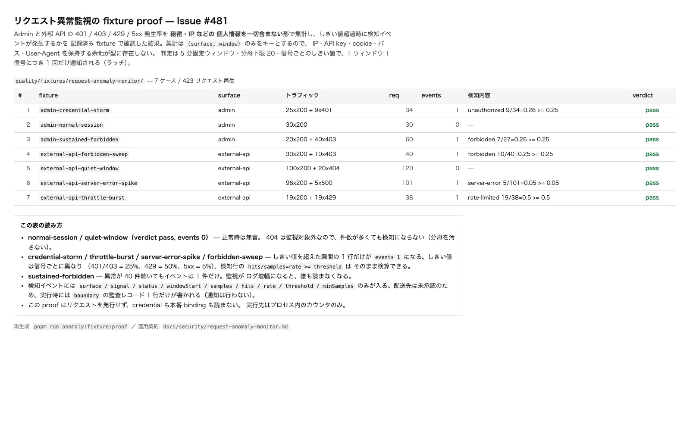

# リクエスト異常監視の運用契約（Issue #481）

Admin（`/admin*`）と外部 API（`/api/v1/*`）の **401 / 403 / 429 / 5xx
発生率を、秘密・IP などの個人情報を一切含まない形で集計し**、しきい値を
超えたときに**検知イベントを生成する**。本 Issue が作るのは観測と判定
までで、**通知先は owner が承認するまで設定しない**。

実体の宣言は 3 箇所だけに分散させず、次の 3 点が実体である。

| 対象 | 場所 |
| --- | --- |
| 集計・判定・イベント生成 | `src/http/middleware/anomaly-monitor.ts` |
| 観測点（Worker の choke point） | `src/server.ts` |
| しきい値の値 | `DEFAULT_ANOMALY_POLICY`（上記ファイル内） |

## 監視対象と観測点

`src/server.ts` は **すべての Worker 生成レスポンス**が通過する唯一の
choke point である。ここからしか観測できない surface が 2 つある。

| surface | path | 応答する層 |
| --- | --- | --- |
| `admin` | `/admin`, `/admin/*` | TanStack Start SSR |
| `external-api` | `/api/v1`, `/api/v1/*` | Hono `externalBoundary` |

- path の判定は `matchesExternalBoundary` と同じ **exact-prefix-or-`/`**
  規則（`classifySurface`）。`/adminish` や `/api/v10` は監視対象に
  含まれない。prefix だけで一致させると、無関係なトラフィックを
  監視対象の率に加算してしまう。Admin 側は Issue #654 以降、
  TanStack Router と同じ入力（percent-decode 後に `toLowerCase()`）で
  正規化してから判定する。`/ADMIN/KEYS` と `/%61dmin/keys` は admin、
  `/administration`・`//admin`・`/admin%2Fkeys` は admin ではない。
  判定の実体は `src/http/admin-path.ts` の `isAdminPath` で、
  `src/server.ts` の cache policy と同じ関数を使う。
- 観測は dispatch の直後、**`settleSsrDocumentResponse` の後**に行う。
  SSR が落ちたが訪問者には読める fallback 文書を返した 500 を、
  訪問者に見えている 200 として数えてはならない。
- 監視対象以外の path は **数えない**（分母にも入れない）。
  `404` も監視対象外なので、crawler が多数来ても検知にならない。

## 集計の契約（個人情報を持ち込まない根拠）

集計のキーは **`(surface, window)` だけ**である。

- `AnomalyObservation` は `{ surface, status, at }` の 3 フィールドしか
  持たない。IP・API key id・cookie・path・User-Agent を入れる**型上の
  空き自体が存在しない**。「あとから 1 個足す」ことが review fatigue
  ではなく型エラーになる。
- 検知イベントのフィールドは `ANOMALY_EVENT_FIELDS` で閉じる。単純な
  triage のために IP を足す修正は `src/http/middleware/anomaly-monitor.test.ts`
  の失敗になる。
- メモリは surface ごとに固定長（4 つの signal の整数と latch 集合）。
  per-caller の map も時刻の保持もないので、暴走してメモリを使い切る
  経路が無く、Worker isolate の中で増えない。
- `src/server.ts` の sink はフィールドを**列挙**して書く（spread しない）。
  イベント型に新しいプロパティが増えても、sink 側は明示的な変更なしに
  継承しない。

## 信号としきい値

| signal | 該当する応答 | しきい値 | 分母下限 |
| --- | --- | --- | --- |
| `unauthorized` | `401` | 25% | 20 |
| `forbidden` | `403` | 25% | 20 |
| `rate-limited` | `429` | 50% | 20 |
| `server-error` | `5xx`（500 を含む） | 5% | 20 |

- **分母**は surface のウィンドウ中の**全リクエスト数**。4 クラス以外の
  応答（2xx/3xx/404 等）は分母にしか寄与しない。
- **分母下限 20** なしでは、静かな surface の 1 件が 100% になり
  起動直後に毎回検知してしまう。
- 値は表面ごとの契約から選んだ保守的な初期値であり、`data` として
  一箇所に置いてある。ベースラインを実測した運用者がこの表を編集する
  （判定式をループの中に埋め込まない）。
- **判定は小数 2 桁に丸めた値で行う**。レコードに記録される rate
  と、実際にしきい値と比較された rate が同じになるため、検算できる。
  `5/101 = 0.0495 → 0.05` が 5% 越过として検知されるのがその帰結。

### ウィンドウとラッチ

- ウィンドウは **5 分固定**（`ANOMALY_WINDOW_MS`）で、Unix epoch の
  境界に揃える。sliding window にはリクエストごとの時刻の保持が
  必要で、それはこの module が**意図的に持っていない**唯一の次元である。
  境界をまたぐ短いバーストは次ウィンドウに希釈される、という限界は
  隠さずこの節に書く。
- **1 ウィンドウ 1 signal につき検知は 1 回**（ラッチ）。異常が続いて
  いても次のウィンドウまで再通知せず、リクエストごとに記録しない。
  監視がログ増幅になると、読む人が消えるため。
- ラッチはウィンドウの切替時に解除される。持続する異常は毎ウィンドウ
  1 回、再通知される（「一度言ったら静か」ではなく、異常が続いている
  ことを毎ウィンドウ示す）。

## 検知イベントの契約

イベント名は **`anomaly.detected`**。`src/logging` の redaction は
24 文字以上の token 状文字列を `[redacted-blob]` に置換するため、名前が
長えると**レコード自身が身元を失う**（実際に 2 度そうなった。単体テスト
が長さ 24 未満と `redactLogText` 不変を固定している）。

| field | 意味 |
| --- | --- |
| `event` | `anomaly.detected` |
| `surface` | `admin` / `external-api` |
| `signal` | 上表の signal 名 |
| `status` | 証跡としての status クラス（`401` / `403` / `429` / `5xx`） |
| `windowStart` | 算定した固定ウィンドウの開始（ISO） |
| `samples` | その surface のウィンドウ中の総リクエスト数（分母） |
| `hits` | その signal に該当したリクエスト数 |
| `rate` | `hits / samples` を小数 2 桁に丸めた値 |
| `threshold` | 比較されたしきい値 |
| `minSamples` | 判定に用いた分母下限 |
| `at` | 検知した瞬間（ISO） |

`hits / samples = rate >= threshold` は手計算で検算できる。運用ログには
scope `boundary` の監査レコード 1 行として出る（`src/logging` の redaction
を必ず経由する）。

## 配送先は未承認（owner decision）

- 実行時に書かれるのは **監査レコード 1 行だけ**。通知（メール・Webhook・
  third-party・Cloudflare Alert）は**一切行わない**。platform 外へ出る
  配信は新しい Cloudflare service を要求するため（AGENTS.md §4）、
  ticket と ADR を伴う owner 承認が先。
- 差し込み口は `createAnomalyMonitor({ onEvent })`。承認された後に
  配送先を実装しても、判定側の変更は不要。
- `security.txt` の報告先（Issue #468）が既に「owner 承認後に公開」
  であるのと同じ順序を採っている。**承認のない連絡先を先に公開しない。**

## 検証

| 検証 | 内容 | 再生成 |
| --- | --- | --- |
| 単体 | 判定・ラッチ・形・redaction 耐性（23 件） | `pnpm exec vitest run src/http/middleware/anomaly-monitor.test.ts` |
| entry 結線 | 実 HTTP で 401 突発を流して、レコードが 1 行だけ出ることをフィールド単位で検証 | `pnpm exec vitest run test/integration/request-anomaly-monitor.test.ts` |
| fixture proof | 記録済み 7 ケースを**実装そのもの**に通して、宣言どおりのイベント数か判定（423 リクエスト再生） | `pnpm run anomaly:fixture:proof` |
| 画像 | proof の出力表を HTML 化して撮影 | `pnpm run verify:anomaly-monitor-screenshot` |

fixture proof は

- **credential を一切読まない**（実行先はプロセス内のカウンタだけ）。
- status-only 出力（verdict・件数・reason code のみ）。
- HTML ページを書く前に、address / e-mail / credential 形状を走査し、
  1 件でも検出したら**行番号だけ**を理由として非ゼロ終了する。

## スクリーンショット



`docs/verification/security/anomaly-monitor-fixture.webp`
（1600 px 幅・WebP q80・約 87 KB。Issue が指定した `.png` ではなく
PNG を WebP に変換した。flat なテキストページなので可視差分はなく、
リポジトリを膨らませない）。

## 正常時の観測

**沈黙であることが正常時の観測結果である。** 検知行が出ない =
しきい値内、というのが唯一の正常判定。

```bash
pnpm run anomaly:fixture:proof          # 7 ケースすべて verdict pass / events 0-1
pnpm exec vitest run test/integration/request-anomaly-monitor.test.ts
```

- `admin-normal-session` / `external-api-quiet-window` は **events 0**
  であること（404 を 20 件足しても検知にならないこと）を固定している。
- entry 結線のテストは、通常の Admin 閲覧 30 回が **1 件も記録しない**
  ことを固定している。ここで鳴る監視は、読者を訓練する。

## 異常時の観測と修復手順

検知行が出たら、次の順で切り分ける。**行には呼び出し元の情報が含まれ
ない**ので、最初の 1 ステップは「何が起きたか」を既存ログの別系統から
当てる作業になる。

1. **surface と signal を読む**（`surface` / `signal` / `status`）。
2. **`rate` と `threshold` を検算する**。`rate` がしきい値ぎりぎりで
   あれば、直前の 1 件でウィンドウ境界をまたいだ可能性がある。境界を
   またいだだけのノイズとして扱い、**記録は残す**。
3. **同時刻の `boundary` エラーレコードを読む**（`src/http/errors.ts` の
   出力）。failure の内訳はそちらに集約されている。
4. 次の表で primary cause を絞る。

| signal | 想定される primary cause | 確認する場所 | 修復 |
| --- | --- | --- | --- |
| `unauthorized` | consumer の token 期限切れ / secret のローテーション直後 / 総当たり | `docs/security/api-key-scope.md`、Better Auth の secret 状態 | 消費者へ再発行を連絡。ローテーション手順は `docs/runbook/consumer-api-key-rotation.md`。総当たりが疑わしければ login rate limit（Issue #456）の記録を確認 |
| `forbidden` | scope 不整合 / origin 拒否 / admin の認証不足 | `docs/security/api-cors.md`、`docs/security/step-up-authentication.md` | consumer の scope を確認し、必要なら再発行。`403` が `/admin/*` に集まっていれば運用セッション側の問題 |
| `rate-limited` | consumer が上限を超え続けている / 統合側の連打 | `docs/security/write-rate-limit.md` の budget 表 | 消費側の呼び出し間隔を是正。budget の変更は owner 判断（ADR-0010） |
| `server-error` | Worker / binding / 上流の障害 | `boundary` のエラーレコード、`docs/troubleshooting.md`、`cloudflare.config.ts` の binding | 影響範囲が外部 API 全体なら配信を凍結する。`/admin` だけなら運用者側のセッション問題。**どちらの surface でも、他の signal とは独立に扱う** |

5. **収束の確認**: 次のウィンドウで検知が出なければ収束とみなす
   （ラッチがあるので、同じ異常が 2 回出るのは「別ウィンドウでも
   続いている」 의미だけ）。
6. **記録を残す**: どの signal、どの rate、どの window だったかを
   Issue に貼る。画像は evidence そのものではなく生成元の索引であり、
   貼るのは数値と行そのもの（`anomaly:fixture:proof` の出力表）である。

**しないこと**: 検知行を根拠に credential・IP・User-Agent を別のログに
追記すること。集計は個人ごとの軌跡ではなく surface 全体の割合であり、
privacy の再評価が必要なデータではない。

## 変更時の運用影響

| 変更 | 影響 | 検証 |
| --- | --- | --- |
| `DEFAULT_ANOMALY_POLICY` の値を編集 | 検知の鳴りやすさが変わる。fixture の期待値も要更新 | `pnpm run anomaly:fixture:proof`（期待値がずれると非ゼロ終了） |
| signal を追加 | `ANOMALY_SIGNALS` / `signalForStatus` / policy / fixture / doc の表を同時更新 | 単体 + fixture proof |
| surface を追加 | `ANOMALY_SURFACES` / `classifySurface` / doc の表を同時更新 | 単体（lookalike path を含む） |
| イベント名を変更 | redaction に飲まれるとレコードの身元を失う | `anomaly-monitor.test.ts` の長さ / 不変アサーション |
| 配送先を追加 | platform 外送信。owner 承認 + ADR が先行 | — |

## 既知の制限

- **集計は isolate 単位でありグローバルではない。** Cloudflare はリクエストを
  多数の isolate に分散させるため、この module の母数は「その isolate が
  実際に処理したリクエスト数」である。グローバルな率は zone 側の
  analytics / Logpush の性質であり、本 repository が観測できるのは
  owner が用意した配送先のみ。この文書を読む人は rate を「全体の率」と
  読まないこと。
- **通知は未設定。** 検知イベントはどこにも配送されない（owner 承認待ち）。
  「検知したことに気づけない」のは現状の既知の状態であり、隠していない。
- **Admin 側の異常 crossings は fixture 再現である。** HTTP 経由で異常な
  Admin status に到達するには実際の operator session が必要で、本 Issue は
  production credential からの生成を禁じている。実 HTTP による再現は
  external API の 401 突発のみ（`test/integration/request-anomaly-monitor.test.ts`）。
- **外部 third-party read（`src/external-api`）は監視に載っていない。**
  `AnomalyObservation` は値を渡すだけの型なので、同じ語彙で後から
  報告できるが、`external-api` と `http` は互いに import できないという
  依存方向のルール（AGENTS.md §3）があるため、接続は owner decision。
- **固定ウィンドウの希釈**。境界をまたぐ短いバーストは次ウィンドウに
  希釈される。5 分以上の継続があれば必ず他ウィンドウにも現れるため、
  持続する異常は取りこぼさない。