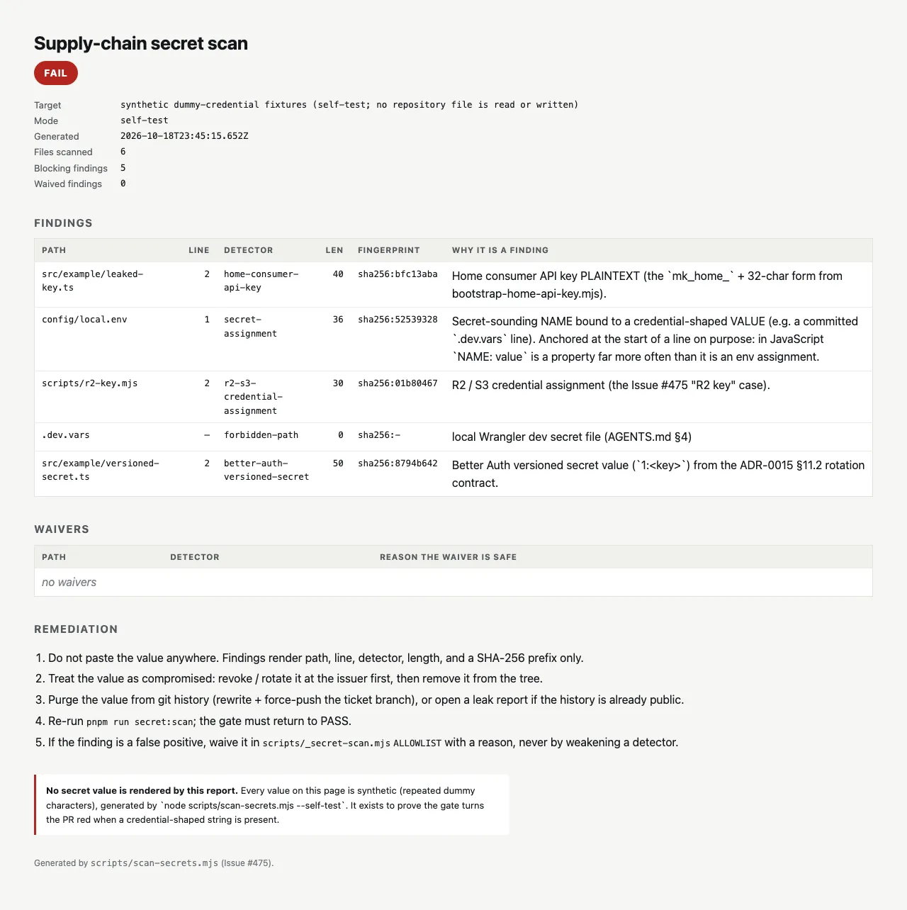

# Supply-chain secret scan — repository gate

> Canonical operator reference for the deterministic, pre-merge credential
> scan introduced by Issue #475. Cross-linked from
> [`AGENTS.md §4`](../../AGENTS.md),
> [`docs/runbook/infisical-secrets.md`](../runbook/infisical-secrets.md),
> and [`quality/profile.yaml`](../../quality/profile.yaml).
>
> **Scope.** This runbook answers four questions:
>
> 1. *What does the gate scan, and what does it deliberately not scan?*
> 2. *How do I read a finding without ever seeing the value?*
> 3. *How do I make the gate red on purpose, and what does red look like?*
> 4. *How do I remediate a real finding, and how do I handle a false
>    positive?*
>
> **No-value-listing.** AGENTS.md §4 forbids value-listing against real
> environments (originating incident: Issue #139, 2026-09-28). The scan
> keeps that discipline on its own output: a finding carries the path,
> the line, the detector id, the value's **length**, and a **SHA-256
> prefix**. A gate whose log line contains the credential it just found
> is a credential exfiltration primitive with extra steps, so the report
> format is part of the security contract.

## 1. What the gate is

| Field | Value |
| --- | --- |
| Implementation | `scripts/scan-secrets.mjs` (CLI) + `scripts/_secret-scan.mjs` (detector table + pure scanner) |
| Unit tests | `scripts/scan-secrets.test.mjs` (`node --test`, wired into `pnpm test`) |
| Source scan | `pnpm run secret:scan` — inside `validate:fast`, so every PR and every release push |
| Bundle scan | `pnpm run secret:scan:bundle` — inside `validate:integration`, right after `pnpm run build:production`; exits 2 when no build output exists on disk |
| Detection proof | `pnpm run secret:scan:self-test` — synthetic dummy credentials, no repository file is read or written |
| Gate wiring | `quality/profile.yaml#security_gates.repository_static_secret_scan` |

### 1.1 Relationship to GitHub Push Protection

`quality/profile.yaml#security_gates.secret_scanning` records the
host-side scan as `mode: asynchronous`: it reviews a push **after** it
lands, and it is not part of `required_checks`. This gate is the
deterministic, pre-merge counterpart: same obligation (a credential must
not be committed), earlier boundary (inside the `validate` job, before
merge). Neither replaces the other:

- the host-side scan sees history, PR descriptions, and shapes this gate
  does not model;
- this gate fails the build the moment the value is committed, with a
  finding that does not contain the value.

**Where "pre-merge" actually binds.** The gate is enforced wherever
`validate` is a *required* check. At the time of writing the only
required-check ruleset in this repository covers `refs/heads/main`, so
a red `validate` blocks the `release-*` → `main` promotion but does not,
by itself, block a ticket-PR merge: on a branch without a required check
a red `validate` is enforced by convention (AGENTS.md §6), not by the
branch ruleset. Treat a red secret scan as merge-blocking regardless of
the branch it was reported on — whether release branches should carry a
required `validate` check is a repository-setting question this gate
does not decide.

### 1.2 Surfaces

| Surface | Command | File set | Mode |
| --- | --- | --- | --- |
| Tracked files | `pnpm run secret:scan` | `git ls-files` | `source` — every rule |
| Untracked, not ignored | `pnpm run secret:scan` | `git ls-files --others --exclude-standard` | `source` — every rule |
| Build artifacts | `pnpm run secret:scan:bundle` | `dist/`, `.cloudflare/output/`, `dist-cloudflare/` | `bundle` — shape rules only |
| Self-test | `pnpm run secret:scan:self-test` | in-memory synthetic fixtures | `source` |

The tracked set alone would be enough for CI — a credential has to be
committed to reach a PR. The untracked set exists for the moment *before*
that: a value in a worktree file that is one `git add` away from being
committed should be caught while the operator is still looking at the
file. `.gitignore` is the filter (`--exclude-standard`), so there is no
second ignore list to keep in sync, and a gitignored `.dev.vars` is
invisible to the source scan by construction — which is precisely why a
*tracked* `.dev.vars` is its own `forbidden-path` finding.

Two surfaces exist because a credential can reach production without ever
being committed: build-time inlining (`vite define`, a `vars` block, an
imported fixture) puts a value into `dist/client` or into the cf Build
Output while every source file stays clean. The bundle scan is the only
thing standing between that and a deploy.

Binary files (`.png`, `.woff2`, `.pdf`, …) are skipped by extension and by
a NUL-byte sniff. Files above 8 MiB in the bundle scan are reported as
`[skipped]` rather than silently dropped, so the gate never overstates
its coverage.

## 2. Detectors

`scripts/_secret-scan.mjs` holds the table as data. `mode` splits the
rules into two tiers:

| Detector | Mode | What it asserts |
| --- | --- | --- |
| `forbidden-path` | both | `.dev.vars`, `.env*`, `*.pem`, `*.key`, `*.p12`, `*.pfx`, `.infisical/` must not be **tracked**. `.dev.vars.example` / `.env.example` are the committed documentation templates and are explicitly exempt. |
| `private-key-block` | both | PEM `PRIVATE KEY` block |
| `aws-access-key-id` | both | `AKIA…` / `ASIA…` — R2 S3-compatible keys are issued in this format |
| `r2-s3-credential-assignment` | source | `aws_secret_access_key` / `aws_access_key_id` / `r2_*` bound to a value |
| `cloudflare-api-token` | both | `v1.0-<id>-<key>` |
| `github-token` | both | `ghp_` / `gho_` / `ghu_` / `ghs_` / `ghr_` / `github_pat_` |
| `slack-token` | both | `xox[abpors]-` |
| `stripe-secret-key` | both | `sk_live_` / `sk_test_` / `rk_live_` / `rk_test_` |
| `google-api-key` | both | `AIza…` |
| `jwt` | both | three base64url segments beginning `eyJ` |
| `better-auth-versioned-secret` | both | `1:<key>` / `2:<key>` — the ADR-0015 §11.2 rotation contract |
| `home-consumer-api-key` | both | `mk_home_` + 32 characters — the plaintext form from `bootstrap-home-api-key.mjs` |
| `secret-assignment` | source | a secret-sounding NAME at the **start of a line** bound to a credential-shaped VALUE |

### 2.1 Why `secret-assignment` is anchored to the start of a line

In JavaScript, `NAME: value` is a property far more often than it is an
env assignment — `CLOUDFLARE_API_TOKEN: r2Credential(env)` is not a
leak. Anchoring the name to the start of a line keeps the rule on the
syntax that actually carries a committed dotenv line
(`BETTER_AUTH_SECRET=…`) while dropping the property-shaped noise.

The NAME may be double-quoted, so the line-anchored JSON form
`"NAME": "value"` (a credential written into a pretty-printed JSON
config) is a finding. Two gaps remain, and naming them is part of the
contract rather than an omission:

- a NAME that does not start a line is still not matched, which includes
  a single-line JSON object (`{"A": "…", "B": "…"}`) and a mid-line
  JavaScript property;
- therefore a *non-provider-shaped* value under a mid-line secret key is
  not detected here. Provider-shaped values inside such a JSON file are
  still caught by the `mode: both` rules, and `r2-s3-credential-assignment`
  is not line-anchored at all.

### 2.2 What "credential-shaped VALUE" means

`looksLikeCredentialValue()` is the single decision point and is
unit-tested on its own. A value is a finding when it is long enough,
not a placeholder, not a code reference (`process.env.X`, `env.X`,
`${X}`), not a `SCREAMING_SNAKE` identifier, and then one of:

- a provider prefix (`mk_home_`, `AKIA`, `ghp_`, `sk_live_`, `AIza`,
  `xox…`, `v1.0-`), or
- the Better Auth versioned form `1:`/`2:` with a full-length payload, or
- a hex run of 32+ characters (a SHA-256 digest, a hex API key), or
- a 32+ character base64 / base64url run with three character classes
  and no hyphenated English word.

The last clause is what keeps this repository quiet: test fixtures and
marker strings such as `this-is-a-deliberately-unique-marker-XYZ-9876`
are hyphenated English, not base64.

**This is a shape test, not an entropy oracle.** A deliberate, low-entropy
credential would not be caught here; that judgement belongs to the
asynchronous host-side scan. Stating the boundary is part of the gate —
a gate that claims to catch everything gets trusted with things it cannot
see.

## 3. Reading a finding

```text
[scan-secrets] src/home/status.ts:12 [home-consumer-api-key] len=40 sha256:9f2c41ab — Home consumer API key PLAINTEXT …
```

| Field | Use |
| --- | --- |
| `path:line` | where to look |
| `detector` | which rule fired, and therefore which remediation applies |
| `len` | the value's length — enough to recognise a truncated paste |
| `sha256:xxxxxxxx` | correlation only. Two findings with the same fingerprint are the same value; two values of the same shape have different fingerprints. Truncated SHA-256 of a high-entropy secret is not reversible. For a deliberately LOW-entropy credential the prefix is a brute-force oracle, which is one more reason not to rely on it: treat any value that reached a public remote as already exposed, and let the asynchronous Push Protection scan own the low-entropy judgement. |

There is deliberately no "here is the value" affordance. If you need to
know what the credential IS, read the file you already have access to —
or, for a live environment value, follow the status-only flows in
[`docs/runbook/infisical-secrets.md`](../runbook/infisical-secrets.md).

## 4. Normal and abnormal observation

### 4.1 Normal (expected) observation

Both samples below were captured from one working copy of the Issue #475
branch; the numbers drift as the base branch merges in (every one of them
carries no meaning — see the bullets after the block), so compare the
shape of the output, not the numbers.

```console
$ pnpm run secret:scan          # no build present — the validate:fast case
[scan-secrets] tracked files + build artifacts — 1067 file(s) scanned, 0 blocking finding(s), 11 waived
[scan-secrets] source surface: 1067 tracked + 0 untracked-not-ignored
  scripts/check-sbom.test.mjs:73 [private-key-block] len=31 sha256:8bcac790 — PEM private key block. …
      waived: The SBOM gate own detector fixtures (Issue #471). …
  …
  [skipped] dist (not built in this run)
  [skipped] .cloudflare/output (not built in this run)
  [skipped] dist-cloudflare (not built in this run)
[scan-secrets] 11 waiver(s) in _secret-scan.mjs ALLOWLIST (9 entries, each with a reason)

$ pnpm run secret:scan:bundle   # after pnpm run build:production — the validate:integration case
[scan-secrets] build artifacts — 207 file(s) scanned, 0 blocking finding(s), 0 waived
  [missing] dist-cloudflare (build output not found)
```

Four things are normal and must not be "fixed":

- the **waiver lines** — they are printed so the waiver set stays visible
  in CI logs instead of hiding behind a green build. Every current waiver
  is a *fixture whose job is to contain a credential shape*: this
  scanner's own self-test fixtures, the SBOM gate's rejection samples
  (`scripts/check-sbom.test.mjs`), and the log-redaction masking sample
  (`src/logging/redact.test.ts`). A gate that asserts it REJECTS a shape
  has to hold that shape;
- the **`[skipped]` build-artifact lines** in `secret:scan` (the bundle is
  not built during `validate:fast`; the bundle scan runs later in
  `validate:integration`);
- a **`[missing]` line** in `secret:scan:bundle` — it names a build
  artifact root that does not exist on this machine (for example
  `dist-cloudflare`, which only some build paths produce). It is normal
  as long as at least one artifact root was scanned; if EVERY root is
  missing the gate exits 2 instead of reporting a clean scan of
  nothing (§4.2);
- **file counts** — they move as the tree moves and carry no meaning;
- the exit code 0.

### 4.2 Abnormal observation — proving the gate turns the PR red

Never do this on a pushed branch. The reproduction is deliberately local
and uses synthetic values, so no credential-shaped string ever enters the
public git history:

```console
$ pnpm run secret:scan:self-test
[scan-secrets] self-test — synthetic dummy fixtures only, no repository file is touched
  [clean   ] src/example/clean.ts (0 finding(s))
  [DETECTED] src/example/leaked-key.ts (1 finding(s))
  [DETECTED] config/local.env (1 finding(s))
  [DETECTED] scripts/r2-key.mjs (1 finding(s))
  [DETECTED] .dev.vars (1 finding(s))
  [DETECTED] src/example/versioned-secret.ts (1 finding(s))
  …
[scan-secrets] self-test: 5 finding(s) on dummy credentials, 0 on clean input
$ echo $?
0        # the SELF-TEST passes: detection is proven
```

The self-test asserts both directions. The **gate** is what turns red —
`self-test` exiting non-zero means a detector stopped working, which is
the more dangerous state:

```console
$ pnpm run secret:scan:self-test
[scan-secrets] self-test FAILED: every dummy fixture must be detected and every clean fixture must stay silent
$ echo $?
1
```

To see the gate itself fail, inject a synthetic value into a **scratch**
worktree (never a pushed branch) and read the finding:

```console
$ printf 'export const k = "%s";\n' "mk_home_$(printf 'D%.0s' {1..32})" > src/home/scan-probe.ts
$ pnpm run secret:scan
[scan-secrets] tracked files + build artifacts — 1068 file(s) scanned, 1 blocking finding(s), 11 waived
[scan-secrets] source surface: 1067 tracked + 1 untracked-not-ignored
  src/home/scan-probe.ts:1 [home-consumer-api-key] len=40 sha256:bfc13aba — Home consumer API key PLAINTEXT …
$ echo $?
1
$ rm src/home/scan-probe.ts     # never commit this file
```

The bundle scan fails closed the same way — an empty scan surface is a
failure to scan, not a clean scan. Running it before any build (or after
the build-output path changed without `BUNDLE_DIRS` being updated) exits
2:

```console
$ pnpm run secret:scan:bundle   # no build output on disk
[scan-secrets] build artifacts — 0 file(s) scanned, 0 blocking finding(s), 0 waived
  [missing] dist (build output not found)
  [missing] .cloudflare/output (build output not found)
  [missing] dist-cloudflare (build output not found)
[scan-secrets] bundle scan surface is empty: none of dist, .cloudflare/output, dist-cloudflare exists. Run `pnpm run build:production` first.
$ echo $?
2
```

Exit codes: `0` clean, `1` findings, `2` the scan could not run
(unknown argument, or a bundle surface that does not exist). `2` is the
one an operator must never read as success.

In CI the same exit code 1 fails the `validate` job, which fails the PR.
The failing report is also available as a review artefact:

```console
$ pnpm run secret:scan --report=.tmp/secret-scan.html
```

(`pnpm run secret:scan -- --report=…` works too — a bare `--` is
accepted and ignored.)

Screenshot of that failing report:
[`docs/verification/supply-chain/secret-scan-fail.webp`](../verification/supply-chain/secret-scan-fail.webp).



The image is a *picture of a report*, not proof on its own. The
reproducible proof is `pnpm run secret:scan:self-test` plus
`node --test scripts/scan-secrets.test.mjs`, which drives the same
detectors over the same fixtures.

### 4.3 Regenerating the screenshot

```console
$ pnpm run verify:secret-scan-screenshot
```

`scripts/shoot-secret-scan-report.mjs` re-runs the self-test, renders
its HTML report, screenshots it in Chromium, and overwrites
`docs/verification/supply-chain/secret-scan-fail.webp` (WebP, quality
80, ≤300 KB). It exits non-zero if the self-test does not fail, so the
committed artefact can never drift into a picture of a green run. It is
a documentation tool and never runs inside `validate:*`.

## 5. Remediation of a real finding

Order matters. Revocation first, cleanup second.

1. **Do not paste the value anywhere.** Findings are status-only by
   construction; keep it that way (no screenshots of the raw line, no
   `cat`, no "here is what it was" in an Issue).
2. **Revoke at the issuer.** A committed credential is compromised the
   moment the branch is pushed to a public remote. Better Auth → rotate
   via `docs/runbook/cloudflare-workers-builds.md`; home consumer API key
   → `docs/runbook/consumer-api-key-rotation.md`; Cloudflare token →
   `docs/security/cloudflare-api-token-inventory.md`; anything else →
   the issuing provider's console.
3. **Remove it from the tree**, then re-run `pnpm run secret:scan`.
4. **Purge the history** if the branch is already pushed: rewrite the
   ticket branch and force-push, or treat it as a leak and rotate
   everything it touched. Rewriting is not sufficient on its own —
   step 2 is not optional.
5. **Record the incident** the way Issue #139 was recorded: no values,
   fingerprints only.

### 5.1 False positives

A detector is never weakened to make a finding go away. The waiver table
lives in `scripts/_secret-scan.mjs` (`ALLOWLIST`) and every entry carries
`path`, an optional `detector` (narrow the waiver to one rule), and a
`reason` that explains why the hit is safe. `node --test
scripts/scan-secrets.test.mjs` asserts that each entry has a substantive
reason, that an unlisted path still fails, and that a waiver does not leak
into a sibling file.

The waiver list is short on purpose, and it is not only this scanner's own
fixtures: a file whose *purpose* is to contain a credential shape (a gate's
rejection sample, a redaction test) is a legitimate entry. A waiver still
has to name a file and a reason, because "the test needed it" is a claim a
reviewer can check and "some tests need it" is not. A waiver list that
starts absorbing non-test source is a signal that a detector is too broad —
fix the detector instead.

A **blanket** entry (no `detector`) waives every detector plus
`forbidden-path` for that file, so a credential pasted into the file
later is silently waived. It is reserved for a file that must hold shapes
for several detectors at once — a gate's own rejection fixtures. Before
adding one, check what the file actually matches (scan it with
`skipAllowlist: true`); a file that matches nothing gets no entry at all,
and a file that matches one shape gets one scoped entry, not a blanket
one. The scanner's own files follow that rule: `scripts/scan-secrets.mjs`
is waived per detector for exactly its two self-test fixtures, and the
detector table itself holds no waiver because it matches nothing.