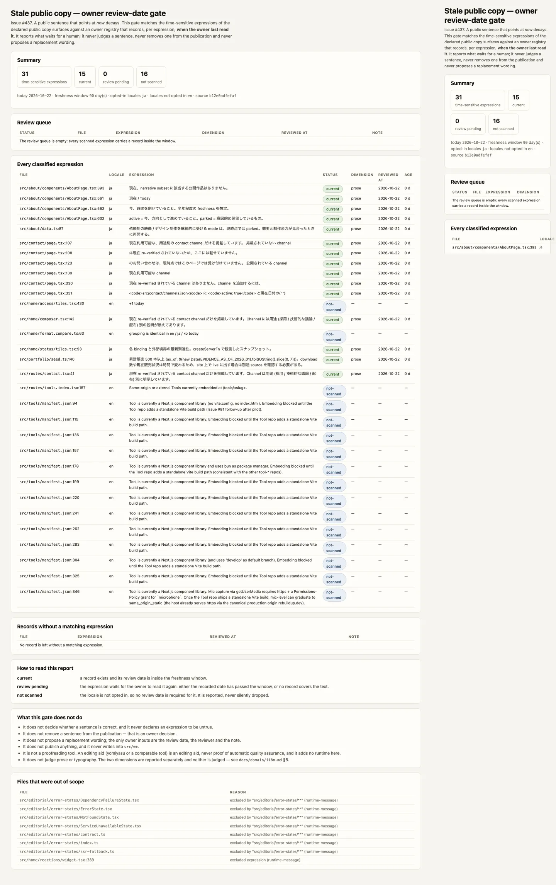

# 公開 copy の review date gate — 検証記録 (Issue #437)

> `scripts/check-stale-content-review.mjs` が、公開 copy のうち「今」を指す
> 文面を抜き出し、owner の review date と突き合わせる gate の**検証記録**である。
> 契約の本文は [`../../domain/content-review.md`](../../domain/content-review.md)、
> 運用手順は [`../../runbook/stale-content-review.md`](../../runbook/stale-content-review.md)、
> owner の記録の正本は
> [`../../../quality/stale-content-review.json`](../../../quality/stale-content-review.json)。
> この document は gate 実行の仕様書ではない。



## before / after と合格基準

| | before (#437 の前) | after |
| --- | --- | --- |
| 古びる公開文言 | 誰が最後に読んだかが **どこにも残らない**。古びても誰も気づかない | 各文面に **owner の review date** があり、window を越えると **review pending** として機械的に列挙される |
| 記録が無い文 | 「誰も読んでいない」のか「記録する場所が無かった」のか区別できない | `unrecorded` として明示され、owner に提示される。**書き換えると記録は失効する**ので、古い記録の流用はできない |
| 「古い」の意味 | 「古い = 誤り」と混同されやすい | gate の語彙は **review pending**。**判定する verdict 語（false / unpublish / outdated）を使わない**。公開からの除去は owner の決定 |
| locale | 全部を等しく見る／全部を見ない、どちらか | **opt-in**。一覧に無い locale は **走査しない**が、**黙って無視もしない**（`not-scanned` として報告する） |

合格基準は **1 つ**で、`pnpm run copy:stale:check` の exit code が 0 であること。

- 走査した文面がすべて window 内の記録を持つ → exit 0
- review pending（`stale` / `unrecorded`）がある → exit 1
- 判断できない（registry が読めない / record が壊れている / 日付が parse できない /
  review date が未来） → exit 2（**判断できないものを pass にはしない**）

## 受け入れ条件への対応

| 受け入れ条件 | 実装 | どこで確かめるか |
| --- | --- | --- |
| 古い update date の article が **review pending** になり、**unpublish を一律に強制しない** | 4 つの status（`current` / `stale` / `unrecorded` / `not-scanned`）と review queue。gate は `src/**` に書かない（`--out` が `src/` を指すと exit 2） | `node --test scripts/check-stale-content-review.test.mjs`（gate が木を変えないこと） |
| 原文の意味・数値・否定・権限を保ち、**未確認の書き換えを自分で公開しない** | 照合は文面に対して行い、gate は置換文案を提案しない。gate に文面を書く code path は無い | 同上（「does not propose a replacement wording」assertion） |
| prose と typography の差を明示し、**locale は必要な機能として opt-in** | registry の `dimension`（`prose` / `typography`）と `locales`。2 つの分離の根拠は `docs/domain/i18n.md` §5、locale opt-in の根拠は同 §6 | fixture の typography record（`今日の font stack はそのままです。`）と `not-scanned` の英語 expression |
| 1 Issue / 1 PR。Storybook / preview / **CI fixture** で、他の Issue の完了を待たない | fixture は `test/fixtures/content/stale-review/` の独立した公開 copy tree。live tree に依存しない | `node --test scripts/check-stale-content-review.test.mjs` |
| 対象テスト・対象外・再現手順を PR に書く | 本 document と [`../../runbook/stale-content-review.md`](../../runbook/stale-content-review.md) §6・§8 | PR body |

## 再現条件

| 項目 | 条件 |
| --- | --- |
| ブラウザ | **gate には不要**。gate はテキスト走査である（WebP の生成だけがブラウザを使う） |
| ネットワーク | **不要**（0 回の fetch）。編集補助ツールも **gate の外側** で offline 実行する |
| Runtime | Node.js `>=22.18`（`package.json#engines`、CI は 22.18 固定）。**Python は追加しない** |
| 依存 install | 不要（`pnpm install` 済みなら Node 標準モジュールのみ） |
| 日付 | gate の判定は **日付に依存する**。`--today=YYYY-MM-DD` で明示できる（fixture のテストはこれを使う） |
| ソース SHA | レポートに `git rev-parse --short=12 HEAD` を出す。gate 自体は SHA 非依存 |

再現手順:

```bash
# gate 単体
pnpm run copy:stale:check

# HTML レポート
node scripts/check-stale-content-review.mjs --format=html \
  --out=.tmp/stale-content-review.html

# fixture による 4 状態の検証
node --test scripts/check-stale-content-review.test.mjs

# 検証画像（WebP）を再生成
pnpm run verify:stale-copy-review-screenshot
```

CI では `validate:fast`（`quality/profile.yaml#gates.fast.components`）が同じ
コマンドを `validate:integration` の一部として実行する。

## 画像が示すもの

| section | 何を証明するか |
| --- | --- |
| Summary | 走査した文面数、window 内の記録数、**review pending** の数、走査しなかった locale の数 |
| Review queue | review pending の文面と、その review date・dimension・note。**空なら「誰も読んでいない文面はありません」と書く** |
| Every classified expression | 1 文面 1 行の分類表。file / locale / 文面 / status / dimension / review date / 経過日数 |
| Records without a matching expression | 記録はあるが文面に **一致しない** 記録（文を書き換えて失効した記録） |
| How to read this report | 4 つの status の読み方 |
| What this gate does not do | gate が **しない** こと（判定しない / 除去しない / 書き換えない / 公開しない / 採点しない） |
| Files that were out of scope | registry が明示的に除外した surface（理由つき） |

desktop 1440 と mobile 390 の 2 viewport を 1 枚に合成している。**画像は
テストの代用ではない。** 4 状態の検証と不変条件は
`scripts/check-stale-content-review.test.mjs`（29 ケース）が行う。

## fail-closed の一覧（exit 2）

| 入力 | 結果 |
| --- | --- |
| registry ファイルが無い / JSON ではない | exit 2 |
| `version` が 1 ではない | exit 2 |
| `freshnessWindowDays` が正の整数ではない | exit 2 |
| `locales` が空配列ではない / locale が重複する | exit 2 |
| `excludedPaths` / `excludedExpressions` の要素が壊れている | exit 2 |
| record に `id` / `path` / `expression` / `locale` / `reviewedBy` / `note` が無い | exit 2 |
| record の `id` が重複する | exit 2 |
| 同じ path + expression の record が 2 件ある | exit 2 |
| `dimension` が `prose` / `typography` ではない | exit 2 |
| `reviewedAt` が ISO 日付でない / 実在しない日付 | exit 2 |
| `reviewedAt` が今日より未来 | exit 2 |
| `--today` が ISO 日付でない | exit 2 |
| `--out` が `src/` を指す | exit 2（**gate は `src/**` に書かない**） |

## 対象外（宣言済みの対象外）

| 対象 | 理由 | 将来の手作業 |
| --- | --- | --- |
| `src/editorial/error-states/**` | runtime message。障害時に機械が出す文 | registry の `excludedPaths` に明示済み。別の場所へ出すなら owner decision |
| `src/home/reactions/widget.tsx` のエラー文 | 同上 | registry の `excludedExpressions` に明示済み |
| 時間幅だけの文（「30 日以内」） | detector は「今を指す語」を探すのであって、時間帯を探すのではない | 検出規則の変更は owner decision（token 表に追加する） |
| 生の JSX テキスト（英語） | 共有の segment 抽出は日本語しか見ない | 検出器の変更。英語も対称に扱うなら token 表と抽出の両方を直す |
| prose / typography の評価 | それぞれ owner と font stack の仕事 | `docs/domain/i18n.md` §5 の所有 |
| **公開からの除去** | **owner の決定** | 本 gate は review target を作るだけ |

## 既知の限界

- **抽出はテキスト走査**である。構文解析はしない。segment は **行単位**
  なので、行を跨ぐ 1 文は複数 segment になる。
- **検出は token ベース**。`今日` / `現在` / `最新` / `今` / `現時点`（と
  英語版）と、その固定結合（`最新鋭` / `今月` / `至今` など）を区別する。
  数値や相対日時の表記は検出しない。
- **record は文面**に紐づく。行は紐づかない（1 行挿入で全記録が失効する
  のを避けるため）。同じ file に同じ文面が 2 箇所あれば 1 件の記録を共有する。
- **reviewer の同一性を検証しない。** 実際の権限は PR review にある。
- **window は「読む間隔」であって「真である期間」ではない。** gate が緑でも
  文が誤っていることはある。gate はそれを **検出しない**。

## 関連 Issue との重複回避

- **#506** (`copy:approval:check`): PR の差分に対する owner の承認。本 gate は
  差分ではなくリポジトリの状態（更新日の管理）を見る。
- **#428** (`copy:i18n:check`): locale 契約。
- **#433 / #432**: 文字そのものの policy。
