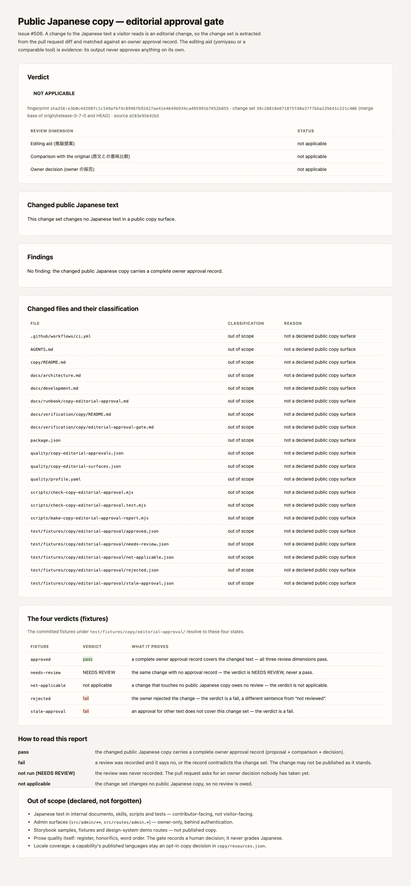

# 公開日本語 copy の編集レビュー承認 gate — 検証記録 (Issue #506)

> `scripts/check-copy-editorial-approval.mjs` が、PR で変わった公開日本語の
> 文面だけを抜き出し、owner の承認記録と突き合わせる gate の**検証記録**である。
> 実行仕様は
> [`docs/runbook/copy-editorial-approval.md`](../../runbook/copy-editorial-approval.md)、
> 宣言の正本は
> [`quality/copy-editorial-surfaces.json`](../../../quality/copy-editorial-surfaces.json) と
> [`quality/copy-editorial-approvals.json`](../../../quality/copy-editorial-approvals.json)。
> この document は gate 実行の仕様書ではない。



## before / after と合格基準

| | before (#506 の前) | after |
| --- | --- | --- |
| 公開日本語の書き換え | 誰の判断か、どこにも残らない。編集補助ツールの出力だけを「レビュー済み」と読む余地がある | 差分から変更された文面だけが抜き出され、owner の承認記録（推敲の採否 / 原文との意味比較 / 採否の決定）を持つ PR だけが通る |
| レビュー未確認の状態 | 「レビューしただろう」という **暗黙の仮定**。機械にも人間にも判別できない | `not run`（NEEDS REVIEW）として明示され、CI が止める。`fail`（レビューしたが否定）とは別の文 |
| 承認の流用 | 前の PR の「レビュー済み」を今の PR が inheriting できる | 承認は **変更文面の fingerprint** に紐づく。別の文面を指す記録は `stale-approval` として `fail` |
| 対象外の扱い | 公開 copy でない日本語（内部文書・admin・サンプル）が同じ扱い | 対象は opt-in の宣言（ディレクトリ粒度の `publicCopyGlobs` と、ファイル粒度の `publicCopyFiles`）。対象外のファイルは理由付きで 1 個ずつレポートに並ぶ |

合格基準は **1 つ**で、`pnpm run copy:approval:check -- --base=<base>` の
exit code が 0 であること。

- 公開日本語 changed なし → `not applicable` → exit 0
- 承認記録が complete → `pass` → exit 0
- 承認記録が無い → `not run`（NEEDS REVIEW）→ exit 1
- 記録が拒否 / 別の文面 / 比較が欠けている → `fail` → exit 1
- base ref を解決できない → exit 2（入力エラー。**判断できないものを pass にはしない**）

## 受け入れ条件への対応

| 受け入れ条件 | 実装 | どこで確かめるか |
| --- | --- | --- |
| 日本語変更時に review 未確認を FAIL / NEEDS REVIEW として扱い、確認した場合だけ通る | 3 つの review dimension（`proposal` / `semantic` / `approval`）のいずれも未達なら verdict は `not run`、CI は exit 1 | `test/fixtures/copy/editorial-approval/needs-review.json`（`not run`）、`approved.json`（`pass`） |
| pass / fail / not run / not applicable を区別する | 4 つの verdict は gate の戻り値とレポートの section が別々に表現する | fixture 5 件が 4 状態すべてに解決することを `scripts/check-copy-editorial-approval.test.mjs` が assert する |
| 現行の obligation-oriented 依存方向を守り、ページ統合 / 他言語全完成を前提にしない | gate は `src/**` を **import しない**。差分と 2 つの JSON 宣言だけを読む。locale の opt-in は `copy/resources.json` のまま触らない | `pnpm run architecture:check`、`quality/profile.yaml#copy_editorial_approval` の `out_of_scope` |
| 正常 / 不正常 fixture で検証し、対象外と将来の手作業を明記する | fixture 5 件（approved / needs-review / rejected / stale-approval / not-applicable）と、本 document §「対象外」 | `node --test scripts/check-copy-editorial-approval.test.mjs` |
| 1 Issue / 1 PR で独立した変更に閉じる | 本 PR は gate・宣言・fixture・runbook・検証画像のみを追加し、既存の copy 契約・locale 契約・页面構成には触れない | 本 PR の diff |

## 再現条件

| 項目 | 条件 |
| --- | --- |
| ブラウザ | **不要**。gate は git diff と 2 つの JSON を read するのみ。Chromium が無くても同じ結果になる（WebP の生成だけがブラウザを使う） |
| ネットワーク | **不要**（0 回の fetch）。編集補助ツール自体も **gate の外側** で offline 実行する |
| CPU / 負荷 | 依存なし。Node.js 起動を含めて約 0.1 秒（Apple Silicon ローカル実測）。並列実行による flaky 化はない |
| Runtime | Node.js `>=22.18`（`package.json#engines`、CI は 22.18 固定） |
| ソース SHA | レポートヘッダに `git rev-parse --short=12 HEAD` を出力する。gate 自体は SHA 非依存で、tree が同じなら verdict は同一 |
| 依存 install | 不要（`pnpm install` 済みなら Node 標準モジュールのみ） |

再現手順:

```bash
# gate 単体（base を明示する。CI は GITHUB_BASE_REF から解決する）
pnpm run copy:approval:check -- --base=release-0-7-0

# HTML レポート
node scripts/check-copy-editorial-approval.mjs --base=release-0-7-0 \
  --format=html --out=.tmp/copy-editorial-approval.html

# fixture による 4 状態の検証
node --test scripts/check-copy-editorial-approval.test.mjs

# 検証画像（WebP）を再生成
pnpm run verify:copy-editorial-approval-screenshot -- --base=origin/release-0-7-0
```

CI では `validate` ジョブの `Copy editorial approval gate` ステップ
（`.github/workflows/ci.yml`）が同じコマンドを `pull_request` イベントでのみ
実行する。`actions/checkout` は depth-1 clone なので base commit が含まれず、
ステップが base ref を明示的に fetch する。`push` イベントには PR の差分が
存在しないため、このステップは動かない。

## 画像が示すもの

| section | 何を証明するか |
| --- | --- |
| Verdict | 判定そのもの（4 状態）と、3 つの review dimension の状態 |
| Changed public Japanese text | 抜き出された変更文面と、その原文（差分から復元される） |
| Findings | なぜその verdict になったか（`no-approval-record` / `stale-approval` / `approval-rejected` / `comparison-missing` など） |
| Changed files and their classification | 変更されたファイルが **どれだけ** 公開 copy surface と判定されたか、対象外のものには **理由** があるか |
| The four verdicts (fixtures) | 4 状態それぞれが、どの fixture から，即可に再現されるか |

**画像はテストの代用ではない。** 4 状態の検証は
`scripts/check-copy-editorial-approval.test.mjs`（29 ケース）が行う。画像は
CI ログの読み方を読者へ示すためのものである。

## 対象外（宣言済みの対象外）

| 対象 | 理由 | 将来の手作業 |
| --- | --- | --- |
| 内部文書・skills・AGENTS.md・README の日本語 | contributor 向きであり、visitor-facing copy ではない | 対象へ入れる場合は owner decision。glob 宣言と記録運用を同時に広げる |
| `src/admin/**` / `src/routes/admin.*` | 認証の背後にある owner 専用 surface | admin を公開対象にしない限り対象外のまま |
| Storybook / fixture / design-system demo | publish される copy ではない | 対象外のまま |
| 編集補助ツールの採用判断そのもの | gate は採点しない | 記録運用（§4.2 of the runbook）が人の判断を受ける |
| locale 全完成 / ページ統合 | #428 の opt-in 契約が別 obligation の所有 | #428 側の copy decision として扱う |
| reviewer の同一性の検証 | repository 内の記録では証明できない | 実際の権限は PR review（AGENTS.md §6）。owner だけが merge する |

## 既知の限界

- 抽出は **テキスト走査** である。構文解析はせず、文字列リテラルと JSX の生
  テキストから日本語セグメントを抜き出す。コメント行は対象外。
- 複数リテラルを含む 1 行の書き換えは、removed 側と added 側を位置対応で結ぶ。
  1 文の書き換えでは正しく、複数 segment の一括差し替えでは対応がずれる
  可能性がある（segment 自体は列挙される）。
- gate は `reviewer` が owner であることを **証明しない**。実際の権限は PR review
  にある。
- 1 PR = 1 承認。承認後に別の文面を追加すると fingerprint が変わるため、
  差分追加後は owner の再承認が必要。

## 関連 Issue との重複回避

- **#428** (`copy:i18n:check`): locale 契約 — どの capability がどの言語で公開
  されているか、未翻訳キー、fallback 連鎖、数値/否定/権限の保持。**機械で
  決められること** の gate。
- **#508** (`release:gate:check`): release が実行する検査の ledger。本 gate は
  **差分** を対象にするため、release ではなく pull request のゲートとして
  CI の `validate` ジョブに置いた（profile の `copy_editorial_approval` ブロック）。
- **#492** (`routes:quality:check`): route roster と gate coverage の ledger。
  対象は route であり copy ではない。
