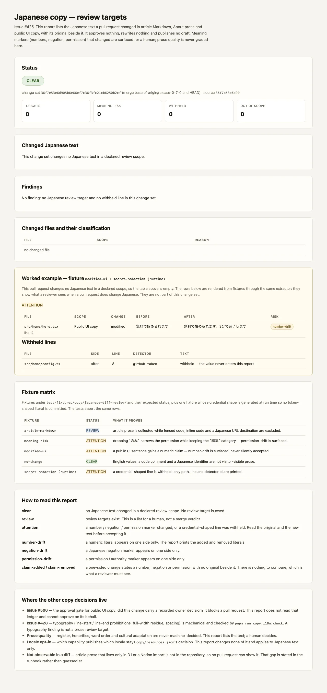

# 日本語 copy のレビュー対象レポート — 検証記録 (Issue #425)

> `scripts/collect-japanese-copy-review.mjs` が、PR で変わった日本語の
> **訪問者可読テキスト** を記事 Markdown / About prose / 公開 UI copy の
> 3 scope で集め、原文と変更後を並べて出すレポートの**検証記録**である。
> 実行仕様は
> [`docs/runbook/japanese-copy-review.md`](../../runbook/japanese-copy-review.md)、
> 宣言の正本は
> [`quality/japanese-copy-review-surfaces.json`](../../../quality/japanese-copy-review-surfaces.json)。
> この document は gate の仕様書ではない（本レポートは gate ではない）。



## before / after と合格基準

| | before (#425 の前) | after |
| --- | --- | --- |
| 記事 Markdown の変更 | #506 の surface 宣言は `**/*.md` を除外しており、記事本文の日本語はどのレポートにも現れない | `article` scope として、変更された prose と原文が並ぶ。fenced code / URL / inline code は除外される |
| About prose | 公開 UI copy と同じ扱いで、記事としての読み物であることが見えない | `about` scope としてラベルされ、原文差分が出る |
| 意味の変化 | 文章が変わったことだけが diff に残り、数値・否定・権限が変わったかは人が探す | `number-drift` / `negation-drift` / `permission-drift` / `claim-added` / `claim-removed` として明示される |
| credential 形の値 | 文章として抽出され、レポートに載る可能性がある | その行は丸ごと伏せられ、path / 行 / detector id だけが残る |
| 未確定の推敲 | 「レポートに出た = 公開された」と読む余地がある | レポートは **承認も書き換えも公開もしない**。承認は #506 の owner 記録だけが行う |

合格基準は「レポートが **変更集合を正しく説明している**」ことであり、
merge の可否ではない。

- 日本語の review target が無い → `clear` → exit 0
- review target がある → `review` → exit 0
- 意味マーカーが変わった / credential 行を伏せた → `attention` → exit 0
  （`--strict` のローカル実行のみ exit 1）
- base ref / diff を解決できない → exit 2（**説明できない変更集合を
  「変更なし」とは言わない**）

## 受け入れ条件への対応

| 受け入れ条件 | 実装 | どこで確かめるか |
| --- | --- | --- |
| 日本語テキスト変更が検出され、コード識別子や機密情報は対象外 | `extractSegments` / `visibleSegments` / `markdownSegments` が prose だけを返し、`secretShape` が credential 形の行を丸ごと伏せる | `no-change.json`（識別子・コメント・英語値は `clear`）、`secret-redaction`（runtime fixture、値はどの renderer にも出ない） |
| 元の意味・数値・否定・権限を守り、未確定な推敲を勝手に公開しない | 数値は集合差分、否定・権限はマーカー集合差分。レポートは列挙のみで、本文を書き換える経路を持たない | `modified-ui.json`（`number-drift`）、`meaning-risk.json`（`のみ` の削除を `permission-drift`）、`scripts/collect-japanese-copy-review.test.mjs` |
| 文章品質とタイポグラフィの違いを明示し、locale は必要な機能で opt-in | レポート本文と runbook §1/§10 が #428（組版）と prose quality（人）を分離。`copy/resources.json` は読まない・変更しない | `pnpm run copy:i18n:check` と本レポートの責務表、`quality/profile.yaml#japanese_copy_review.boundary` |
| 1 Issue / 1 PR。Storybook / プレビュー / CI fixture で他 Issue の完成を待たず検証 | 本 PR は収集スクリプト・宣言・fixture・CI レポート・runbook・検証画像だけを追加する。検証は CI fixture と本画像で閉じる | 本 PR の diff、`node --test scripts/collect-japanese-copy-review.test.mjs` |
| 対象テスト、未対応範囲、再現手順を PR に記載 | runbook §8 と本 document §「既知の限界」、PR 本文 | 本 document と PR 本文 |

## 再現条件

| 項目 | 条件 |
| --- | --- |
| ブラウザ | **不要**。レポートは git diff と 2 つの JSON を読むだけ。Chromium が無くても同じ結果になる（WebP の生成だけがブラウザを使う） |
| ネットワーク | **不要**（0 回の fetch）。外部 API も編集補助ツールも呼ばない |
| CPU / 負荷 | 依存なし。Node.js 起動を含めて約 0.2 秒（Apple Silicon ローカル実測）。並列実行による flaky 化はない |
| Runtime | Node.js `>=22.18`（`package.json#engines`、CI は 22.18 固定）。Python を必須ランタイムにしない |
| ソース SHA | レポートヘッダに `git rev-parse --short=12 HEAD` を出力する。レポート自体は tree が同じなら同一 |
| 依存 install | 不要（`pnpm install` 済みなら Node 標準モジュールのみ）。WebP 生成だけが `@playwright/test` と `sharp` を使う |

再現手順:

```bash
# レポート（base を明示する。CI は GITHUB_BASE_REF から解決する）
pnpm run copy:diff:report -- --base=release-0-7-0

# JSON / HTML
pnpm run copy:diff:report -- --base=release-0-7-0 --format=json \
  --out=.tmp/japanese-copy-review-report.json
pnpm run copy:diff:report -- --base=release-0-7-0 --format=html \
  --out=.tmp/japanese-copy-review-report.html

# fixture による status の検証
node --test scripts/collect-japanese-copy-review.test.mjs

# 検証画像（WebP）を再生成
pnpm run verify:copy-diff-report-screenshot -- --base=origin/release-0-7-0
```

CI では `validate` ジョブの `Japanese copy review targets` ステップ
（`.github/workflows/ci.yml`）が同じコマンドを `pull_request` イベントでのみ
実行し、JSON / text を `japanese-copy-review-report-<sha>` artifact として
30 日保持する。`actions/checkout` は depth-1 clone なので、ステップが base ref を
明示的に fetch する。`push` イベントには PR の差分が存在しないため動かない。

## 画像が示すもの

| section | 何を証明するか |
| --- | --- |
| Status | 現在の変更集合の status（`clear` / `review` / `attention`）と、その diff base |
| Changed Japanese text | 変更された日本語 prose と、その原文。scope / 変更種別 / 意味リスクが並ぶ |
| Worked example | この PR 自身は日本語 copy を変えないため、committed fixture から before / after と withheld line を実演する（**この PR の変更集合ではない** と明記） |
| Withheld lines | credential 形の行は値ではなく path / 行 / detector id だけが出る |
| Fixture matrix | 4 つの committed fixture と runtime credential fixture が、それぞれどの status に解決するか |
| Where the other copy decisions live | #506（承認）/ #428（組版）/ prose quality / locale opt-in / リポジトリ外の記事、の境界 |

**画像はテストの代用ではない。** status と抽出規則は
`scripts/collect-japanese-copy-review.test.mjs` が assert する。画像は
CI ログとレポートの読み方を読者へ示すためのものである。

## 対象外（宣言済みの対象外）

| 対象 | 理由 | 将来の手作業 |
| --- | --- | --- |
| 内部文書・skills・AGENTS.md・README・docs の日本語 | contributor 向きであり、visitor-facing copy ではない | 対象へ入れる場合は owner decision。glob 宣言を広げる |
| `scripts/**` / `test/**` の日本語 | 開発用 artefact であり、公開文面ではない | 対象外のまま |
| `src/admin/**` / `src/routes/admin.*` | 認証の背後にある owner 専用 surface | admin を公開対象にしない限り対象外 |
| Storybook / fixture / design-system demo | publish される copy ではない | 対象外のまま |
| 組版（行頭・行末禁則、full-width、spacing） | #428 の `copy:i18n:check` が機械判定する別の契約 | #428 側で扱う |
| prose quality（語調・敬称・語順） | 機械で決めない | 人が読む。レポートは材料だけを出す |
| D1 / Notion import だけに存在する記事本文 | PR の差分に存在しない | リポジトリに commit するか、別の観測面を設計する（本 Issue の範囲外） |

## 既知の限界

- **抽出は行単位のテキスト走査である。** 構文解析はせず、Markdown の
  fenced code 状態だけをファイル全体から復元する。曖昧な行は非 prose 側に
  倒す（誤検出より取りこぼしを選ぶ）。
- **removed / added の対応は位置対応である。** 1 文の書き換えでは正しいが、
  複数 segment の一括差し替えでは対応がずれる可能性がある（segment 自体は
  列挙される）。
- **マーカー判定は heuristic である。** 語彙に無い否定・権限表現や文脈依存の
  含意は検出しない。レポートは「読む場所」を指すだけで、意味の同一性を
  主張しない。
- **`--strict` は CI では使わない。** 未レビューの文章は通常状態であり、
  merge を止めるのは #506 の承認 gate だけである。
- **画像の拡張子は `.webp` である。** Issue #425 は `.png` を名指しするが、
  このリポジトリは検証画像を WebP で commit する（Issue #501 の先例）。
  capture script は `.webp` 以外の出力を拒否し、300 KB を超えたら失敗する。

## 関連 Issue との重複回避

- **#506** (`copy:approval:check`): 公開 copy の変更に owner の承認記録が
  あるかを問う blocking gate。本レポートは承認台帳を読まず、同じ
  `scripts/_copy-japanese-diff.mjs` の抽出関数を共有する。
  2 つの gate は冗長ではない — 片方は「何が変わったか」、もう片方は
  「誰が承認したか」を問う。
- **#428** (`copy:i18n:check`): locale 契約と組版の機械判定。本レポートは
  文章を列挙するだけで、組版を採点しない。
- **#508** (`release:gate:check`): release が実行する検査の ledger。本レポートは
  PR 差分を対象にするため、release ではなく CI の `validate` ジョブに置く。
- **#492** (`routes:quality:check`): route roster の ledger。対象は route であり
  copy ではない。
