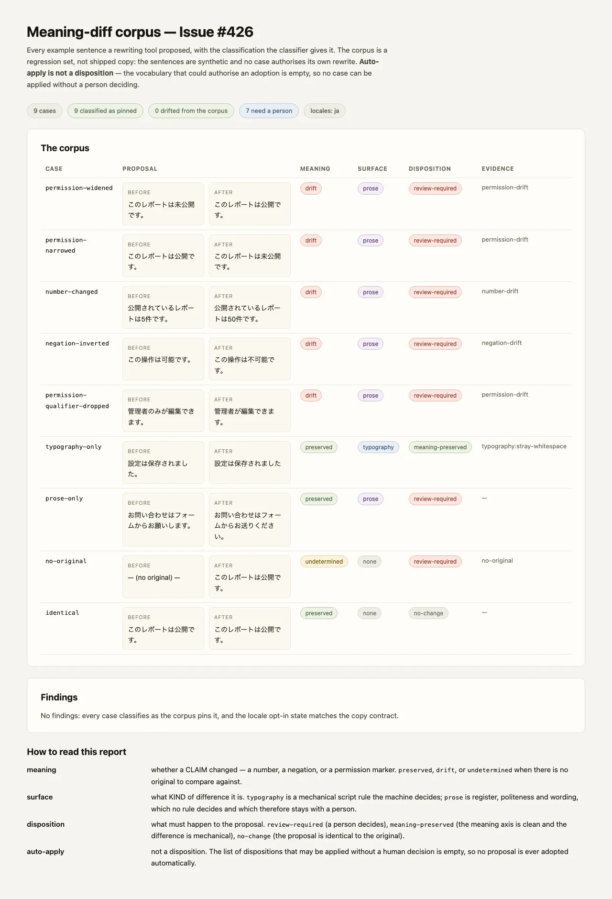

# 意味差分（意味保持）の評価レポート — 検証記録 (Issue #426)

> `scripts/make-copy-meaning-diff-report.mjs` が、corpus 評価の HTML / text レポートを
> `.tmp/copy-meaning-diff-report/` に生成し、そのページを Chromium で撮影して
> `docs/verification/copy/meaning-diff-evaluation.webp` に書き出す。
> **判定そのものは `scripts/check-copy-meaning-diff.mjs` が持つ。**
> このスクリプトは判定を二重に持たず、HTML / text の描画は gate 自身の
> `renderHtml` / `renderText` を使うので、レポートと gate が食い違えない。



## 適用対象 / 対象外

| 区分 | 対象 | 理由 |
| --- | --- | --- |
| **適用対象** | `test/fixtures/copy/meaning-diff/corpus.json` の全 case | Issue #426 の回帰集合。提案 pair（`before` / `after`）ごとに、意味軸・surface 軸・disposition の 3 つを、gate が出した値のまま並べる |
| **適用対象** | `copy/resources.json` の locale opt-in 状態 | corpus が「どの locale の主張をカバーしているか」を主張する根拠。gate が読むだけなので、このスクリプトは書き換えない |
| **対象外** | 実際の公開 copy | この Issue の主題は「推敲の自動採用をしない」契約であって、公開文面の採点ではない。corpus の文面はすべて合成された例であり、どれも公開も採用もされない |
| **対象外** | prose quality（語調・敬称・文の長さ） | 機械が決めない。`surface: prose` は人が読む axis であり、この Issue の gate はそれを scoring しない（`#428` と同じ「機械は prose を決定しない」拒否を継承する） |
| **対象外** | 編集補助ツールとの実連携 | 本 Issue の gate には推敲の入力口がない。corpus は fixture として同じ classifier を通す（入力口の実装は別 Issue） |

## 機械検査で決まること / 人が決めること

| 軸 | 値 | 誰が決めるか |
| --- | --- | --- |
| `meaning` | `preserved` / `drift` / `undetermined` | **機械**（gate）。主張 = 数値・否定・許可マーカー。`未公開` → `公開` のような「包含される語」を含む複合マーカーで判定する |
| `surface` | `none` / `typography` / `prose` | **機械**（gate）。`typography` は `#428` と同じ改行規則で機械が決める差分、`prose` は機械が決めない差分 |
| `disposition` | `review-required` / `meaning-preserved` / `no-change` | **機械**（gate）。どの提案が人手に回すかを gate が分類する |
| 採用の可否 | 自動採用は存在しない | **型**。自動採用できる disposition の集合 `AUTO_APPLY_DISPOSITIONS` は空で、`autoAdopt` はそこから導出される。集合に 1 つ足すには閉じた語彙への可視な変更が要る |

**人が決めるのは「意味が適切か」だけである。** 名前が読者にとって正しいか、
数値・否定・権限が意図どおりか、文が運用方針として妥当か は、このレポートでは
決めない。レポートは **列挙まで** であり、推敲を適用する経路を持たない。

## 終了コード

| コード | 意味 |
| --- | --- |
| 0 | corpus が corpus のとおりに分類され、検証画像も書き出された |
| 1 | 分類のずれ（違反あり）またはレポート / 撮影の失敗 |
| 2 | 判定できない（corpus / copy contract を読めない）。「違反なし」とは言わない |

## 再現手順

```bash
# gate 単体の判定（HTML / text / JSON も同じ gate から出る）
pnpm run copy:meaning:check
pnpm run copy:meaning:check -- --format=html --out=.tmp/copy-meaning-diff.html

# レポート + 検証画像（WebP）を生成する
pnpm run verify:copy-meaning-diff-screenshot

# レポートの回帰テスト
node --test scripts/check-copy-meaning-diff.test.mjs
node --test scripts/make-copy-meaning-diff-report.test.mjs
```

- ブラウザ: **WebP の生成だけ**が Chromium を使う（`pnpm run e2e:install` 済みであること）。判定そのものはブラウザ不要。
- ネットワーク: 不要。レポートは loopback（127.0.0.1 の ephemeral port）だけで配信され、外部 API も編集補助ツールも呼ばない。
- Runtime: Node.js のみ。Python を必須ランタイムにしない。
- 中間ファイル: `.tmp/copy-meaning-diff-report/`（gitignored）。**PNG は書かない**（撮影はメモリ内の Buffer に行い、WebP に直接エンコードする）。

## 画像が示すもの

| section | 何を証明するか |
| --- | --- |
| The corpus | 全 case の before / after と、意味軸・surface 軸・disposition・evidence code |
| Findings | corpus からのずれがあれば finding として出る。info は locale opt-in の説明 |
| How to read this report | 3 軸の意味と、「auto-apply は disposition ではない」こと |

**画像はテストの代用ではない。** 分類の正しさは
`scripts/check-copy-meaning-diff.test.mjs`、レポートが違反を列挙することは
`scripts/make-copy-meaning-diff-report.test.mjs` が assert する。

## 対象外（宣言済みの対象外）

| 対象 | 理由 | 将来の手作業 |
| --- | --- | --- |
| 実際の編集補助ツール / AI 提案の入力口 | 本 Issue は「自動採用しない」契約で、入力口そのものは別 | 入力口を作る Issue ごとに、その提案をこの corpus と同じ classifier へ通す |
| prose quality の採点 | 機械が決めない（`#428` も同じ拒否をする） | 人のレビューに委ねる。レポートはその材料を出すだけ |
| 公開 copy の変更 | gate は提案を分類するが、公開はしない | 公開は別の obligation（`#506` の承認記録） |
| 画像以外の証拠（CI ログ、JSON） | 画像は読み手の理解のためのもの | JSON は `.tmp/copy-meaning-diff-report/report.json` に出る（commit されない） |

## 既知の限界

- **拡張子は WebP**: Issue #426 は `docs/verification/copy/meaning-diff-evaluation.png` と書いているが、このリポジトリの規約は検証画像を **WebP のみ** で commit する（`#501` の precedent、隣接する copy artefact も同じ）。PNG は作っていない。
- **スクリーンショットの非再現性**: Chromium の撮影はプロセス間でバイト単位で再現しない。レポートの中身（HTML / text / JSON）は tree が同じなら同一で、画像はそれの 1 つのスナップショットである。
- **`undetermined` は「問題なし」ではない。** 元の文が無い case（`no-original`）は、主張が保持されたことを **主張できない** ので `undetermined` になる。drift が見つからないことと drift があり得ないことは別である。
- **マーカー判定は heuristic である。** 語彙に無い否定・権限表現や文脈依存の含意は検出しない。レポートは drift の **発生箇所** を指すだけで、意味の同一性を主張しない。
