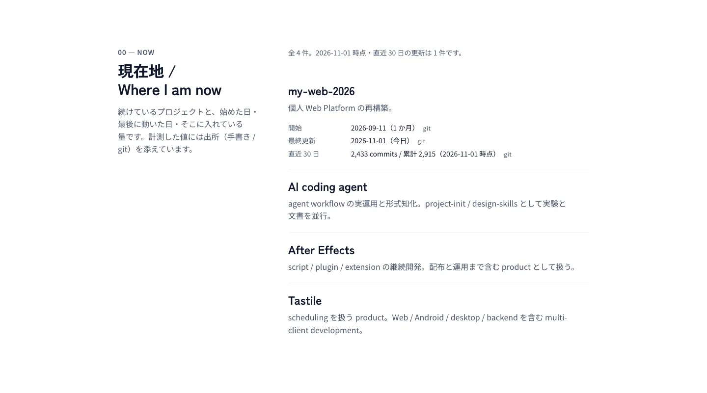
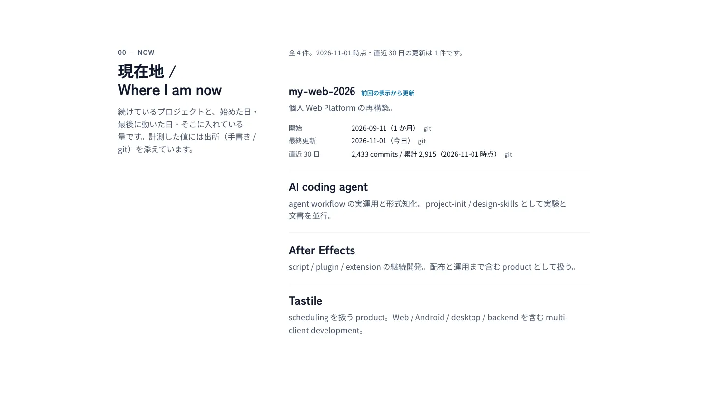
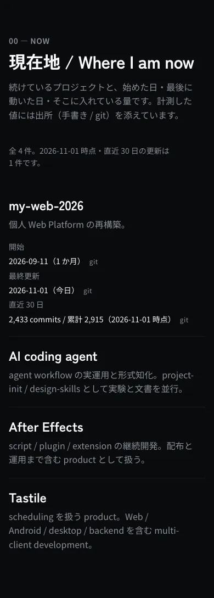

# 現在地セクション — 検証記録 (Issue #316)

> Home の「現在地 / Where I am now」セクションの**実描画の検証記録**である。
> 実装の契約は `src/home/current/**`、データの正本は
> [`../../../src/home/current/roster.ts`](../../../src/home/current/roster.ts)
> (owner が編集する roster) と
> [`../../../src/home/current/git-facts.json`](../../../src/home/current/git-facts.json)
> (このリポジトリの履歴のスナップショット)。
> この Issue は **Draft のまま**で、owner が値を書き終えるまで Ready にしない。



## 何を確かめたか

| 主張 | どう担保しているか | どこで確かめるか |
| --- | --- | --- |
| 値には**出所**が付く | 事実は `ProjectFact<T>` (`value` / `source` / `observedOn`) として運ばれ、描画側が `手書き` / `git` / `GitHub` を必ず並べる。活動量には**計測日**も付く (`（2026-11-01 時点）`) | `src/home/current/CurrentProjects.test.tsx`、本 document の画像 |
| 無い値は**出さない** | 事実が無ければ行そのものが出ない。`未記入` / ダッシュ / 0 での穴埋めはしていない | `CurrentProjects.test.tsx` の「absent facts are omitted, not filled」 |
| 数字は**再現できるものだけ** git 由来にする | `my-web-2026` の開始日・最終更新・コミット数は `scripts/sync-home-git-facts.mjs` が履歴から作り、`pnpm run current:facts:check` が形・暦・件数を再検査する。手で書いた値ではない | `src/home/current/git-facts.test.ts`、`scripts/check-home-git-facts.test.mjs` |
| 一覧は roster が唯一の id 源 | provider が roster に無い id を返してもレコードにならない（将来の GitHub 連携が一覧を増やせない） | `src/home/current/source.test.ts` の `composeRecords` |
| 段階は**構造**で、点数ではない | 全件に段階があるときだけ見出し（`主軸` / `並行` / `副次` / `休止`）、一部だけなら行内タグ。空の段階は描かない | `source.test.ts` の `groupByWeight` |
| motion は**実データの差分**だけで発火する | 比較するのは保存済み事実のみ（導出値 `1 か月` / `今日` / 30 日件数は含めない）。初回訪問は何も動かない | `use-changed-projects.test.ts`、下記の観測値 |
| 低減設定で情報は失われない | `prefers-reduced-motion: reduce` ではマーカーは残り、フェードだけが消える | `change-marker-reduced` の観測（marker 1 / animated 0） |
| 390 でも横スクロールしない | 1 カラム、`md` 以上でラベル列を固定幅に | 390 の画像 2 枚 |

## 実描画の観測値

`pnpm run capture:home-current-projects` が 7 条件を撮り、**撮るだけでなく
DOM を読み返して**次を判定する。判定は `verdict.ok === true` で、
失敗時は画像を残さずに終了する。

| 条件 | viewport | 配色 | 低減設定 | marker | animated |
| --- | --- | --- | --- | --- | --- |
| desktop-light | 1440×720 | light | no-preference | 0 | 0 |
| desktop-dark | 1440×720 | dark | no-preference | 0 | 0 |
| mobile-light | 390×900 | light | no-preference | 0 | 0 |
| mobile-dark | 390×900 | dark | no-preference | 0 | 0 |
| reduced-motion | 1440×720 | light | reduce | 0 | 0 |
| change-marker | 1440×720 | light | no-preference | **1** | **1** (`currentLocationChange`) |
| change-marker-reduced | 1440×720 | light | reduce | **1** | 0 |

- light と dark は**同じ情報**（同じ件数・同じ行・同じ文）を出す。
- desktop と mobile も同じ情報を出す。
- 初回訪問（上 5 条件）は marker 0 / animated 0。**何も動かない**。
- 変化した事実 1 件で、動くのはその行のマーカーだけ。低減設定では
  マーカーは残り animated 0。
- マーカーは DOM を書き換えて作っていない。1 回目の訪問で保存された署名を
  **1 件だけ**前回値に書き換えて再読込する、という訪問者と同じ手順で作っている。





## 再現手順

```sh
pnpm exec vitest run src/home/current src/privacy test/integration/home-about-current-consistency.test.ts
node --test scripts/check-home-git-facts.test.mjs
pnpm run current:facts:check          # スナップショットの形・暦・件数
pnpm run capture:home-current-projects # 7 枚 + 観測判定 (WebP のみ)
```

- 撮影は `src/home/current/CurrentProjects.stories.tsx` の `Shipped` を
  そのまま harness で描く。Storybook の static build は manager-only なので
  `iframe.html` を使わない（`scripts/capture-error-state-gallery.mjs` と同じ理由）。
- 画像はいずれも WebP、幅 1600 以下・quality 80・予算内（30〜35 kB）。
- 数値は撮影日時点のもので、履歴と roster が変われば変わる。
  **画像の数値を契約として読まないこと**（契約は上表の marker / animated）。

## owner の確認に回す文言

公開コピーなので `pnpm run copy:approval:check` の対象である。owner の承認記録は
まだ無く、PR の CI では **advisory**（NEEDS REVIEW）として出る。

| 種類 | 文言 | 場所 |
| --- | --- | --- |
| 見出し | `現在地 / Where I am now` | `CurrentProjects.tsx` |
| 説明 | `続けているプロジェクトと、始めた日・最後に動いた日・そこに入れている量です。計測した値には出所（手書き / git）を添えています。` | 同上 |
| 集計 | `全 N 件。YYYY-MM-DD 時点・直近 30 日の更新は N 件です。` / `…はありません。` | 同上 |
| ラベル | `開始` / `最終更新` / `直近 N 日` / `N 件` | 同上 |
| 段階 | `主軸` / `並行` / `副次` / `休止` | `src/home/current/source.ts` |
| 出所 | `手書き` / `git` / `GitHub` | 同上 |
| マーカー | `前回の表示から更新` | `CurrentProjects.tsx` |
| 空状態 | `現在、公開している進行中のプロジェクトはありません。` | 同上 |
| roster の一行説明 | 4 件（`my-web-2026` / `Tastile` / `After Effects` / `AI coding agent`） | `src/home/current/roster.ts` |

加えて `quality/stale-content-review.json` に「今」を指す文面
（見出し・空状態）の記録がある。`src/home/current/derive.ts` の `今日` は
計算で出る実行時ラベルなので `excludedExpressions` に明示した。

## まだ確定していないこと

- **owner の値**: 4 件のうち `my-web-2026` 以外の開始日・最終更新・段階・リンクは
  未記入。roster に `handwritten` ブロックが入るまで、それらは**描画されない**
  （fail-closed）。`未記入` という表示は存在しない。
- **公開コピーの承認**: 上表の文言は owner の確認待ち。
- **localStorage の通知**: `mw_home_current_projects_v1` は
  `src/privacy/data-lifecycle.ts` に `pending` で記録した（公開文は未承認なので
  どこにも描画しない）。
- **Issue の状態**: Draft のまま。owner がプロジェクト一覧を確認するまで
  「完了」とは書かない。
