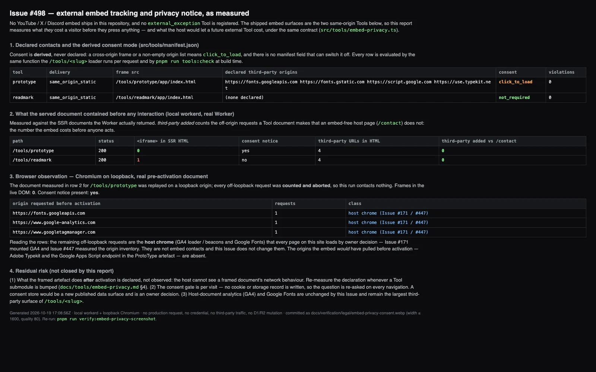

# Embed privacy + consent — verification record (Issue #498)

> Generated by `pnpm run verify:embed-privacy-screenshot`
> (`scripts/make-embed-privacy-report.mjs`). Do not hand-edit the
> image: the suite named below is the authority, and re-running the
> script regenerates it.

## What the image shows

1. **Declared contacts and the derived consent mode** for every
   embeddable Tool in `src/tools/manifest.json`.
2. **What the served document contained before any interaction** —
   `<iframe>` count, whether the consent notice was present, and the
   number of third-party URLs the document references that an
   embed-free page (`/contact`) does not.
3. **A Chromium replay** of the real pre-activation document on a
   loopback origin, counting the requests it attempts while every
   off-loopback request is aborted at the browser's interception
   layer. The probe also asserts that **no** off-loopback response was
   received — a run that was not network-isolated fails instead of
   publishing a report.
4. The residual risks this record does **not** close.

The contract these columns are measuring is described in
[`docs/tools/embed-privacy.md`](../../tools/embed-privacy.md).

## Conditions of the run

| Condition | Value |
| --- | --- |
| Policy rows | `test/integration/embed-privacy.test.ts` driving the real Worker in the local `workerd` pool (`vitest.config.ts` bindings) |
| Browser rows | Chromium (Playwright, the project's pinned build) on `http://127.0.0.1:<port>` |
| Network | every off-loopback request **counted and aborted** at the interception layer (`context.route`); the run measured 2 attempted / 2 aborted / **0** off-loopback responses received — this run contacts no third party, no production origin, and holds no credential |
| D1 / R2 | untouched; no migration, no write |
| Document under test | the SSR document the Worker itself returned for the gated route, carried into the report by the suite (not re-authored) |
| Re-run | `pnpm run verify:embed-privacy-screenshot` |
| Encoding | WebP, width ≤ 1600, quality 80 (the Issue names a `.png` path; the repository stores screenshots as `.webp`) |

## Reading the numbers

- `/tools/prototype` — `click_to_load`. The served HTML contains
  **zero `<iframe>` elements** and the notice is present. Its four
  declared origins are named **as text** inside the notice; none of
  them is fetched. The two off-loopback requests the replay counted
  (`fonts.googleapis.com`, `www.googletagmanager.com`) are the host
  chrome every page loads — a separate owner decision (Issue #171
  mounted GA4, Issue #447 measured the inventory), not an embed
  contact, and unchanged by this Issue. Both were aborted here, so
  this run sent no request to them.
- `/tools/readmark` — `not_required`. It declares an empty contact
  list, so it mounts its frame immediately and the pre-existing
  host-side contract is untouched.
- "Third-party added vs `/contact`" is `0` on both rows. That is the
  number that says the embed costs nothing before the visitor acts.

## Scope and residual risk

1. **Only the pre-activation document is measured here.** What the
   framed artefact does after activation is **declared, not observed**:
   the host cannot see a framed document's network behaviour. The
   declaration is reviewed whenever a Tool submodule is bumped
   (`docs/tools/embed-privacy.md` §"Re-measuring after a submodule
   bump").
2. **The activated state is covered by the browser suites**, not by
   this image: `e2e/tools-prototype.spec.ts` activates the gate and
   asserts the notice listed exactly the declared origins before the
   frame appeared; `e2e/lazy-media.spec.ts` asserts the frame is not
   mounted before activation and is mounted after it.
3. **No consent record is stored.** The gate is per visit; a reload
   asks again. Turning that into a remembered consent is an owner
   decision, not a property this record proves.
4. **The largest third-party surface of `/tools/<slug>` is still the
   host chrome** (GA4 + Google Fonts). This Issue reduced what the
   *embed* costs a visitor; it did not make the page third-party-free.
5. **No YouTube / X / Discord embed exists in this repository**, and
   none is registered as an `external_exception` Tool. If one is
   added, the same contract gates it, and the report is the surface
   that will show it.