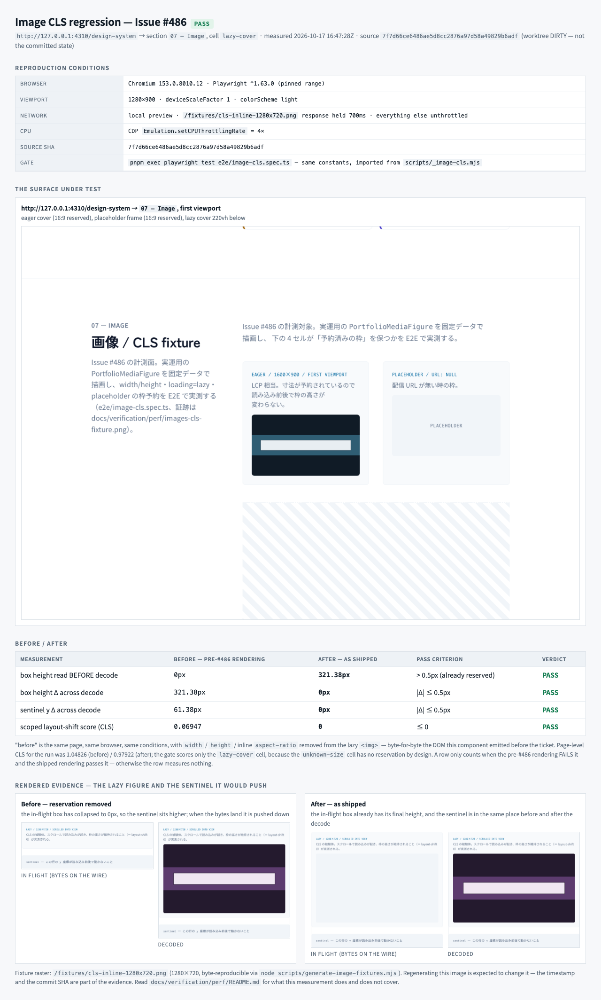

# 画像 CLS 回帰の証跡（Issue #486）

`images-cls-fixture.png` は Issue #486 が要求するスクリーンショットであり、
`/design-system` の `07 — Image` セクションで実測した**ブラウザ / CI レポート**である。



このファイルは「その PNG が何を主張しているか」の正本。数値は
`.tmp/image-cls-report.json`（未 commit）にも machine-readable で残る。

## 何の回帰を測るか

`portfolio_media` は intrinsic size（`width` / `height`）を D1 に持っていたが、
UI の `` はそれを表現していなかった。`` は `width: 100%` + `height: auto`
だけで、intrinsic size を知らない状態では **height 0px** から始まる。`loading="lazy"`
の cover が訪問者のスクロール後に解決すると、その下の要素がすべて押し下げられる。
つまり画像入り surface における純粋な CLS shift である。

修正は 1 要素（`PortfolioMediaFigure` の ``）に閉じていて、
予約機構は次の 3 つだけ:

1. row が正の intrinsic size を持つとき `width` / `height` 属性を出す
   → UA が `aspect-ratio: auto <w> / <h>` を導出し|first paint から枠を確保する
2. 同じ比率を inline `aspect-ratio` として明示する
   → 属性から比率を導出しない engine でも予約が効く
3. （同じ枠契約の延長）`error` で placeholder に差し替えるとき、placeholder frame
   も同じ比率で塗るので**差し替えでも高さが変わらない**

`src/portfolio/components/PortfolioMedia.tsx` が canonical。

## fixture を使う理由（`/portfolio` を測らない理由）

`/portfolio` はローカルで画像を 1 枚も描画できない。`composeMediaUrl`
（`src/portfolio/media.ts`）は R2 の public custom domain が束縛されるまで `null` を返し、
`MEDIA_PUBLIC_BASE_URL` は production-only var である（`wrangler.production.jsonc`）。
したがってローカルの `/portfolio` は常に placeholder 分岐を通り、`` について何も語らない。

fixture（`src/routes/design-system/sections/ImageCls.tsx`）は**本番と同じ
`PortfolioMediaFigure`** を固定データで描画する。測っている要素は出荷される要素で、
固定しているのはデータだけ。Issue が求める「他機能の完成を待たない fixture での計測」が
これに当たる。

4 セル（各 `data-cls-fixture`）:

| セル | 内容 | 測るもの |
| --- | --- | --- |
| `eager-cover` | `loading="eager"` / 1600×900 / first viewport | LCP 相当。読み込み前後で枠が同じ |
| `placeholder` | `url: null` / 1600×900 | 配信 URL が無いときの予約枠 |
| `unknown-size` | `width`/`height` = null | 寸法未計測 row の劣化経路（予約しない = 仕様） |
| `lazy-cover` | `loading="lazy"` / 1280×720 / 220vh 下の spacer の後 | **CLS の被験体** |

`lazy-cover` の直後にある `data-cls-sentinel` 行が測定の中心になっている理由:
layout-shift は「描画された content が**動いた**とき」しか記録されない。
ページ最下端の figure は予約を外れていても下に動かされる content が無いため 0 になる。
sentinel が「figure が押す相手」であり、これがないと before 状態も測れない。

## 再現条件（local / CI 共通）

条件は `scripts/_image-cls.mjs` に**定数**として置き、gate とレポートが同じ値を import する。
別々の値で測ると、PNG が gate が一度も assert していない数値の証拠になってしまう。

| 条件 | 値 | 理由 |
| --- | --- | --- |
| browser | Chromium（Playwright 1.63.x、CI でも同じ project） | `playwright.config.ts` は 0.1.0 で Chromium only |
| viewport | 1280×900 / deviceScaleFactor 1 | desktop Chrome の既定に相当 |
| network | fixture raster `/fixtures/cls-inline-1280x720.png` の response を **700ms 保持**、他は unthrottled | lazy fetch が decode 前に終わると intrinsic size を知る機会を消してしまう |
| CPU | CDP `Emulation.setCPUThrottlingRate` = **4×** | Lighthouse の既定 mobile throttle。CLS は layout property なので verdict は変わらないが、#384–#387 の Lighthouse 数値と可比になるよう固定する |
| source SHA | 生成時に `git rev-parse HEAD` を PNG へ刻印 | 「どの commit で測ったか」を画像が自分で答える |
| 判定基準 | scoped CLS **≤ 0**、枠高さ Δ **≤ 0.5px**、sentinel y Δ **≤ 0.5px** | Core Web Vitals の "good" は 0.1 だが、予約契約は shift を 0 にするためにある |

ローカル: `pnpm run build` 済みで
`pnpm exec playwright test e2e/image-cls.spec.ts`（Playwright の `webServer` が
migration + seed 込みで preview を起動する）。

CI: `.github/workflows/ci.yml` の Playwright step だけがこの spec を回す。
起動条件は push to `main` / `release-*`、または `ui-change` label 付き PR。
Draft PR の `validate:integration` には含まれない点に注意。

## before / after の実測値

`before` は revision を checkout したものではなく、**同じページ・同じ browser・同じ条件で**
lazy `` から `width` / `height` / inline `aspect-ratio` を取り除いた DOM
（= この ticket 以前の描画そのもの）から測定した値。

| 測定 | before（#486 以前） | after（出荷状態） | 合格基準 |
| --- | --- | --- | --- |
| decode 前の枠高さ | 0px | 321.38px | > 0.5px（すでに予約済み） |
| decode をまたぐ枠高さ Δ | +321.38px | 0px | \|Δ\| ≤ 0.5px |
| sentinel の y 座標 Δ | +321.38px | 0px | \|Δ\| ≤ 0.5px |
| scoped CLS | 0.06947 | 0 | ≤ 0 |

（viewport 1280×900 での実測。セル幅に依存するため絶対値は環境差が出るが、
Δ と CLS は条件が固定されていれば再現する。）

## この gate が空振りしないための仕組み

`e2e/image-cls.spec.ts` には 4 本の test がある。最後の 1 本は
**false-green guard**: 同じ条件で予約を外した状態を作り、必ず shift が出ることを確認する。

これがないと「何も測っていない 0」と「予約が効いた 0」を gate が区別できない。
さらに測定中は

- `decodedBefore`（decode 前に枠を読めたか）を assert する
- `#design-system-image` fragment を**付けない**（fragment で初期 navigation 中に
  lazy fetch が始まり、「decode 前」を観測できなくなるため）

の 2 つで「測れていなかった」ケースを失敗させる。

## `srcset` / `sizes` について（未決の owner decision）

実測すると **現状 `srcset` も `sizes` も absent** である。これは意図的で、
gate として固定してある（`toBeNull()`）。理由:

- `composeMediaUrl` は 1 つの object key → 1 つの R2 URL を返すだけで、
  bucket の前段で画像を resize する mechanism がリポジトリに存在しない
- `srcset` を書くことは「配信面が実行しない transformation の URL 構文を捏造する」ことになる
- 実際に low-volume rendition を用意するときの選択肢は 2 つあり、**どちらも owner 決定**:
  1. Cloudflare Image Resizing（`/cdn-cgi/image/...`）— zone 側の設定と費用、
     custom domain が Worker route を通る必要がある
  2. ingest 時に R2 へ variant を pre-generate する —
     `portfolio_media` に variant 幅の行を持てる schema 変更と job が必要

決定されるまで `` は 1 枚だけを送る。#384–#387（Lighthouse 計測 / gate / CWV budget）
とは重複しない: あちらは budget と gate、本 ticket は 1 要素の予約契約と証跡。

## `quality/profile.yaml` への影響

**変更なし。** 判断根拠:

- 変更 risk は `src_unit`（component）+ 既存 fixture route。既存 profile では
  `fast` gate（`pnpm run validate:fast`）で十分
- E2E step は `release_extra` の既存項目。新規 job / 新規 trigger / 新規 script を
  足していない（`disallowed_patterns` の "duplicate … on the same trigger" に該当しない）
- gate を 1 つ増やすなら `security_gates` に budget として書くのが本筋だが、
  #486 の gate は「0 ayakude 达不到たら落ちる」assertion であり、
  Lighthouse / CWV budget という別の axis（#386）着她しない

fixture raster の再生成を CI で gate するのは **していない**
（`scripts/generate-image-fixtures.mjs --check` は手動実行用）。
gate を増やす判断は owner 決定として次 Issue に残す。

## 再生成

```bash
pnpm run build
node scripts/image-cls-report.mjs              # 4310 番で preview を自分で上げる
node scripts/image-cls-report.mjs --base-url=http://127.0.0.1:3000  # 既存 server に|population
node scripts/generate-image-fixtures.mjs       # fixture raster を書き直す
node scripts/generate-image-fixtures.mjs --check  # commit 済みバイト列との drift を検出
```

PNG は timestamp と commit SHA を含むので、再生成すると必ず差分が出る。
policy / fixture / component を触った changeset と同じ commit で更新する。