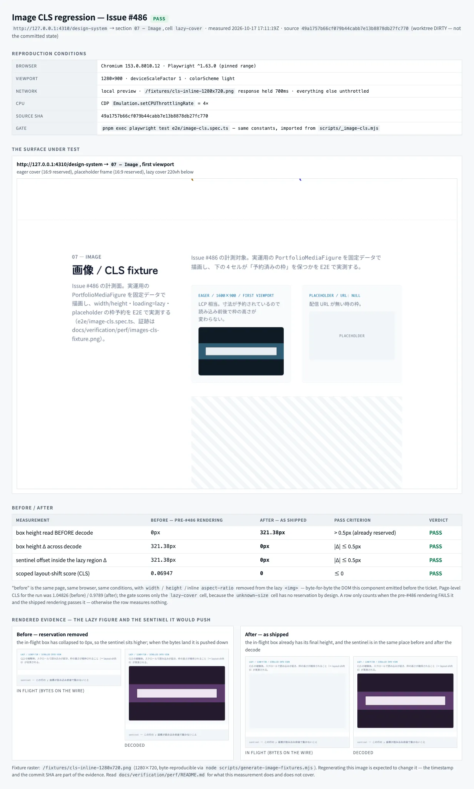
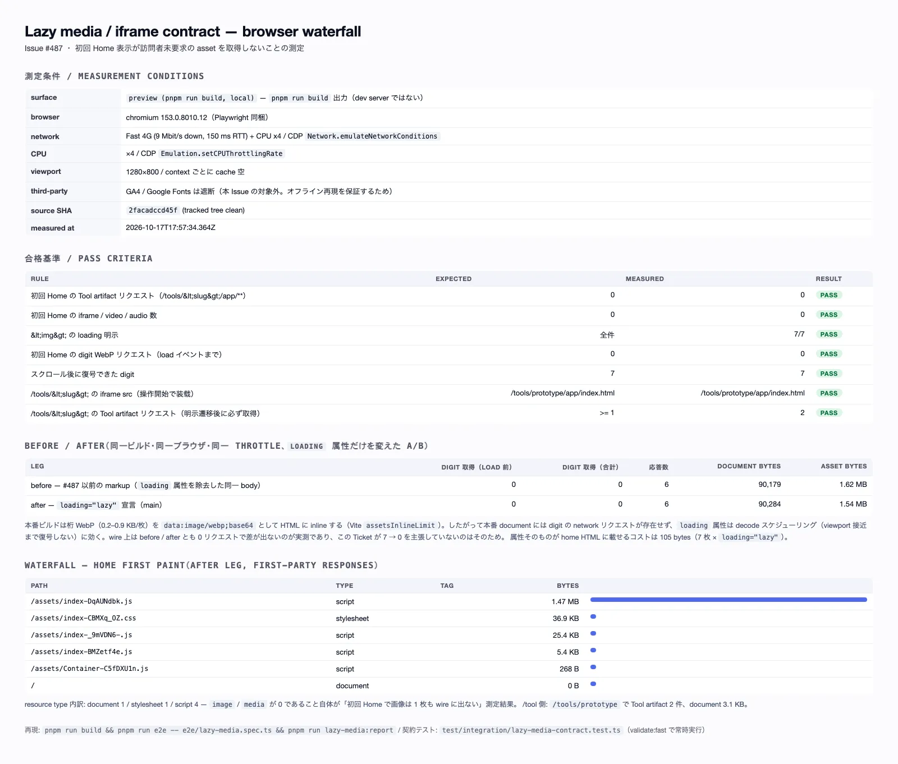

# Performance verification — `docs/verification/perf`

このディレクトリは **1 Issue の検証成果物**置き場です（AGENTS.md §9 の
`.tmp/` は throwaway なので、レビューで再確認できる測定結果はここへ
置きます）。Issue #387 が「UI 以外の 1 Issue/1 PR にも画像付き検証を
必須化する」ticket として独立して走っており、本ディレクトリは #486 と
#487 が作った先例です。#387 とは重複しません（#387 は policy、本ファイル
は 1 チケットずつの測定記録）。

**セクションは Issue 単位で独立**です。1 Issue / 1 PR 原則のため、ticket は
自分のセクションだけ Writes し、既存のセクションは他 ticket の記録として
そのまま残します（1 Issue の成果物が別の Issue の測定記録を上書きしない）。
同じ directory への追記が衝突したら **両方のセクションを残す** のが
既定の解決です。

- 画像 CLS 回帰の証跡（Issue #486）— `portfolio_media` の予約枠契約
- Lazy media / iframe の遅延ロード契約（Issue #487）— 初回 Home の未要求 asset


---

## 画像 CLS 回帰の証跡（Issue #486）

`images-cls-fixture.webp` は Issue #486 が要求するスクリーンショットであり、
`/design-system` の `07 — Image` セクションで実測した**ブラウザ / CI レポート**である。



このファイルは「その画像が何を主張しているか」の正本。数値は
`.tmp/image-cls-report.json`（未 commit）にも machine-readable で残る。

> **拡張子は Issue が名指しした `.png` ではなく `.webp`。** Chromium の full-page
> capture を PNG で持つと 1 枚 360KB になり、再生成のたびにそれが repository に
> 積み上がる。WebP quality 80 は平坦な UI color と mono 文字・flat gradient には
> 視覚差が無く、121KB で収まる。生成 script 側で **幅 ≤ 1600px / quality 80 /
> 300KB 上限**を assert しており、超過したら commit せず終了する
> （`scripts/image-cls-report.mjs#encodeEvidence`）。PNG は commit していない。

### 何の回帰を測るか

`portfolio_media` は intrinsic size（`width` / `height`）を D1 に持っていたが、
UI の `` はそれを表現していなかった。`` は `width: 100%` + `height: auto`
だけで、intrinsic size を知らない状態では **height 0px** から始まる。`loading="lazy"`
の cover が訪問者のスクロール後に解決すると、その下の要素がすべて押し下げられる。
つまり画像入り surface における純粋な CLS shift である。

修正は 1 要素（`PortfolioMediaFigure` の ``）に閉じていて、
予約機構は次の 3 つだけ:

1. row が正の intrinsic size を持つとき `width` / `height` 属性を出す
   → UA が `aspect-ratio: auto <w> / <h>` を導出し|first paint から枠を確保する
2. 同じ比率を inline `aspect-ratio` として明示する
   → 属性から比率を導出しない engine でも予約が効く
3. （同じ枠契約の延長）`error` で placeholder に差し替えるとき、placeholder frame
   も同じ比率で塗るので**差し替えでも高さが変わらない**

`src/portfolio/components/PortfolioMedia.tsx` が canonical。

### fixture を使う理由（`/portfolio` を測らない理由）

`/portfolio` はローカルで画像を 1 枚も描画できない。`composeMediaUrl`
（`src/portfolio/media.ts`）は R2 の public custom domain が束縛されるまで `null` を返し、
`MEDIA_PUBLIC_BASE_URL` は production-only var である（`wrangler.production.jsonc`）。
したがってローカルの `/portfolio` は常に placeholder 分岐を通り、`` について何も語らない。

fixture（`src/routes/design-system/sections/ImageCls.tsx`）は**本番と同じ
`PortfolioMediaFigure`** を固定データで描画する。測っている要素は出荷される要素で、
固定しているのはデータだけ。Issue が求める「他機能の完成を待たない fixture での計測」が
これに当たる。

4 セル（各 `data-cls-fixture`）:

| セル | 内容 | 測るもの |
| --- | --- | --- |
| `eager-cover` | `loading="eager"` / 1600×900 / first viewport | LCP 相当。読み込み前後で枠が同じ |
| `placeholder` | `url: null` / 1600×900 | 配信 URL が無いときの予約枠 |
| `unknown-size` | `width`/`height` = null | 寸法未計測 row の劣化経路（予約しない = 仕様） |
| `lazy-cover` | `loading="lazy"` / 1280×720 / 220vh 下の spacer の後 | **CLS の被験体** |

`lazy-cover` の直後にある `data-cls-sentinel` 行が測定の中心になっている理由:
layout-shift は「描画された content が**動いた**とき」しか記録されない。
ページ最下端の figure は予約を外れていても下に動かされる content が無いため 0 になる。
sentinel が「figure が押す相手」であり、これがないと before 状態も測れない。

sentinel の位置は **region 基準の document 座標**で測る（`regionSentinelOffset` /
`readDocumentBox`）。その理由は 2 つある:

- viewport 座標（`boundingBox()`）だと、scroll anchoring や
  `scrollIntoViewIfNeeded` の丸めによる**スクロール量**が「移動」として混ざる
  （実際に 1.4px の偽陽性が出た）
- sentinel の絶対座標だと、**region より上**にある無関係な reflow（この page では
  web font swap だけで 1px 超動く）が混ざる。gate が主張すべきことは
  「lazy figure が下の content を押さない」であって、
  「page 上のどこでも reflow しない」ではない。
  region 基準なら上の reflow は region と sentinel を一緒に動かすので差分は 0、
  一方 region 内での figure の成長は sentinel だけを押すので差分として残る。

### 再現条件（local / CI 共通）

条件は `scripts/_image-cls.mjs` に**定数**として置き、gate とレポートが同じ値を import する。
別々の値で測ると、レポート画像が gate が一度も assert していない数値の証拠になってしまう。

| 条件 | 値 | 理由 |
| --- | --- | --- |
| browser | Chromium（Playwright 1.63.x、CI でも同じ project） | `playwright.config.ts` は 0.1.0 で Chromium only |
| viewport | 1280×900 / deviceScaleFactor 1 | desktop Chrome の既定に相当 |
| network | fixture raster `/fixtures/cls-inline-1280x720.png` の response を **700ms 保持**、他は unthrottled | lazy fetch が decode 前に終わると intrinsic size を知る機会を消してしまう |
| CPU | CDP `Emulation.setCPUThrottlingRate` = **4×** | Lighthouse の既定 mobile throttle。CLS は layout property なので verdict は変わらないが、#384–#387 の Lighthouse 数値と可比になるよう固定する |
| source SHA | 生成時に `git rev-parse HEAD` を画像へ刻印 | 「どの commit で測ったか」を画像が自分で答える |
| 判定基準 | scoped CLS **≤ 0**、枠高さ Δ **≤ 0.5px**、sentinel offset Δ **≤ 0.5px** | Core Web Vitals の "good" は 0.1 だが、予約契約は shift を 0 にするためにある |

ローカル: `pnpm run build` 済みで
`pnpm exec playwright test e2e/image-cls.spec.ts`（Playwright の `webServer` が
migration + seed 込みで preview を起動する）。

CI: `.github/workflows/ci.yml` の Playwright step だけがこの spec を回す。
起動条件は push to `main` / `release-*`、または `ui-change` label 付き PR。
Draft PR の `validate:integration` には含まれない点に注意。

### before / after の実測値

`before` は revision を checkout したものではなく、**同じページ・同じ browser・同じ条件で**
lazy `` から `width` / `height` / inline `aspect-ratio` を取り除いた DOM
（= この ticket 以前の描画そのもの）から測定した値。

| 測定 | before（#486 以前） | after（出荷状態） | 合格基準 |
| --- | --- | --- | --- |
| decode 前の枠高さ | 0px | 321.38px | > 0.5px（すでに予約済み） |
| decode をまたぐ枠高さ Δ | +321.38px | 0px | \|Δ\| ≤ 0.5px |
| sentinel offset（region 基準）Δ | +321.38px | 0px | \|Δ\| ≤ 0.5px |
| scoped CLS | 0.06947 | 0 | ≤ 0 |

（viewport 1280×900 での実測。セル幅に依存するため絶対値は環境差が出るが、
Δ と CLS は条件が固定されていれば再現する。）

### この gate が空振りしないための仕組み

`e2e/image-cls.spec.ts` には 4 本の test がある。最後の 1 本は
**false-green guard**: 同じ条件で予約を外した状態を作り、必ず shift が出ることを確認する。

これがないと「何も測っていない 0」と「予約が効いた 0」を gate が区別できない。
さらに測定中は

- `decodedBefore`（decode 前に枠を読めたか）を assert する
- `#design-system-image` fragment を**付けない**（fragment で初期 navigation 中に
  lazy fetch が始まり、「decode 前」を観測できなくなるため）

の 2 つで「測れていなかった」ケースを失敗させる。

### `srcset` / `sizes` について（未決の owner decision）

実測すると **現状 `srcset` も `sizes` も absent** である。これは意図的で、
gate として固定してある（`toBeNull()`）。理由:

- `composeMediaUrl` は 1 つの object key → 1 つの R2 URL を返すだけで、
  bucket の前段で画像を resize する mechanism がリポジトリに存在しない
- `srcset` を書くことは「配信面が実行しない transformation の URL 構文を捏造する」ことになる
- 実際に low-volume rendition を用意するときの選択肢は 2 つあり、**どちらも owner 決定**:
  1. Cloudflare Image Resizing（`/cdn-cgi/image/...`）— zone 側の設定と費用、
     custom domain が Worker route を通る必要がある
  2. ingest 時に R2 へ variant を pre-generate する —
     `portfolio_media` に variant 幅の行を持てる schema 変更と job が必要

決定されるまで `` は 1 枚だけを送る。#384–#387（Lighthouse 計測 / gate / CWV budget）
とは重複しない: あちらは budget と gate、本 ticket は 1 要素の予約契約と証跡。

### `quality/profile.yaml` への影響

**変更なし。** 判断根拠:

- 変更 risk は `src_unit`（component）+ 既存 fixture route。既存 profile では
  `fast` gate（`pnpm run validate:fast`）で十分
- E2E step は `release_extra` の既存項目。新規 job / 新規 trigger / 新規 script を
  足していない（`disallowed_patterns` の "duplicate … on the same trigger" に該当しない）
- gate を 1 つ増やすなら `security_gates` に budget として書くのが本筋だが、
  #486 の gate は「0 ayakude 达不到たら落ちる」assertion であり、
  Lighthouse / CWV budget という別の axis（#386）着她しない

fixture raster の再生成を CI で gate するのは **していない**
（`scripts/generate-image-fixtures.mjs --check` は手動実行用）。
gate を増やす判断は owner 決定として次 Issue に残す。

### 再生成

```bash
pnpm run build
node scripts/image-cls-report.mjs              # 4310 番で preview を自分で上げる
node scripts/image-cls-report.mjs --base-url=http://127.0.0.1:3000  # 既存 server に|population
node scripts/generate-image-fixtures.mjs       # fixture raster を書き直す
node scripts/generate-image-fixtures.mjs --check  # commit 済みバイト列との drift を検出
```

証跡画像は timestamp と commit SHA を含むので、再生成すると必ず差分が出る。
policy / fixture / component を触った changeset と同じ commit で更新する。

---

## Lazy media / iframe の遅延ロード契約（Issue #487）



> **拡張子は Issue のチェックボックスが名指しした `.png` ではなく `.webp`。**
> Chromium の full-page capture を PNG で持つと、生成のたびに数百 KB の
> blob が repository に積み上がる。生成 script 側は 幅 ≤ 1600px /
> quality 80 / 300KB 上限を assert しており、超過したら commit せず
> 終了する（`scripts/render-lazy-media-report.mjs`）。同ディレクトリの
> #486 レポートも同じ運用に従う。

### 何を保証しているか

初回 Home 表示は、**訪問者がまだ求めていない asset を持ってこない**。
Its rules are pinned in two places, on purpose:

| 层 | ファイル | 種別 | 実行場所 |
| --- | --- | --- | --- |
| markup 契約 | `test/integration/lazy-media-contract.test.ts` | 決定的な契約 | `validate:fast`（全 PR / 全 release push） |
| browser 測定 | `e2e/lazy-media.spec.ts` | 分散のある実測 | Playwright E2E（main / release push、`ui-change` PR） |
| 画像レポート | `scripts/render-lazy-media-report.mjs` | 成果物生成 | 手動（PR 作成時） |
| 構成の契約 | `src/portfolio/components/PortfolioMedia.test.tsx` | 決定的な契約（media の loading 契約） | `validate:fast` |

契約の内容:

1. `/` の markup に `<iframe>` / `<video>` / `<audio>` が無い。
2. `/` の markup が Tool artifact（`/tools/<slug>/app/**`）を参照しない。
3. `/` が Tool artifact に対する `preload` / `prefetch` hint を出さない。
4. `/` の `` は **全て** `loading` を明示する（暗黙の `eager` を残さない）。
5. 逆向きの保証: `/tools/<slug>` は **今まで通り** sandbox 付き iframe を
   即時 mount する。Tool artifact の取得は「明示的な遷移の後」にだけ起きる。

規則 5 がない測定は「何もロードしない」ことで全部通ってしまうため、
positive control として必ず残す。

規則 1 は markup（`validate:fast`）と browser（`e2e/lazy-media.spec.ts`）の
**両方で `<video>` / `<audio>` も数える**。SSR 契約は「サーバーが返した
markup」しか見ないので、hydration の後に client コードが挿入する
`<video>` を検出できない。穴を埋められるのは browser 側だけなので、
3 要素をすべて記録しすべて assert する（iframe だけ数えると、`<video>`
を 1 枚出したページが `0` PASS として報告される）。

### 実測結果（`docs/verification/perf/lazy-media-waterfall.webp`）

- surface: `pnpm run build` の出力（dev server ではない）
- browser: Playwright 同梱 Chromium
- network: CDP `Network.emulateNetworkConditions` = Fast 4G（9 Mbit/s / 150 ms RTT）
- CPU: CDP `Emulation.setCPUThrottlingRate` = ×4
- third-party: GA4 / Google Fonts は遮断（オフライン再現を保証するため）
- 測定は `.tmp/lazy-media/*.json` に書き出され、画像はその JSON から
  レンダリングされる（数値だけを切り貼りした画像にしない）。
- 画像の source SHA は **458f58f**（tracked tree clean）。その後に積まれた
  コミットはこの README とこの画像ファイルだけで、測定対象のコード
  （`src/**` / `e2e/**` / ビルド出力）には差分が無い。ソース SHA を head に
  合わせる必要はありません。
- 画像は 3 leg（`home-before` / `home-after` / `tool-route`）の
  `sourceSha` / `environment` / `profile` / `cpuThrottlingRate` /
  viewport が一致しない場合、**生成せずに失敗する**。`.tmp/lazy-media/` は
  leg ごとの file なので、Playwright の test だけを再実行すると他の leg が
  古いまま残る。その状態で生成すると `after` leg の source SHA と測定条件を
  3 leg まとめて表示してしまう（= 検証画像が最も避けたいもの）。
  この拒否は `scripts/render-lazy-media-report.test.mjs`（`pnpm run test` に
  参加）が固定している。

### before / after と合格基準

| 項目 | before（#487 以前の markup） | after（`loading="lazy"` + `decoding="async"` 宣言） |
| --- | --- | --- |
| 初回 Home の Tool artifact リクエスト | 0 | **0** |
| 初回 Home の iframe / video / audio（hydration 後） | 0 | **0** |
| 初回 Home の `` で loading 明示 | 0 / 7 | **7 / 7** |
| 初回 Home の image / media 応答 | 0 | **0** |
| document bytes | 90,115 | 90,339（属性のコスト = 224 bytes = 7 × （` loading="lazy"` 15 B + ` decoding="async"` 17 B）） |
| スクロール後に復号できた digit | — | **7 / 7** |
| `/tools/<slug>` の iframe src | `/tools/prototype/app/index.html` | 同一 |
| `/tools/<slug>` の Tool artifact 応答 | 2 | 2（明示遷移後のみ） |

「before」列は after と同じ document の body から、**本チケットが追加した
2 属性（`loading` と `decoding`）を両方**除いたものです。片方だけ除くと
差分が 105 bytes に見えて、実際の markup コストの半分しか測りません。

**重要 — 「7 → 0 リクエスト」は主張しません。** 本番ビルドでは桁 WebP
（0.2–0.9 KB/枚）が Vite の `assetsInlineLimit` 未満なので
`data:image/webp;base64` として home HTML に inline される。すなわち
本番 document には digit の network リクエストが存在せず、`loading` 属性が
効くのは decode スケジューリング（viewport 接近まで復号しない）である。
wire 上の before / after は 0 / 0 で、差が出ないのが実測結果そのもの。

桁が独立した asset として配信される環境（dev SSR document）では同じ
A/B が 7 → 0 になる。`e2e/lazy-media.spec.ts` は測定した document が
どちらの形だったかを `digitImagesInlined` として記録し、control leg は
自分の測定した形のほうを assert する（二つの別物を黙って比較しないため）。
`digitImagesInlined` は**桁ストリップ（counter tile）内の画像だけ**から判定する。
ページ全体の `` で判定すると、桁が inline のまま横に通常 URL の画像が
1 枚増えただけでフラグが `false` に振れ、control leg が「出るはずの無い
7 件」を要求してしまう。

### CI 実測（counter disabled = 既定の E2E 状態）

CI の `Playwright E2E` step には `.dev.vars` が無く、桁ストリップは描画
されない。その状態でも契約は検証される（下の数値は同じ spec を
ローカルで counter disabled = `.dev.vars` 無しで走らせた実測）:

| 項目 | 値 |
| --- | --- |
| `/` の `` 数 | 0（counter disabled） |
| document bytes | 20,426（enabled 時の 90,339 と対照） |
| Tool artifact 応答 / iframe / video / audio | 0 / 0 / 0 / 0 |
| first-party 応答の内訳 | document 1 / stylesheet 1 / script 4 |
| `/tools/prototype` | iframe 1 / Tool artifact 2 |

### 再現手順

```bash
pnpm run build                                   # vite build + scripts/build-tools.mjs
pnpm run e2e -- e2e/lazy-media.spec.ts           # .tmp/lazy-media/{home-before,home-after,tool-route}.json
pnpm run lazy-media:report                       # docs/verification/perf/lazy-media-waterfall.webp
```

dev SSR document の形を測りたい場合（桁が独立リクエストになる）:

```bash
pnpm dev &
PLAYWRIGHT_BASE_URL=http://localhost:3001 \
LAZY_MEDIA_REPORT_DIR=.tmp/lazy-media-dev \
LAZY_MEDIA_ENV='dev server (vite dev)' \
  pnpm exec playwright test e2e/lazy-media.spec.ts
```

**前提**: digit strip は counter が enabled のときだけ描画される
（`MY_WEB_2026_CONSUMER_API_KEY` がないと `—` の disabled 状態になる）。
`.dev.vars` に **dummy 文字列**を 1 つ置いて測定すると桁が現れる。
CI の既定 E2E 状態には `.dev.vars` が無く、その場合 spec は「counter が
disabled」と annotation 付きで記録し、digit 固有の assertion だけを
スキップする（Tool / iframe / loading 属性の規則はそのまま検証される）。
enabled 状態の markup 規則は workerd 側（`validate:fast`）が常に検証する。

### CI での再現

`e2e/lazy-media.spec.ts` は `pnpm run e2e` に含まれる。CI は

- `main` / `release-*` への push
- `ui-change` label の付いた PR

のどちらかで `validate` job 内の Playwright step を実行し、測定 JSON は
`playwright-report` artifact の test attachment として残る
（`ui-change` PR では screenshot も一緒にアップロードされる）。

### `quality/profile.yaml` への影響

**なし（意図的に変更なし）。**

- markup 契約テストは既存 `gates.fast` の `pnpm run test`（`vitest run`）に
  Automatic に入る。新しい gate step は追加していない。
- browser 測定は **gate ではない**。throttle 下の数値は分散があり、
  `validate:*` に入れると flaky になる。gate 化は #384（再現可能な
  Lighthouse コマンド）/ #385（Lighthouse release gate）/ #386
  （Core Web Vitals budget）の所有物であり、本チケットはそこには触れない。
- `change_risk_mapping` の risk 分類にも影響なし（`src_unit` の範囲）。

### 既知の制約

- 桁 WebP は本番ビルドで inline されるため、network レベルの before / after
  差分は出ない（上記のとおり）。差分が見えるのは dev SSR document。
- asset / document のバイト数は**非圧縮**（preview server は gzip しない）。
  leg 間比較には使えるが、帯域の推定には使わない。
- 本測定は **production に一切触らない**。ローカル `vite preview` と
  ローカル D1 state（`.tmp/d1state`）だけで完結する。
- 本 Issue は「1 要素のみ」を修正する指示に従い、product コードの変更は
  `src/home/access/tiles.tsx` の `` 明示だけ。GA4・フォント・
  Tool 本体の bundle 分割などは範囲外（それぞれ別 ticket の領域）。

### 未決の owner decision（この PR では決めない）

1. **桁のロールアップと lazy の相互作用**。`counterDigitRoll` は mount 時の
   アニメーション（delay 0–480 ms）なので、fold より下で mount された strip は
   lazy 取得より先にロールを終えます。訪問者がスクロールして lazy な画像が
   届いた時点では「転がる」ではなく「定位置に着く」表示になります。intersection
   でロールを再発火させるか `eager` に戻すかは**見え方の product decision** で、
   本 Issue の「1 要素」スコープ（loading モードの宣言）外のため、ここでは
   決めるしていません。docstring にはその事実だけを残しています。
2. **portfolio media の loading 契約テストの帰属**。
   `src/portfolio/components/PortfolioMedia.test.tsx` は本 Issue が変更しない
   surface の characterization test ですが、「media は既定 lazy」という契約は
   home 側と同じなので本 PR に置きました。`architecture:check` はクリーンで
   新しい dependency edge もありませんが、**portfolio obligation の owner の
   ratify が必要**です（別 ticket に移す判断を含む）。
3. **検証画像の拡張子**。Issue のチェックボックスは `.png`、出荷物は `.webp`
   （上部の注記のとおり）。repo 全体の画像 policy 決着は #387 の領域です。
