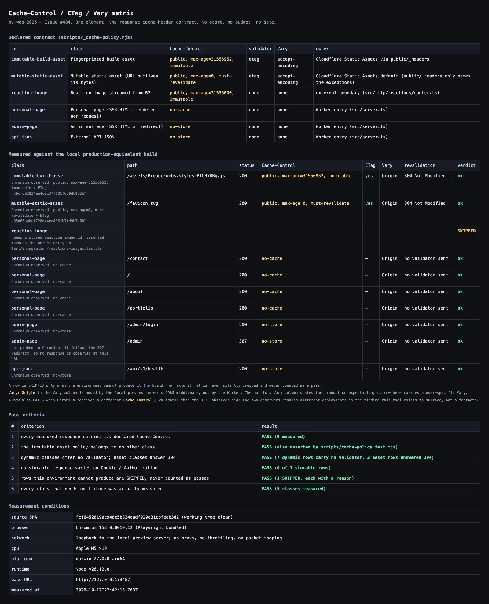

# Cache-Control / ETag / Vary 契約（Issue #484）

> 正となる参照先はこのファイルと [`scripts/_cache-policy.mjs`](../../../scripts/_cache-policy.mjs)（宣言された表）である。
> 実装は3箇所に分かれているが、**表は1つ**であり、その表に対して検査が走る。
>
> **スコープ。** 本Issueが扱うのは「レスポンスのキャッシュヘッダー契約」**1要素だけ**である。
> スコア・Lighthouse・Core Web Vitals 予算・release gate・ダッシュボードは
> 意図的に追加していない（#384 / #385 / #386 / #493 の領域）。
> 本Issueが gate を作っていないことは、このドキュメントと
> `quality/profile.yaml` のコメントの双方で表明している。

## 1. なぜ契約化したのか（何を直したか）

本Issueの直前、キャッシュ方針は4箇所で決定され、それらを束ねるものは存在しなかった。

| 決定者 | 対象 | 値 | 検証 |
| --- | --- | --- | --- |
| `public/_headers` | fingerprinted asset | `public, max-age=31556952, immutable` | 読み手のみ（#291 で実測つき） |
| `src/server.ts` | SSR HTML | `no-cache`、`/admin*` は `no-store` | `test/integration/html-cache-policy.test.ts` |
| `src/http/reactions/*` | R2 画像 | `public, max-age=31536000, immutable` | fixture 内のみ |
| （なし） | `/api/v1/*` の JSON | **方針なし** | なし |

問題は最後の行である。`/api/v1/reactions` は API key principal 単位の集計、
`/api/v1/access/hit` は毎回変わる live 値、`/api/v1/health` は liveness、
error envelope は要求パスを含む。いずれも per-user 応答である。
方針が無いことは「保存してよい」ことではなく、**ランタイム既定に委ねた**ことであり、
将来の edge cache ルールひとつで silent に裏返りうる。

参照したチェックリスト
（<https://zenn.dev/catnose99/articles/547cbf57e5ad28>）が明言するとおり、

- 「ユーザーによって内容が変わるレスポンスが CDN や KVS にキャッシュされていないこと」
- 「静的ファイルが CDN にキャッシュされていること」

の**両側**を、このリポジトリでは片側だけ実装し、暗黙の既定値に依存していた。

## 2. 宣言された行列

正となる表は [`scripts/_cache-policy.mjs`](../../../scripts/_cache-policy.mjs) の
`CACHE_POLICY_MATRIX`。以下はその抜粋であり、**この表が SoT** である
（このドキュメントを編集しても検査は変わらない。表を編集する）。

| id | クラス | 経路例 | `Cache-Control` | validator | `Vary` | 決定者 | 検査 |
| --- | --- | --- | --- | --- | --- | --- | --- |
| `immutable-build-asset` | fingerprinted ビルド資産 | `/assets/<name>-<hash>.js` | `public, max-age=31556952, immutable` | ETag（304） | `Accept-Encoding` のみ | Static Assets（`public/_headers`） | `scripts/cache-policy.test.mjs` |
| `mutable-static-asset` | URL が内容より長い静的資産 | `/share/**`, `/favicon.svg` | `public, max-age=0, must-revalidate`（プラットフォーム既定＝`_headers` に書かない） | ETag（304） | `Accept-Encoding` のみ | Static Assets 既定 | `scripts/cache-policy.test.mjs` |
| `reaction-image` | R2 からストリームするリアクション画像 | `/api/v1/reaction-images/:id` | `public, max-age=31536000, immutable` | なし | なし | 外部 boundary の handler | `test/integration/reactions-images.test.ts` |
| `personal-page` | 個人ページ（リクエストごとに描画） | `/`, `/about`, `/contact`, `/portfolio` | `no-cache` | なし | なし | Worker entry（`src/server.ts`） | `test/integration/cache-policy-matrix.test.ts` |
| `admin-page` | 管理画面（HTML / redirect） | `/admin*` | `no-store` | なし | なし | Worker entry（`src/server.ts`） | 同上 |
| `api-json` | 外部 API JSON | `/api/v1/health`, `/api/v1/*` | `no-store` | なし | なし | Worker entry（`src/server.ts`） | 同上 |

### 2.1 受け入れ条件1（immutable 資産と個人ページは明示的に異なる）

これは「コメント」ではなく**実行可能な不変条件**として固定した。
`separationViolations()` が1件でも返れば、asset 行と他のいずれかの行が
同じ `Cache-Control` を共有している、つまり**どちらかが間違っている**。

- 誤った方向A: 個人ページが `immutable` になる → 訪問者ごとに違う HTML
  （ヒットカウンタ桁、その訪問者自身のリアクション）が凍結される。
- 誤った方向B: asset が `no-cache` になる → 訪問のたびに chunk ごとに
  再検証のラウンドトリップが発生する（#291 が直した的就是ち）。

検査は静的側（`scripts/cache-policy.test.mjs`）と
Worker 実測側（`test/integration/cache-policy-matrix.test.ts`）の
**両方**から同じ不変条件を突く。片側だけの検査では、
もう片側のコード変更に気づけない。

### 2.2 「古い更新」の扱い

`Cache-Control` だけでは契約として不完全である。**条件付きリクエストにどう答えるか**、
つまり「古い更新」をどう扱うかが契約の半分である。

- validator を持つクラスは `If-None-Match` に **304** で答える（測定対象）。
- validator を持たないクラスは `If-None-Match` を送らない。
  Worker 生成 HTML に ETag を**意図的に付けない**理由は、
  訪問者ごとに異なる body に対して「まだ正しいですか」と訊く validator は
  比較するものが存在しないからである（#291 の `no-cache` 設計と整合する）。

### 2.3 `Vary` について

現状 `Vary` を送出するクラスはない。`Vary: Cookie` / `Vary: Authorization`
を含む応答が**共有キャッシュに保存可能**な場合、行列はそれを FAIL として扱う
（`evaluateObservation`）。per-user な body を保存させないという方針を、
`Vary` の宣言だけに依存させないためである。

## 3. 変更点（before / after）

| 対象 | before | after | 判定 |
| --- | --- | --- | --- |
| `/api/v1/*`（JSON。401 / 404 / 500 の envelope を含む） | `Cache-Control` 無し | `no-store`（`src/server.ts` の `applyExternalCachePolicy`） | **修正**。per-principal 応答が保存対象になりうる状態だった |
| `/api/v1/reaction-images/:id` | `public, max-age=31536000, immutable` | 同一（handler の宣言が既定に優先され、downgrade されない） | 維持。回帰テストを追加 |
| `/assets/*` | `public, max-age=31556952, immutable` | 同一（`_headers`） | 維持。行列との突合テストを追加 |
| `/share/**`, `/favicon.svg` | プラットフォーム既定（`max-age=0, must-revalidate`） | 同一（immutable にしないことを明示的に検査） | 維持。「immutable でない」ことが検査対象になった |
| SSR HTML / `/admin*` | `no-cache` / `no-store` | 同一 | 維持。行列の行との突合テストを追加 |

合格基準（すべて自動判定）:

1. 全行の `Cache-Control` が表の値と完全一致する（大小文字のみ無視）。
2. `separationViolations()` が空である。
3. immutable 資産以外に validator（ETag）を持たない動的クラスが存在しない。
4. 保存可能な（`public` かつ `max-age>0`）応答が user-specific な `Vary` を持たない。
5. 環境要因で生成できなかった行は **SKIPPED として明示**され、無言で pass に数えられない。

## 4. 再現条件の記録（ローカル / CI 共通）

測定結果に「どの条件でとったか」が無ければ再現できないため、
`scripts/cache-header-matrix.mjs` は**すべてのレポートに条件ブロックを同梱**する。
CI で走らせた場合も同じフィールドが出るので、ローカルと CI は同じ形式で比較できる。

| 条件 | フィールド | 値の出し方 |
| --- | --- | --- |
| source SHA | `sourceSha` / `workingTree` | 実行時の git HEAD（作業ツリーが dirty なら `dirty` と明記） |
| ブラウザ | `browser` | Playwright 同梱 Chromium（バージョン番号付き） |
| ネットワーク | `network` | ローカル preview への loopback。proxy なし・帯域制限なし・packet shaping なし |
| CPU | `cpu` | `os.cpus()` の model と core 数 |
| プラットフォーム / runtime | `platform` / `runtime` | OS release と arch、Node バージョン |
| 測定対象 | `baseUrl` | 例 `http://127.0.0.1:3000` |
| 時刻 | `measuredAt` | ISO-8601（UTC） |

**指標（スコア）は出ない。** 速度・転送量・TTFB をこのツールは測らない。
Lighthouse 導入は #384、release gate 化は #385、Web Vitals 予算は #386 の担当であり、
ここで先行させると「今回の1要素だけを直す」という受け入れ条件3に反する。

### 4.1 使い方

```bash
# 1) 本番同等のビルドを作る（Cloudflare Build Output）
pnpm run build:production

# 2) ローカル D1 を migrate + seed して preview を起動（Playwright と同じ bootstrap）
node scripts/e2e-local-bootstrap.mjs --port=3000

# 3) 測定（別ターミナル）
pnpm run cache:headers:measure -- --base-url=http://127.0.0.1:3000
pnpm run cache:headers:measure -- --base-url=http://127.0.0.1:3000 \
  --verify --screenshot=docs/verification/perf/cache-headers-matrix.webp
```

- 出力: `.tmp/cache-headers/{matrix.json,matrix.md,report.html}`（gitignored）。
- `--verify` は違反があれば exit 1。**既定では gate ではない**。
  `validate:*` から呼ばれておらず、意図的に人手／任意の計測用である。
- `--no-browser` で Chromium 起動を省略し、HTTP 観測のみにできる。

## 5. 実測レポート（本Issueで採取した1回）



- スクリーンショットは上記の `--screenshot` が生成した `report.html` を WebP 化したもの。
  リポジトリの画像規範に従い **PNG ではなく WebP** で commit した
  （Issue が要求する `docs/verification/perf/cache-headers-matrix.png` と同じ場所だが、
  拡張子のみ `.webp`。PNG を commit するとリポジトリが肥大するため）。
- 生の数値は上記コマンドで再現でき、`.tmp/cache-headers/matrix.md` に出力される。
- レポート内の `source SHA` は**画像を commit する直前の HEAD** を指す。
  スクリーンショット自身を commit すると SHA が変わるため、記録と画像の間に
  1 commit のずれがある（これは避けられない連鎖であり、その旨を明記する）。

### 5.1 測定できなかったもの（隠さない）

- `reaction-image` 行: R2 に実在する画像が無く probe 対象 URL を持たない。
  ルータ実測は D1/R2 fixture がある `test/integration/reactions-images.test.ts` で行う。
- `/` などの loader 依存ページはローカル D1 の seed 状態に依存するため、
  5xx になった行は **SKIPPED（理由つき）** として扱う。合格とは数えない。

## 6. `quality/profile.yaml` への影響

**gate の追加・変更はゼロ。** 意図的である。

| 観点 | 影響 |
| --- | --- |
| `gates.fast` / `gates.integration` / `gates.release` の component 一覧 | 変更なし |
| 追加された検査 | `node --test scripts/cache-policy.test.mjs` / `scripts/cache-header-matrix.test.mjs`（既存 `gates.fast` の `pnpm run test` に含まれるだけ） |
| 追加されたコマンド | `pnpm run cache:headers:measure`（**どの gate からも呼ばない**） |
| 新規の release gate / 必須 check | なし（#385 の領域） |
| 新規のスコア / artifact ダッシュボード | なし（#493 の領域） |

`change_risk_mapping` 側も変わらない。変更は `src/server.ts`（entrypoint）と
`public/_headers` 経由の静的資産であり、`entrypoint_change` は既に
`gate: integration` に分類される既存のままである。

## 7. 既知の制約・将来議題（owner 決定を要するもの）

1. **SSR HTML に ETag を付けない**のは現時点で意図的な選択である。
   body-hash ETag なら理論上は可能（body が違えば hash も違う）だが、
   Cloudflare の edge は Worker 応答を既定でキャッシュしないため、
   得られるのは再訪時の帯域節約だけで render コストは下がらない。
   304 応答による帯域削減量を実測で評価してから再検討する項目であり、
   本Issueでは「無い」ことを行列に固定するだけに留めた。
2. **`Vary: Accept-Encoding` を明示的に宣言すべきか**は未決。
   Cloudflare と preview は圧縮時に付与するが、本リポジトリは制御していない。
   宣言の追加は共有キャッシュのキー空間を変えるため、測定せずに追加しない。
3. **`cache:headers:measure` を CI に載せるか**は本Issueのスコープ外。
   載せると「gate と可視化の混同」に近づくため、#493 と併せて owner が判断する。