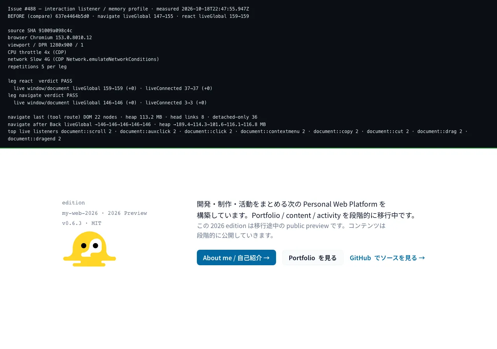

# 反復操作時の listener / memory プロファイル（Issue #488）



> **拡張子は Issue のチェックボックスが名指しした `.png` ではなく `.webp`。**
> Chromium の capture を PNG で持つと 1 枚数百 KB の blob が repository に
> 積み上がる。生成 script 側は幅 1600px / quality 80 / **300KB 上限を実際の
> コードで検査**しており（`screenshotBudgetVerdict` in
> `scripts/interaction-memory-profile.mjs`）、超過したら warning を出して
> 検査結果ごと `report.json` に残す。commit 済みの画像の実測は
> **1280x900 / 52 kB** で予算内。途中生成の PNG は commit していない。

このファイルは **「listener 増加が実際に何が起きているか」の正本**。
数値は `.tmp/interaction-memory-profile/{before,after}.json`（未 commit）に
machine-readable でも残る。

---

## 何を測るか / 何を測らないか

**測るもの**: 2 つの実際の利用者導線を繰り返したあとに、`window` /
`document` / **document に接続済みの要素**に**まだ付いている**イベント
listener の数、加えて DOM node 数と JS heap。

**測らないもの**: Lighthouse スコア、Core Web Vitals budget、そして
**pass/fail の gate**。threshold は #384（再現可能な Lighthouse コマンド）/
#385（release gate）/ #386（CWV budget）の所有物であり、本 Issue は
「計測 + 1 要素の修正」まで。計測・可視化・gate を混ぜることが #488 が
明示的に禁じている混同であり、本コマンドは `validate:*` のどこにも
**接続していない**（`quality/profile.yaml` への影響は 0）。

---

## listener 台帳の作り方（そして「台帳が完全である」ことの意味）

Chromium には「今 listener が何個付いているか」を取得的 API が無い。
`page.addInitScript` で `EventTarget.prototype.addEventListener` /
`removeEventListener` を**アプリコードより先に**差し替える方式を取る。

3 点すべてが判定の正しさを左右する。

1. **完全性**。`page.addInitScript` は document のどのアプリコードより
   先に走る。したがって登録の**漏れがない**。一定間隔の標本採取
   （polling）なら、その合間に登録と解除が完結した listener を見落とす。
2. **解除の同一性**。登録は `(target, type, callback, capture)` で照合する
   —— `removeEventListener` 自身と同一の同一性基準。したがってアプリが
   正しく外した listener を「残っている」と数えない。
3. **live の定義**。登録が live とカウントされるのは、その target が
   `window` / `document` / **いまも document に接続されている要素**の
   場合だけ。破棄済みノードに付いた listener は `detached` として別枠に
   集計する。破棄されたノードの listener はノードと一緒に GC される
   ので、通常の unmount を leak と呼ぶとこのレポートは毎回鳴る。

台帳自身が測定対象を歪めないための追加の 3 点。

- **target は強い参照で持たない**。台帳の各 entry は `WeakRef` で
  target を指す。`removeEventListener` を呼ばない通常の unmount では
  ノードが回収可能なまま残り、snapshot 時に deref できなくなった entry は
  `collected` として台帳から落とす。台帳がノードを掴んでしまうと、
  「切り離したノードはノードと一緒に回収される」という判定前提そのものが
  壊れる。
- **重複登録は 1 token に畳む**。ブラウザは同じ
  `(target, type, callback, capture)` の追加登録を無視するので、台帳も
  既存 token があるときは新しい token を作らない。呼び出しごとに token を
  足すと、1 回の `removeEventListener` で実体は消えても台帳には
  「実在しない listener」が残り、偽の増加になる。
- **自動解除も反映する**。`{once:true}` は発火時に wrapper が token を
  解放し、`AbortSignal` は `abort` で解放する。どちらも browser 内部で
  登録が消える経路なので、明示的な `removeEventListener` だけを見ていると
  `liveGlobal` が偽って増え続ける。

判定は `evaluateProfile` が全体の `status` を返す。両 leg が実測されて
初めて `PASS` で、どちらかが `skipped` なら **`INCOMPLETE`**（非 pass、
終了コードも 0 ではない）。計測中の `pageerror`、および「emoji を 1 回も
クリックできなかった反復」も FAIL として扱う。レンダー例外で listener が
平坦になっただけの run を成功証跡にしないためである。

判定に使うのは 2 クラスだけで、**両方が要る**。

| 指標 | 意味 | growth 判定 |
| --- | --- | --- |
| `liveGlobal` | `window` / `document` に付いた listener 数 | **0 を超える増加は FAIL** |
| `liveConnected` | 上記 + 接続済みの要素に付いた listener 数 | **0 を超える増加は FAIL** |

tolerance が 0 なのは、`window` / `document` の listener は「外す人が
いるまで」残るものだからである。「同じ導線をもう一度走らせても
何も tear down されていない」のはノイズではなく defect である。

**warm-up** は 1 反復分だけ除外する（`DEFAULT_WARMUP_CYCLES`）。最初の
1 回は emoji picker の chunk・初回 route のデータ・React の初回 event
delegation を確保する処理であり、その後は再実行されない。これを leak に
数えるのは誤検出、最後まで除外するのは遅く出る leak を隠すことになる。

---

## 2 本の導線

| leg | 何をするか | なぜこの導線か |
| --- | --- | --- |
| `react` | `/` で「リアクションを追加」→ `thumbs` を検索 → emoji を実クリック → ESC で閉じる、を N 回 | Issue #488 が名指しした Reactions 操作。中身は **出荷されている** `ReactionsWidget` + `emoji-picker-react`（fake ではなく本物）。 Optimistic chip の add/remove 両方が通る |
| `navigate` | `/tools` で Tool の `<Link>` を実クリック → `/tools/<slug>` → browser Back で `/tools` に戻る、を N 回 | Issue #488 が名指しした Tools 埋込 + ページ移動 |

**page 遷移が要るのは client-side だけ**。document 全体を再読み込みする
と listener も document もすべて破棄されるので、`page.goto` のループでは
絶対に listener の蓄積を測れない。`/tools` のリンクは
`src/routes/tools.index.tsx` の TanStack `<Link>` なので、クリックも
Back も client-side 遷移であり JavaScript 文脈・React tree・`document`
が生き残る。これは**仮定ではなく**、スナップショットの `added` が証言して
いる（document 全体の再読み込みなら 0 に戻るが、client-side 遷移をまたいでも
単調増加し続ける）。

---

## 再現条件（local / CI 共通）

条件は**計測のたびに JSON へ記録され**、数字だけの画像にはしない。
`--compare` で before を渡すと **before 側の条件と invocation も** 比較対象
に含まれ、browser / CPU throttle / network profile / viewport / DPR /
surface / repetitions のいずれかが食い違う場合は warning を出し、
レポートと画像パネルにも `COMPARE WARNING` として残す。条件が違う
before/after を同条件の証跡として描画しないためである。

`--base-url` は既定で **loopback origin（`localhost` / `127.0.0.0/8` /
`[::1]`）だけ**を受け付ける。このコマンドは実際に emoji をクリックし
route 遷移を行うので、`https://rebuildup.dev` のような共有・本番 origin を
渡せてしまうと計測がデータを変更し得る。非 loopback を測る場合は
`--allow-remote` を明示し、その場合 `report.json` の
`productionTouched` は `false` ではなく `null`（不明）になる。

| 条件 | 値 |
| --- | --- |
| browser | Chromium 153.0.8010.12（Playwright `^1.63.0`）、headless、`--enable-precise-memory-info` |
| viewport | 1280x900 / deviceScaleFactor 1 |
| network | CDP `Network.emulateNetworkConditions` = Slow 4G（150 ms RTT / 1638 kbps down / 750 kbps up） |
| CPU | CDP `Emulation.setCPUThrottlingRate` = **×4**（#384–#387 との比較可能性のため固定） |
| surface | **`pnpm run build` の出力**（dev server ではない）を `vite preview` で配信 |
| 本番 | **一切触らない**。local D1 のみ、deploy なし、secret の読み出し・表示なし |
| host | macOS（darwin arm64 27.0.0）、Node v26.12.0 |
| source（after / 本スナップショット） | branch `488`, commit `91009a0`, clean tree |
| source（before / `--compare` 入力） | branch `488`, commit `637e446`, **dirty tree** |
| repetitions | 5 per leg |

**before capture が dirty なのは「修正前の build を測る」という行為そのもの**。
`src/routes/__root.tsx` の旧 content を復元して build した状態であり、
その復元手順は下「修正の再現手順」に書いている。after capture は clean な
commit で撮っているので、このスナップショットが名指しする SHA を検証できる。

---

## before / after の実測値

判定基準（**この Issue の Informational なもので gate ではない**）:
各 leg の warm-up を超える区間で `liveGlobal` と `liveConnected` の
増加が **0**。

> **取得 commit に関する留保**: 下の数値と画像は台帳の安全性修正
> （`WeakRef` 化 / 重複畳み込み / `once` と `AbortSignal` の解放 =
> `239ff6c8`）の**前**に撮った commit `91009a0` のものです。その修正は
> 偽陽性除去と failure 条件の追加に限られ、実 leak を隠す方向には作用
> しません。ただし「listener 台帳の作り方」節が説明しているのは**修正後**
> の台帳である点については、下の表を読むときに区別する必要がある、という
> 留保をここで明記しておく。

### `navigate`（`/tools` ⇄ `/tools/<slug>` を 5 往復）

| 反復 | 0（読み込み直後） | 1 | 2 | 3 | 4 | 5 |
| --- | --- | --- | --- | --- | --- | --- |
| **before** `liveGlobal` | 146 | 147 | 149 | 151 | 153 | **155** |
| **after** `liveGlobal` | 146 | 146 | 146 | 146 | 146 | **146** |
| before / after `liveConnected` | 0 / 0 | 3 / 3 | 3 / 3 | 3 / 3 | 3 / 3 | 3 / 3 |
| verdict | — | — | — | — | — | **FAIL → PASS** |

1 往復は client-side 遷移を **2 回**（Tools 索引 → Tool route → Back）、
したがって before の +2/往復 は **route 遷移 1 回あたり +1** の
単調増加で、次の往復でも止まらない。判定は
`navigate: liveGlobal grew by 8 across 4 settled repetition(s)
(147 -> 155, 2/repetition)` と出た。

**何が残っていたか**（before、5 往復後の tool route における内訳）:

```
document::DOMContentLoaded   9     ← これが全部
document::scroll             2
document::click              2
document::auxclick           2
（以降 React の event delegation が全 type に 2 つずつ / window::popstate 1 / …）
```

after では **`DOMContentLoaded` という key 自体が台帳に存在しない**
（0 件、その他はすべて同一）。

### `react`（`/` の picker 操作を 5 回）

| 反復 | 0 | 1 | 2 | 3 | 4 | 5 |
| --- | --- | --- | --- | --- | --- | --- |
| before `liveGlobal` | 146 | 159 | 159 | 159 | 159 | 159 |
| after `liveGlobal` | 146 | 159 | 159 | 159 | 159 | 159 |
| `liveConnected` | 37 | 37 | 37 | 37 | 37 | 37 |
| verdict | PASS | | | | | **PASS** |

**両 capture とも PASS**。1 回目の +13 は warm-up（picker chunk と
emoji 一覧の mount）で、その後は完全に一定。つまり
**Reactions 操作そのものは leak の原因ではない**。 chip 数は
`1 → 0 → 1 → 0 → 1` と往復しており、optimistic toggle の add/remove
両方が実際に通っている（=「何もクリックしていない」ではない）。

### DOM node 数・heap

| 項目 | before | after |
| --- | --- | --- |
| `navigate` DOM nodes（tool route） | 126 → 22 ×5 | 126 → 22 ×5 |
| `react` DOM nodes | 299 → 308 / 306 / 308 / 306 / 308 | 同左 |
| head `<link>` 数 | 9 → 8 ×5 | 9 → 8 ×5 |
| `navigate` heap（tool route、MB） | 203.5 / 228.2 / 205.7 / 218.6 / 230.6 / 114.4 | 209.9 / 234.7 / 109.5 / 130.5 / 111.9 / 113.2 |
| `react` heap（MB） | 161.5 / 161.6 / 190.6 / 215.3 / 239.5 / 139.2 | 161.6 / 162.5 / 193.0 / 219.3 / 244.7 / 145.1 |

DOM node 数・head `<link>` 数は before / after で完全に一致している。
この Issue が直したのは **listener の累計だけ**であり、DOM の増減には
一切触れていない。heap は GC の鋸波（sawtooth）で**傾向がない**
（before の最終 round trip は 114.4 MB、after は 113.2 MB。5 往復して
倍増も発散もしていない）— before と after が違うのは台帳の
`liveGlobal` だけであり、memory そのものには leak の兆しがない。

---

## 修正は 1 要素

`src/routes/__root.tsx` の `head().scripts[0]`、**Issue #291 の
non-blocking webfont flip スクリプト 1 つだけ**。

### なぜこれが毎 route 遷移で実行されるのか

TanStack Router は root の head を**全 route match にマージ**する。
したがって client-side 遷移のたびに

- `media="print"` の `<link rel="stylesheet">` が**作り直され**
- その inline `<script>` も作り直され、ブラウザが**その場で本文を再実行する**

### なぜそれが listener を 1 個ずつ残したのか

旧版は最後が

```js
if (!f()) document.addEventListener("DOMContentLoaded", f)
```

だった。`f()` は `link[rel="stylesheet"][media="print"]` を探すが、
遷移直後は「**pending な** print link」が無いので `false` を返す。
document はとっくに load 済みで **`DOMContentLoaded` は二度と発火しない**。
したがってこの listener は
**永久に発火しないまま `document` に居座る** —— しかも遷移ごとに 1 個。

### 修正後の契約

「いま document にある print-media stylesheet を flip する」は変えて
いない。変えたのは**際限のない側**だけ:

1. `DOMContentLoaded` fallback は `document.readyState === "loading"` の
   とき**だけ**登録する（待っているイベントが発火しうる状態だけ）。
2. document が interactive になった後に link がまだ DOM に無い場合は
   **有界な rAF ポーリング**（60 フレーム ≒ 1 秒）で解決する。listener を
   増やさず，自己終了する。
3. `<link>` ごとの `load` 束縛は `{once:true}` + expando ガードで，
   同じ要素に対して再実行されても listener が積まれない。

### 修正の再現手順

```sh
# 前提: local D1 の migration が未適用だと `/` が 500 で preview が
# ready にならない。preview が `.tmp/d1state` を bind したあとに
# migrate すると設定上で読めなくなる（`scripts/e2e-local-bootstrap.mjs`
# の docstring と同じ順序）ので、初回は先に適用する。
pnpm run db:migrate:apply:local

git show 637e446:src/routes/__root.tsx > src/routes/__root.tsx
pnpm run build
pnpm run perf:interaction:memory -- --cycles=5 \
  --json-out=.tmp/interaction-memory-profile/before.json --no-screenshot

git restore src/routes/__root.tsx
pnpm run build
pnpm run perf:interaction:memory -- --cycles=5 \
  --json-out=.tmp/interaction-memory-profile/after.json \
  --compare=.tmp/interaction-memory-profile/before.json \
  --screenshot=docs/verification/perf/interaction-memory-profile.webp
```

before capture を撮る間は `src/routes/__root.tsx` が dirty になるため、
`report.json` は `workingTreeDirty: true` を記録する（= 修正前の build を
測ったということ）。after capture は clean な commit で撮っているので、この
スナップショットが名指しする SHA を検証できる。

---

## `quality/profile.yaml` への影響

**変更なし（意図的に変更なし）。**

| profile surface | 効果 |
| --- | --- |
| `gates.fast` / `gates.integration` / `gates.release` | 変更なし — どの `validate:*` にも測定 step を追加していない |
| `ci.jobs` / `ci.required_checks` | 変更なし — workflow 変更・required check 追加なし |
| `change_risk_mapping` | 変更なし — 触るのは `src/routes/__root.tsx`（`src_unit`）+ script で、既存 profile で `fast` に写っている |
| `coverage_policy` | 変更なし — coverage データは取っていない |

`perf:interaction:memory` は `layout-audit-shoot` と同じ系統の手動
成果物生成コマンドである。gate にすると、分散のある browser 計測が
release の Builds を赤くすることになる。しかも #386 が budget を決める前の
段階で threshold 決定を先取りすることになり、**その順序こそが #486 /
#487 が守ってきた分割**だから、本 Issue もそれに従う。

`validate:fast` に入るのは **browser を起動しない契約テスト**
（`scripts/interaction-memory-profile.test.mjs`、40 tests）のみで、
測定そのものは走らない。これは gate ではなく、「将来 gate にしたときに
この判定が壊れない」ことを固定するための契約である。内訳は 2 層で、

1. 判定ロジックの純関数（`evaluateProfile` / `describeGrowth` /
   `parseArgs` / loopback 制限など）。
2. **注入スクリプト（台帳）そのものを stub DOM 上で実行する振る舞い
   テスト**。重複登録の畳み込み / `removeEventListener` / `once` /
   `AbortSignal` / detached 判定を、源の文字列への正規表現ではなく
   実行結果で確かめる。

この 2 層目があるため、台帳の判定を「ソースの一部の文字列」に依存していない。

また、本 Issue の **修正対象そのもの**（`src/routes/__root.tsx` の inline
script）には別の決定的な契約がある。`scripts/seo-head-contract.mjs` の
`evaluateFlipScriptContract` が SSR が出す `<head>` の inline script を評価し、
`test/integration/seo-head.test.ts` が REAL Worker を通して `/` と `/about` に
対して検証する（readyState ガード / `once` / 有界な rAF。修正前の形状は
同じチェックで必ず検出される）。Inline script は route 遷移ごとに作り直されて
再実行されるため、測定とは独立に修正の形状を固定する契約がもう 1 層ある。

---

## CI での再現

**配線していない、意図的**。理由は 3 つ。

1. `pnpm run e2e` は `main` / `release-*` push と `ui-change` label 付き
   PR だけで走る。`ui-change` の付け忘れで無言で測定されない。
2. CI runner は `.dev.vars` が無く、**`react` leg は SKIPPED になり、
   全体 verdict は `INCOMPLETE`（非 pass）になる**
   （`scripts/interaction-memory-profile.mjs` は理由も書く。緑に見せかけない）。
   CI で回すなら `.dev.vars` を通す job 側の準備が必要になる。
3. この Issue の gate 化は **#385（release gate）の owner decision**。
   本 Issue は threshold を「ある数値を提示した」だけであり、
   「その数値が赤くなる CI step を新設すべきだ」とは主張していない。

CI で**同じ判定を再現したい**場合の条件は上の表のとおり（browser /
viewport / network / CPU / surface / source SHA すべて JSON に入る）。
headless Chromium は同一 build、CPU throttle と network profile は CDP で
明示指定しているので、runner が Linux でも macOS でも listener 数その
ものは再現する。

---

## 既知の制約

- `detached` は判定に**入れていない**。実測値は before / after とも
  0 → 9 → 18 → 27 → 36（1 往復あたり +9）。これは route 遷移ごとに
  作り直される stylesheet `<link>` ノードに付いた `load` / `error` で、
  そのノードは document から外れるので**ノードと一緒に回収される**。
  「破棄済みノードへの listener」を leak と数えると通常の unmount でも
  レポートが鳴るため、別の枠で報告するだけにしている。ただし
  「**ノードが回収されずに保持される**」型の regression（ノードを
  クロージャで掴んだままにする等）は、この指標では検出できず heap の
  trend としてしか出ない。**今回の heap は両 capture とも trend 無し。**
- 1 run であり、分布ではない。listener count は決定的な量（同じ build で
  同じ導線なら同じ数）だが、heap は GC タイミングに依るため傾向だけを
  読む。
- viewport は desktop のみ。mobile matrix は #386 の領域。
- `react` leg は upstream の API key が local に無いため、chip の
  optimistic 状態は add/remove するが出力 aggregate は常に空。**測って
  いるのは picker の mount/unmount と chip の再描画であって、upstream
  round-trip ではない。**
- 計測は **`pnpm run build` の preview 出力**に対して行った。dev SSR
  document（桁画像が独立リクエストになる等の差）は測っていない。
- `.tmp/` は gitignored。ここに書かれるのは未 commit の再生成用
  データだけ。

---

## 未決の owner decision（本 PR では決めない）

1. **この測定を gate にするか**。Issue #385 の領域。threshold は
   「warm-up を超える区間で listener 増加 0」という形で既に
   決まっているので、決めるべきなのは「どの CI step で、どのトリガーで
   走らせるか」。本 PR はそこに触れていない。
2. **client-side 遷移で head の `<link>` / `<script>` が作り直される
   こと自体**。本 Issue が直したのは「作り直されたときに listener を
   残さない」側だけで、**作り直しが起きている**ことには手を入れていない。
   `headLinks` が 9 → 8 → 8 … で一定であることから、少なくとも
   head 内の `<link>` は route 単位で増減して収束しているように見える
   が、これは `headLinks` の 1 回の観測であり、累積の主張ではない。
   TanStack Router の head merge 方針（ADR ではなくフレームワーク側の
   挙動）に踏み込む判断は別 ticket 領域。
3. **DOM node 数の記録**。今回は before / after 同一で増減なしだったため
   上限を置いていない。#490 の per-card node ceiling のような
   「増えたら，それは defect」という閾値を持つべきかどうかは、測定の
   分散を見たうえでの別判断。