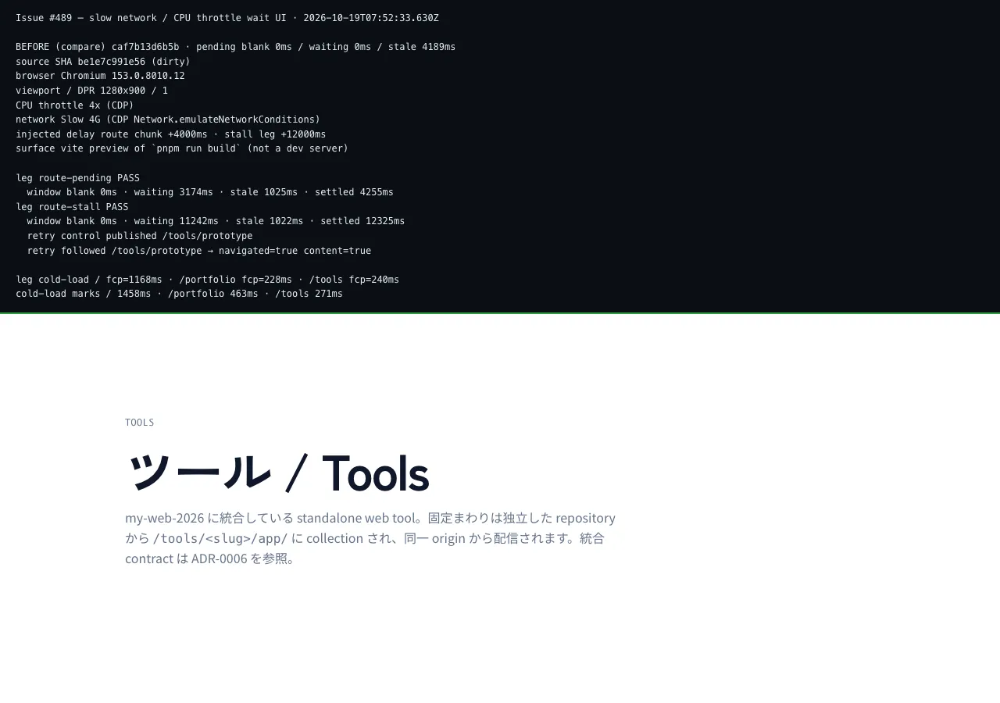

# 低速回線・CPU 制限で待機 UI が成立するかの測定（Issue #489）



> **拡張子は Issue のチェックボックスが名指しした `.png` ではなく `.webp`。**
> Chromium の capture を PNG で持つと 1 枚数百 KB の blob が repository に
> 積み上がる。生成 script 側は幅 1600px / quality 80 / **300KB 上限を実際の
> コードで検査**しており（`screenshotBudgetVerdict` in
> `scripts/slow-network-wait-ui.mjs`）、超過したら warning を出して検査結果ごと
> `report.json` に残す。commit 済みの画像の実測は **1280x900 / 41 kB** で予算内。
> 途中生成の PNG は commit していない。

このファイルは **「低速回線でリクエストを待たされている訪問者が何を見るか」の
正本**。数値は `.tmp/slow-network-wait-ui/{before,after}.json`（未 commit）に
machine-readable でも残る。

---

## 何を測るか / 何を測らないか

**測るもの**: Slow 4G（CDP `Network.emulateNetworkConditions`: RTT 150ms /
down 1600kbps / up 750kbps）と CPU 4x throttle（CDP
`Emulation.setCPUThrottlingRate`）の下で、**リクエストが未着のあいだ訪問者に
何を見せられるか**。3 本の導線。

| leg | 何をするか | 測る問い |
| --- | --- | --- |
| `route-pending` | `/tools` からツール詳細 route への **client-side 遷移**を 3 回（route chunk の応答を +4000ms 遅延） | 待機中の outlet は blank / stale / waiting のどれだったか |
| `route-stall` | 同じ client-side 遷移を +12000ms stall | 長い待ちのあいだも情報と再試行 control があり、その control を**実際に踏むと**ページが届くか |
| `cold-load` | `/` `/portfolio` `/tools` の cold document load | 初回表示で paint が起き、route 自身の marker まで届くか |

**測らないもの**: Lighthouse スコア、Core Web Vitals budget、そして **pass/fail
の gate**。threshold の所有者は #384（再現可能な Lighthouse コマンド）/ #385
（release gate）/ #386（CWV budget）であり、本 Issue は「計測 + 1 要素の修正」
まで。計測・可視化・ゲートを混ぜることが #489 が明示的に禁じている混同であり、
本コマンドは `validate:*` のどこにも **接続していない**
（`quality/profile.yaml` への影響は 0、下段参照）。

---

## 判定基準（3 つ。それぞれ単独で FAIL になりうる）

| ID | 基準 | 測る値 |
| --- | --- | --- |
| C1 | 待機中に outlet が **blank**（何も描かれていない）になってはいけない | `blankMs === 0` |
| C2 | 待ちが閾値をすぎた時点から、**情報を持つ面**が出なければならない | `uninformedAfterThresholdMs <= SAMPLE_INTERVAL_MS`（100ms） |
| C3 | 遷移は結局 settle する。settle しない待ちは「遅いだけ」ではない | `settled === true` |

判定に使う閾値 **`FEEDBACK_AFTER_MS = 1000ms` は dashboard で決めた数字では
ない**。TanStack Router 自身の `defaultPendingMs`（= pending lane を出すまでの
既定時間）であり、「フレームワークが『待ち』を表示すると決めた時点まで何も
出さない」ことを検出しているだけ。**1000ms をすぎた待機を情報なしで放置する
ことが、「遅い」と「壊れている」を訪問者に区別不能にする**から。

`content`（前のページのまま URL だけが変わった状態）は blank ではないが、
**C2 の失敗**になる。Slow 4G の下で前ページが URL だけ差し替わったまま
待たされるのは、**クリックが無反応に映った**のと同じ体験だから。

C2 の許容値は **1 サンプル間隔（`SAMPLE_INTERVAL_MS = 100ms`）**。outlet は
100ms ごとの採取なので、1001ms に現れた面が最初に記録されるのは次のサンプル
であり、`=== 0` を要求すると同じコードでも run ごとに PASS / FAIL が入れ替わる
（実測: 同条件で面の出現が 1025ms の回と 1031ms の回があった）。これは gate の
緩和ではなく**観測分解能の明示**で、report は実測 ms をそのまま残し、1 間隔を
超えて遅れた面は今も FAIL になる（`FEEDBACK_TOLERANCE_MS`）。

判定ロジックは純関数（`classifySample` / `describeWaitWindow` /
`evaluateWaitWindow` / `evaluateRetryOutcome` / `evaluateColdLoad`）で、
browser を起動せずに `scripts/slow-network-wait-ui.test.mjs`（49 tests、
`validate:fast` に入っている）が固定している。test 側は PASS が出やすい系列を
ではなく、**修正前の実測 series（待ちの全区間が `content` / settle しない）が
必ず FAIL になること**を固定している。

---

## 待機中の分類（100ms ごとに採取）

各サンプルは 4 状態のどれか 1 つに分類される。

| 分類 | 意味 |
| --- | --- |
| `settled` | 遷移先 route の marker が出現（= 待ちは終了） |
| `waiting` | 待機面（`[data-testid="waiting-state"]` / `[role="status"]`）が表示中で可視・テキストあり |
| `content` | 何か描画されているが遷移先ではない（前ページが URL だけ差し替わった状態） |
| `blank` | outlet に可視コンテンツが無い |

各サンプルは **その後続区間** を計上する（状態が変わったのは区間の開始点）。
「待ちが 1000ms をすぎたあとに `content` / `blank` だった時間」が
`uninformedAfterThresholdMs`。marker が出たら計測は終わる。

### route marker（settled の判定基準）

marker は「その route の内容が document に入ったときだけ存在する selector」。
**URL ではない**。client-side 遷移は遷移開始の瞬間に URL が確定するため、
URL で見ると「待ちが無い」と判定してしまう。

| route | marker |
| --- | --- |
| `/tools` | `#app-root h1`（index の見出し。詳細 route には `h1` がない） |
| `/tools/prototype` | `iframe[src*="/tools/prototype/app/"]` |
| `/tools/readmark` | `iframe[src*="/tools/readmark/app/"]` |

---

## client-side 遷移を測れるのは 1 本だけ

本プラットフォームのサイト内遷移の多くは **素の `<a>`** である
（`src/editorial/nav/PublicNav.tsx` のホーム / Portfolio / …）。それは
document 全体の再読み込みなので、**待機 UI の問題にならない**。
TanStack `<Link>` による **client-side 遷移**があるのは `/tools` のツール
カードと Breadcrumbs だけで、`route-pending` / `route-stall` はその実在する
client-side 導線を測っている。

そのため「低速回線でも blank になりうる導線」の測定範囲が限られるのは、
**欠点ではなく記録**である（既知の制約にも列挙した）。

---

## 再現条件（local / CI 共通）

条件は **計測のたびに JSON へ記録され**、数字だけの画像にはしない。`--compare`
で before を渡すと **before 側の条件も**比較対象に入り、browser / CPU throttle /
network profile / viewport / DPR / surface / cycles / **注入 delay / stall** の
いずれかが食い違う場合は warning を出し、レポートと画像パネルにも
`COMPARE WARNING` として残る。本 Issue の before / after はこの比較で
`comparable: true`。

| 条件 | 値 |
| --- | --- |
| browser | Chromium 153.0.8010.12（`@playwright/test` 1.63.0 同梱の headless） |
| network | Slow 4G — RTT 150ms / down 1600kbps / up 750kbps（CDP `Network.emulateNetworkConditions`） |
| CPU | 4x throttle（CDP `Emulation.setCPUThrottlingRate`） |
| viewport / DPR | 1280x900 / 1 |
| surface | `pnpm run build` 出力の `vite preview`（dev サーバーではない） |
| データ | ローカル D1（`applyMigrations --target=local` + portfolio skeleton seed。Playwright の `scripts/e2e-local-bootstrap.mjs` と同じ手順） |
| 注入 delay | route chunk +4000ms（`route-pending`）/ +12000ms（`route-stall`） |
| source SHA | before: `caf7b13d`（修正前 build）/ after: `31256ea8`（修正込み build、`workingTreeDirty: false`）。どちらも `report.json#environment.sourceSha` に記録 |
| 実行 | `pnpm run perf:wait:ui -- --cycles=3` |

**注入 delay は実測ではない。** loopback preview では実待ちが数十 ms しかなく、
そのまま測ると report が実際の worst case より良く見えてしまう。そのため
route chunk の応答を明示的に遅らせ、**遅らせたミリ秒そのものを report に
記録している**。

各 cycle は **新しい document から** 始める。同一 SPA セッション内では route
module が JavaScript の module registry に入っているため最初の 1 回しか
download が起きず、2 回目以降は 40ms 程度で settle してしまう（測っても
何も測れない）。Playwright の routing は HTTP cache を無効化するので、再読み込み
した document は chunk を実際に再取得する。

---

## before / after の実測値

**同一条件**（上表）での実測。判定はすべて script が出力した値。

### `route-pending`（`/tools` → ツール詳細、chunk +4000ms）

| cycle | 遷移先 | blank | **情報（waiting）** | **stale（前ページのまま）** | settled | 判定 |
| --- | --- | --- | --- | --- | --- | --- |
| before 1 | `/tools/prototype` | 0ms | **0ms** | **4189ms** | 4254ms | FAIL |
| before 2 | `/tools/readmark` | 0ms | **0ms** | **4183ms** | 4202ms | FAIL |
| before 3 | `/tools/prototype` | 0ms | **0ms** | **4173ms** | 4190ms | FAIL |
| after 1 | `/tools/prototype` | 0ms | **3188ms** | **1021ms** | 4273ms | PASS |
| after 2 | `/tools/readmark` | 0ms | **3165ms** | **1024ms** | 4207ms | PASS |
| after 3 | `/tools/prototype` | 0ms | **3166ms** | **1027ms** | 4220ms | PASS |

### `route-stall`（chunk +12000ms）

| | blank | **情報（waiting）** | **stale** | settled | 判定 |
| --- | --- | --- | --- | --- | --- |
| before | 0ms | **0ms** | **12223ms** | 12279ms | FAIL |
| after | 0ms | **11162ms** | **1020ms** | 12225ms | PASS |

### 再試行 control（待機中に publish されるか、実際に踏むか）

| | publish された href | 踏んだ結果 | 判定 |
| --- | --- | --- | --- |
| before | **publish されない** | — | FAIL |
| after | `/tools/prototype` | **新しい document が 1 件立った**（sessionStorage の `documentId` が増加）→ destination の content が描画 | PASS |

「document が立ったか」は **URL ではなく document identity** で判定している。
router は待機面を出す **前** に遷移先 location を確定済みなので、URL だけ見
ると「再試行が効いた」と「もともとこの URL だった」を区別できない。

### `cold-load`（代表 3 route、cold document load）

| route | status | TTFB（responseStart） | FCP | marker 到達 | 判定 |
| --- | --- | --- | --- | --- | --- |
| `/` | 200 | 33ms | 1164ms | 1460ms | PASS |
| `/portfolio` | 200 | 9ms | 248ms | 482ms | PASS |
| `/tools` | 200 | 4ms | 224ms | 280ms | PASS |

**修正前後で cold-load の数値は変わらない。** 今回直したのは client-side 遷移の
**待ち**であり、SSR document の初回表示ではない。待機面は client-side 専用
（`Match.tsx` は server 側では pending を描かない）。

`/` の FCP が他 route より大きいのは、3 つのうち `/` だけがローカル D1 を
読むため。**本番を壊さずに代表ページで測る**という受け入れ条件どおり、
local D1 / loopback のみで完結している。

---

## 修正は 1 要素

**`getRouter()` に `defaultPendingComponent` を 1 つ足しただけ**。

```
src/router.tsx           defaultPendingComponent: RoutePendingState
src/editorial/waiting/   RoutePendingState.tsx（router 側の束縛）
                         WaitingState.tsx（面本体 + copy 契約）
                         index.ts
                         waiting-state.test.tsx（SSR markup 契約 7 tests）
```

### なぜこれが効いていたのか

`@tanstack/react-router` の `Match.tsx` は pending match を

```js
const PendingComponent = route?.options.pendingComponent ?? router.options.defaultPendingComponent;
if (!PendingComponent) return null;
```

で描画する。**どちらにも未設定なら `null`**。修正前は
`defaultPendingComponent` が無く、`@tanstack/router-core` の `offerPending` も
「pending component が無いので lane を差し替えない」と判断するため、結果として
**前のページが URL だけ差し替わったまま**待ち続けた（本 Issue の測定が
`content` を記録した状態そのもの）。

### 修正後の契約

- **1 秒（`defaultPendingMs`）までは前ページのまま**。実測でも 1021ms /
  1024ms / 1027ms と出ており、前ページの离去によるちらつきは起きていない。
- 1 秒をすぎたら **`RoutePendingState`** が pending lane を描画する。
  表示メッセージは `読み込み中 / Loading` + `ページを読み込んでいます /
  Loading this page` + 状況の説明（日英）。
- **再試行 control** は常時 publish され、素の `<a href>`（クリックハンドラ
  なし）。href は router state の `pathname + searchStr` なので
  `/portfolio?facets=develop` でもクエリを落とさない。
- `<output>`（implied role `status`）で polite に announce、外側に
  `aria-busy="true"`。
- **進捗率・経過秒・再試行回数は出さない**（プラットフォームが持っていない
  数字を出さないため）。copy 契約として test で固定している。
- **motion はゼロ**。`src/editorial/waiting/waiting-state.test.tsx` が
  Panda の atomic class 略号（`trs_…` / `anim_…`）と component 定義の
  どちらにも `animation` / `transition` / `@keyframes` が無いことを assert
  しており、`a11y:reduced-motion:check`（`validate:fast`）の管轄を広げない。
- 見出し要素（`<h1>` / `<h2>`）は出さない。待機面は「ページ」ではなく
  「まだ描いてないページについてのメッセージ」であり、遷移先が自分の見出しを
  持ってくるため。
- `defaultPendingComponent` は **router 全体**に効くため、同じ route の
  revalidation が遅い場合（例: `/portfolio?facets=…` の search 更新）にも
  **すでに描画済みの内容**が `defaultPendingMs` 後に待機面へ置き換わる。
  現在の client-side `<Link>` 導線は `/tools` だけで、このケースは 3 leg の
  測定対象外（未決 decision #3）。同じ route の再取得だけ前ページを残したい
  場合は `route.options.pendingComponent` の per-route 上書きが次の分界に
  なるが、その判断は本 Issue では行っていない。

### 修正の再現手順

```bash
# 1) build（測定は preview 出力に対して行う）
pnpm run build

# 2) 測定（ローカル D1 を自動 prepare して preview を起動する）
pnpm run perf:wait:ui -- --cycles=3

# 3) before と並べて読む
pnpm run perf:wait:ui -- --cycles=3 --compare=.tmp/slow-network-wait-ui/before.json
```

出力例（after）:

```
route-pending blank 0ms · waiting 3188ms · stale 1021ms · settled 4273ms → PASS
route-stall   blank 0ms · waiting 11162ms · stale 1020ms · settled 12225ms → PASS
cold-load /         fcp  1164ms · marker  1460ms → PASS
retry          /tools/prototype → navigated=true content=true → PASS
verdict        PASS
```

---

## `quality/profile.yaml` への影響

**変更なし（意図的に変更なし）。**

| profile surface | 効果 |
| --- | --- |
| `gates.fast` / `gates.integration` / `gates.release` | 変更なし — どの `validate:*` にも測定 step を追加していない |
| `ci.jobs` / `ci.required_checks` | 変更なし — workflow 変更・required check 追加なし |
| `change_risk_mapping` | 変更なし — 触るのは `src/router.tsx`（`src_unit`）+ `src/editorial/**` + scripts で、既存 profile で `fast` に写っている |
| `coverage_policy` | 変更なし — coverage データは取っていない |

`perf:wait:ui` は `perf:interaction:memory` と同じ系統の手動成果物生成
コマンドである。gate にすると、分散のある browser 計測が release の Builds を
赤くすることになる。しかも #386 が budget を決める前の段階で threshold 決定を
先取りすることになり、**その順序こそが #485〜#490 が守ってきた分割**だから、
本 Issue もそれに従う。

`validate:fast` に入るのは **browser を起動しない契約テスト**
（`scripts/slow-network-wait-ui.test.mjs` 49 tests）と **SSR markup 契約**
（`src/editorial/waiting/waiting-state.test.tsx` 7 tests）のみ。測定そのもの
は走らない。

---

## CI での再現

**配線していない、意図的**。理由は 3 つ。

1. `pnpm run e2e` は `main` / `release-*` push と `ui-change` label 付き PR
   だけで走る。label の付け忘れで無言で測定されない。
2. CI runner では network / CPU throttle 自体は同じ CDP 呼び出しで再現できる
   が、**headless Chromium のバージョン**がローカルと異なり、hydration 完了
   までの絶対時間が変わる。before / after を **比較可能** にするには
   「同一 build・同一 browser」の比較が必要なので、CI を before 側に使わない。
3. この測定の gate 化は **#385（release gate）の owner decision**。本 Issue は
   「1 要素を足して実測値を提示した」だけで、「その数値が赤くなる CI step を
   新設すべきだ」とは主張していない。

CI で **同じ判定を再現したい** 場合の条件は上表のとおり（browser / viewport /
network / CPU / surface / 注入 delay / source SHA がすべて JSON に入る）。
ただし runner の pixel / JS 性能が違うため、**C1 / C2 / C3 の真偽**は移植性
があるが、`settled` などの絶対値は移植しない。

---

## 既知の制約

- **注入 delay による測定**である。実ネットワークの待機時間をそのまま測って
  いるわけではない。実 worst case をこれより良く見せる意図はないが、逆に
  「実リンクでもこれ以下の空白は起きない」という主張もできない。
- client-side 遷移を測定できるのは `/tools` の index → 詳細だけ
  （`PublicNav` 経由は document 遷移で、blank 問題にならない）。
- 1 run であり、分布ではない。ただし待ち時間を構成するのは injected delay
  （決定的な値）なので、**blank / waiting / stale の内訳は run ごとに安定**して
  出る（本次は cycle 間で ±20ms）。
- **client-side の待ちの上限（タイムアウト）は入れていない**。入れるか否かは
  owner decision であり、本 Issue が担当するのは「待たされている人を情報なし
  で放置しない」ことだけ。上限を入れる場合は「遅いが正常な request を
  捨てる」副作用と、`src/editorial/error-states/` 側の 503 surface との責務
  分界を決める必要がある。
- viewport は desktop のみ。mobile matrix は #386 の領域。
- 計測は **`pnpm run build` の preview 出力**に対して行った。dev SSR document
  との差（画像が独立リクエストになる等）は測っていない。
- `.tmp/` は gitignored。ここに書かれるのは未 commit の再生成用データだけ。

---

## 未決の owner decision（本 PR では決めない）

1. **この測定を gate にするか**。Issue #385 の領域。判定（C1 blank ゼロ /
   C2 閾値超過後は情報あり / C3 settle する / 再試行 control が document を
   届ける）は script 内で確定済みなので、決めるべきなのは「どの CI step で、
   どのトリガーで走らせるか」。本 PR はそこに触れていない。
2. **client-side 待ちの上限（タイムアウト）**。上のとおり owner decision。
3. **`/tools` 以外の client-side 遷移を増やすか**。現状 `PublicNav` は素の
   `<a>` なので、`/portfolio` の facet フィルタなど D1 を読む route を
   client-side 遷移にすれば、同型の「前ページのまま」が他の route にも出る。
   document 遷移か client-side 遷移かの設計は IA / performance の話なので
   別 ticket 領域。
4. **閾値 1000ms を platform 自身の copy にするか**。現状は framework の
   `defaultPendingMs` をそのまま測っているだけ。platform 自身が
   「1 秒までは前ページ露出を OK とする」という判断として明示するなら、
   `defaultPendingMs` を設定して契約化するべき。