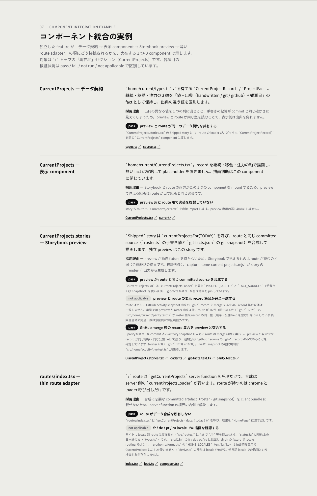

# /stack「コンポーネント統合の実例」— 検証記録 (Issue #510)

> `/stack` に追加した「コンポーネント統合の実例」セクションの**検証記録**である。
> 実例として選んだのは `/` トップの「現在地」セクション
> (`src/home/current/**` の `CurrentProjects`)。データ契約・表示
> component・Storybook preview・薄い route adapter の 4 層を、複製ではなく
> 実在する 1 つの component で説明する。



上記は `http://127.0.0.1:3000/stack`（`pnpm run build` 後の
`node scripts/e2e-local-bootstrap.mjs --port=3000` preview）を
Playwright Chromium 1280px で撮った実画面。セクション
`data-testid="stack-section-component-integration"` のみを切り出している。

## 実例の選定根拠

Issue #510 は「独立 feature のデータ契約 / 表示 component /
Storybook → route adapter への薄い接続」を **1 つの実在 component** で
説明することを求める。repo 内の候補を調べた結果:

- `src/personal/**` の `.preview.ts` + `.stories.tsx` を持つ component
  （handle-map / manifesto / melting-face 等）は、いずれも
  **route を持たない preview 専用 surface**（AGENTS.md §3 の
  `personal -> editorial` 単一 edge の制約上、route への mount は
  owner 判断として保留されている）。「接続済み route」が存在しない。
- `src/portfolio/**` の `PortfolioCaseStudy` 等も story のみで、
  route から mount されていない。
- `src/home/current/CurrentProjects` は **data contract
  (`types.ts`) → display component (`CurrentProjects.tsx`) →
  Storybook (`CurrentProjects.stories.tsx`) → thin route adapter
  (`src/routes/index.tsx` → `getCurrentProjects` server fn →
  `currentProjectsLoader`)** がすべて実在し、かつ story の `Shipped`
  が route と同じ committed source を合成する。**本 Issue の要件を
  最もよく満たす実例**として採用した。

## 判定基準と結果

ページ上の各 check は `pass` / `fail` / `not run` / `not applicable`
の 4 値で描画される（`e2e/stack.spec.ts` が `data-status` 属性で
区別を pin する。本節の check に `fail` / `not run` の実例は
残っていない — Issue #510 後続の parity 検証で `not run` だった
2 件が `pass` / `not applicable` に確定したため）。

| check | 判定 | 根拠 |
| --- | --- | --- |
| preview と route が同一のデータ契約を共有する | **pass** | `CurrentProjects.stories.tsx` の `Shipped` と `/` route の loader がどちらも `CurrentProjectRecord[]` を同じ `CurrentProjects` component に渡す（`src/home/current/types.ts`）。 |
| preview 用と route 用で実装を複製していない | **pass** | story も route（`home/composer.tsx` 経由）も `CurrentProjects.tsx` を直接 import する。preview 専用の写しは存在しない。 |
| preview が route と同じ committed source を合成する | **pass** | `currentProjectsFor`（`loader.ts`）は `currentProjectsLoader` と同じ `PROJECT_ROSTER` と `FACT_SOURCES`（手書き + `git-facts.json`）を使う。`git-facts.test.ts` が合成結果を pin。 |
| preview と route の表示 record 集合が完全一致する | **not applicable** | route はさらに GitHub activity snapshot 由来の `gh-*` record を merge するため、record 集合全体は一致しない。実測では preview が roster 由来 4 件、route が 16 件（同一の 4 件 + `gh-*` 12 件）。この差分は意図的で、集合全体の完全一致は本例の保証範囲外。 |
| GitHub merge 後の record 集合を preview と突合する | **pass** | `src/home/current/parity.test.ts` が commit 済み activity snapshot を入力に route の merge 経路（`currentProjectsLoader.loadCurrentProjects` + `selectPublishedProjects`）を実行し、preview の全 roster record が同じ順序・同じ公開 field（`load.ts` の `toPublicRecord` が落とす `evidence` を除く）で残り、追加分が `github` source の `gh-*` record のみであることを確認した（roster 4 件 + `gh-*` 12 件 = 16 件）。live D1 snapshot の選択規則は `src/home/activity/live.test.ts` が担保する。 |
| route がデータ合成を所有しない | **pass** | `routes/index.tsx` は `getCurrentProjects({ data: { today } })` を呼び結果を `HomePage` に渡すだけ。合成は server 側 `currentProjectsLoader` が行う。 |
| fr / de / pt / ru locale での描画を確認する | **not applicable** | サイトに locale 別 route は存在しない（`src/routes/` は flat で `/fr` 等を持たない）。`statusJa` は `types.ts` の契約上の日本語の文。`src/i18n` の fr / de / pt / ru は見出し glyph の fixture で locale routing ではなく、`src/home/format.ts` の `HOME_LOCALES`（en / ja / ko）は Intl 整形専用で CurrentProjects はこれを使わない（`derive.ts` の整形は locale 非依存）。他言語 locale での描画という検査対象が存在しない。 |

`fail` の項目は今回の実例には存在しない（検証が主張と矛盾した項目が
無いため）。語彙としては `StackCheckStatus` が 4 値を保持し、
`StackPage.tsx` の `CHECK_STATUS_LABEL` が literal token
（`pass` / `fail` / `not run` / `not applicable`）で描画する。
色だけに依存しない区別は editorial semantic layer の方針
（status に hue を持たせない、Issue #887）に従う。

## 実行手順

```sh
# unit: stack section data と version 解決
pnpm exec vitest run src/routes/stack

# e2e: /stack の描画と check verdict の区別
git submodule update --init --recursive   # tool artifact build に必要
pnpm run build                            # preview が dist/ を読むため
pnpm exec playwright test e2e/stack.spec.ts

# 型・静的検査
pnpm run typecheck
pnpm run lint:check                        # biome lint
pnpm run architecture:check
pnpm run publication:check

# 実画面キャプチャ（任意）
node scripts/e2e-local-bootstrap.mjs --port=3000 &
# → /stack を Chromium で開き [data-testid="stack-section-component-integration"] を撮影
```

## 正常 / 不正常 fixture

- **正常系**: `Shipped` story と `/` route の双方が、roster +
  handwritten + git snapshot の committed data で同じ
  `CurrentProjectRecord[]` を合成する（`git-facts.test.ts`、
  `source.test.ts` が担保）。
- **異常系 / 縮退系**: GitHub activity snapshot が invalid / absent
  の場合、`readGitHubActivitySnapshot` が empty list を返し、route は
  roster+git のみに縮退する（`loader.ts` の `GITHUB_PROJECTS`
  初期化）。fact が無い項目は placeholder で埋めず省略する
  （`CurrentProjects.test.tsx`「absent facts are omitted」）。
  これらは `/stack` セクションの copy が主張する範囲内であり、
  ページ側に新規の分岐は無い。

## 対象外と将来の手作業

- **対象外**: live D1 snapshot を入力にした route 出力と preview 出力の
  record 集合の完全一致。parity は commit 済み artefact 経路で
  `parity.test.ts` が pin し、live / committed の選択規則は
  `live.test.ts` が担保するが、実 D1 document を使った突合は
  operator 環境依存のため対象外。GitHub merge を preview 側の
  story にも載せるかは owner 判断。
- **対象外**: fr / de / pt / ru locale での描画確認（locale 別
  route が存在しないため `not applicable`）。
- **対象外**: 新しい route・公開 surface の追加。`/stack` は
  `PUBLIC_NAV_ITEMS` / `SITEMAP_ENTRIES` に載らない reference
  surface のまま（#381 の契約を維持）。
- **将来の手作業**: 本 PR が変える公開日本語 copy（`stack.ts` の
  新規 section）には owner の editorial approval が必要
  （`quality/copy-editorial-surfaces.json` で `src/routes/**` は
  public copy）。`copy:approval:check` は PR diff 単位の gate なので、
  PR 作成時に `pending` record の追加と owner 確認を行う。
