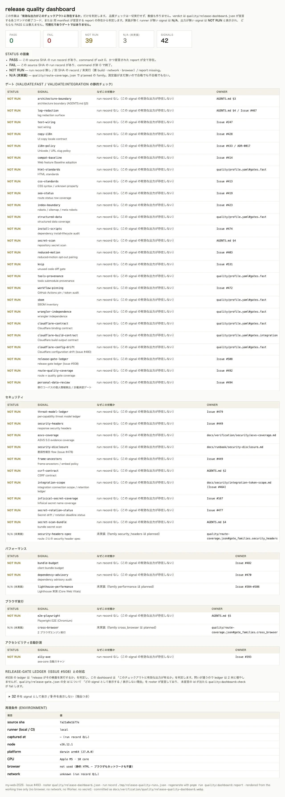

# Release quality dashboard（Issue #493）

> `quality/release-dashboard.json` が「どの品質 signal が存在し、それぞれどう判定されるか」を
> 宣言し、`scripts/release-quality-dashboard.mjs` が
> **そのチェックアウトに有効な出力があるかどうかだけ**を 1 枚の HTML に集約します。
> この document はそのダッシュボードの**検証記録**であり、ゲートや測定の仕様書では
> ありません。



## 何をしないか（線引き）

本 Issue は「既存の有効出力の集約」だけを担当し、次の 3 つを混同しません。

| 区分 | 誰の担当か | 本 Issue の扱い |
| --- | --- | --- |
| **ゲート**（失敗を CI で止める判定） | `quality/profile.yaml#gates.*` の既存コマンド | **実行も追加もしない**。終了コードを読むだけ |
| **性能測定**（実測値の取得） | Issue #384（再現性）/ #385（gate 化）/ #386（予算） | N/A 行として「未実装」と表示する |
| **可視化**（読むための 1 枚） | 本 Issue | これが今回の成果物 |

ダッシュボードが「PASS」を表示しても、`validate:fast` / `validate:integration` /
`validate:release` のどこにも 1 行も追加していません。理由は
「`quality/profile.yaml` への影響」節に記載します。

## before / after と合格基準

| | before（#493 の前） | after |
| --- | --- | --- |
| 品質 signal の所在 | `quality/profile.yaml`、`quality/route-coverage.json`、`quality/release-gate.json`、`docs/verification/**` の .md / .webp、CI log に分散。「何が実装済みで何が未実装か」は読む人ごとに違う | `quality/release-dashboard.json` が 1 ファイルで signal を宣言し、HTML 1 枚で状態を一覧する |
| 未実装の測定器（Lighthouse / axe / 2 ブラウザエンジン / route ごとの security header spec） | 「存在しない」のか「動いているのに記録が無い」のか区別できない | `planned` family を継承して **N/A（未実装）** として明示し、PASS 集計には入れない |
| 測定していない signal | 「報告が無い」ので自然に PASS と読める | **NOT RUN**。run record 無し / 別 source SHA / 未実行（要 build・network・browser）/ report missing の 4 理由を出力 |
| 再現条件 | 記載なし | environment ブロックに browser / network / CPU / Node / platform / runner（local か CI か）/ source SHA を出力 |
| verdict の出所 | 追えない | 既存 command の終了コード、または既存 report の存在。ダッシュボードは何も測定しない |

合格基準は「`pnpm run quality:dashboard:report` が、未計測を PASS として表示しないこと」。

2026-10-19 のローカル実測値は **signal 36 件 / PASS 27 / FAIL 0 / NOT RUN 5 / N/A 4**。

- NOT RUN 5 件は `bundle-budget` / `cloudflare-build-contract` / `secret-scan-bundle`（要 production build）、
  `dependency-advisory`（要 registry network）、`e2e-playwright`（要 build + browser + Worker）。
  いずれも**この実行では意図的に走らせていない**ためrun record 側も `skipped` であり、
  推測値は 1 つも載せていません。
- N/A 4 件は `quality/route-coverage.json` の `performance` / `a11y` / `cross_browser` /
  `security_headers` family（いずれも `planned`）。**Issue #384–#387 の担当**であり、本 Issue は
  「まだ無いもの」を 1 箇所に明示することだけを担当します。
- PASS 27 件の 1 つに `route-quality-coverage`（#492）があり、その有効な出力は
  `.tmp/route-quality-report.html` です。**この report が消えると PASS から NOT RUN に落ちます**
  （次の節）。

## Issue #508（release gate ledger）との重複整理

#508 が `quality/release-gate.json` を `release-0-7-0` に追加し、**同じ status 語彙**
（pass / fail / not run / N/A）で「release がその検査を実行するか」を判定する gate を公開しました。
本 Issue と #508 は別々に立ち上がった互いに独立した ticket で、両者は参照関係にあるため、次の通り整理しています。

| | #508 の ledger | 本 Issue の roster |
| --- | --- | --- |
| 答える問い | その検査は release chain に含まれるか（カバレッジ） | このチェックアウトに有効な出力が有るか（verdict） |
| verdict の出所 | 宣言と `validate:*` / CI `validate` ジョブの transitive closure | 実行されたコマンドの終了コードと report の存在 |
| artifact / 実行環境 | 扱わない | report の存在・source SHA・browser / network / CPU を記録 |

**ledger を 2 本増やさない**代わりに、`quality/release-dashboard.json` の
`ledger_alignment` が `quality/release-gate.json` の**全 id** について
「どの signal として表示するか」または「表示しない理由」を宣言し、
未宣言 id が出たら `quality:dashboard:check` が exit 1 になります（fixture テスト済み）。
現状は 27 件を signal として表示、9 件を表示しない（理由つき）。
例：`release-version` は release branch 名から期待 version を導出するため ticket branch で
構造的に FAIL する、`cf-typegen` は `.cloudflare/types/index.d.ts` を書き換える（dashboard は
ツリーを mutate しない）、`production-smoke` は deploy 後手動 window の row である。

## 4 状態の定義（missing report が誤 PASS しない構造）

`classifySignal()`（`scripts/release-quality-dashboard.mjs`）は純粋関数で、「出力が無い」
分岐は一律 `not_run` を返します。`pass` に到達する経路は 1 つしかありません。

| 状態 | 条件 |
| --- | --- |
| `PASS` | 現 source SHA を**名乗った** run record が存在し、command が exit 0、かつ roster が `evidence.kind: artefact` と宣言した report が**すべて**ディスクに存在し、**その実行の artefact inventory にも載っている** |
| `FAIL` | 現 source SHA の run record が存在し、command が非 0 で終了（終了コードのみ表示し、stdout は記録しない） |
| `NOT RUN` | run record 無し / 読み込めない record / 別 source SHA の record / **source SHA を記録していない record** / このチェックアウトの SHA が取れない / signal が `skipped`（要 build・network・browser・Worker）/ **report missing** / **今回の実行が書いていない report** |
| `N/A（未実装）` | `quality/route-coverage.json` で `planned` の family。測定器が無いので合格でも不合格でもない |

この 4 分岐は `scripts/release-quality-dashboard.test.mjs` で fixture 固定しています。
特に「exit code 0 だが report が無い → NOT RUN」「report が前回実行の遺骸で今回の
inventory に無い → NOT RUN」「record が source SHA を名乗らない → NOT RUN」という
fail-open しかけだった分岐をそれぞれテストしています。

### review で潰した fail-open

| 元の欠陥 | 現状 |
| --- | --- |
| `runRecord.source_sha` が空の record は比較をスキップして PASS 扱いになっていた | `source_sha` が string でない場合、またはこのツリーの SHA が取れない場合は比較不能として `NOT RUN` |
| `planRuns()` が `signal.evidence` を落としていたため、record の `artifacts` が常に `[]` だった | plan が `evidence` を持ち、record entry は `inventoryArtefacts()` の結果を保持する（`.tmp/release-quality-runs.json` で実測済み） |
| artefact の PASS が「ファイル存在」だけだったため、前回実行の report が今の exit 0 を補助していた | 「存在する」＋「その実行の inventory に載っている」の両方が必要 |
| record が壊れた JSON / `runs` が配列でない場合に throw、または「run record なし」と誤表示していた | `readRunRecord()` が形を検証し、理由を NOT RUN の reason に出力する（throw しない） |
| `platform` をレンダラーマシンから書いていた（CI の record をローカルで読むと嘘になる） | recorder が `environment.platform` を記録し、renderer は record の値を優先する |
| `--root` に値が無い / `--report` が `--report=` 形式でない場合に crash、または黙って無視していた | どちらも stderr に理由を出して exit 2 |
| `bundle-budget` / `e2e-playwright` の command が宣言した report を一度も書かず、緑でも NOT RUN 固定的だった | command を実際に report を書く形に修正（`--report=` / `--html=` / `--reporter=html`）。さらに roster validator が「宣言した path に command が到達可能か」を検査する |
| `loadRoster()` が `releaseGatePath` 引数を受け取っていたが使っていなかった | 引数を削除し、roster の `release_gate_ledger` だけを読む単一の経路に |
| recorder のヘッダコメントが `{ ... runs[], skipped[] }` と書いていたが実際には top-level `skipped` が無い | コメントを実際の形（`runs[]` に skipped も同じ配列で入り込む）に修正 |

## 再現条件（local / CI）

| 項目 | 条件 |
| --- | --- |
| ブラウザ | **ダッシュボード生成には不要**。静的 HTML を書き出すだけなので Chromium が無くても同じ結果になる。スクリーンショット撮影時のみ `pnpm run e2e:install` 済みの Playwright Chromium を使う |
| ネットワーク | **不要**。既定の `quality:dashboard:record` は `requirements` に network を含む signal を実行せず `skipped` として記録する。`--allow=network` を明示した実行でのみ registry に接続する |
| CPU / 負荷 | 既定で実行される 27 command の合計は Apple M5 ローカル実測で**約 5 秒**（要求 build / network / browser / worker の 5 件は `skipped`）。並列実行による flaky 化はない |
| Runner | `process.env.CI` から `local` / `ci` を記録する。CI では同じ command が CI ランナー上で同じ形式（CPU モデルと Node patch が local と異なる）で走る |
| Runtime | Node.js `>=22.18`（`package.json#engines`、CI は 22.18 固定）。この検証環境で実際に実行した Node は `v26.12.0` |
| Source SHA | run record は `git rev-parse --short=12 HEAD` を持つ。**別 SHA の record は全 signal を NOT RUN にする**（古い verdict を PASS にしない） |

再現手順:

```bash
pnpm run quality:dashboard:record          # 既存 command を実行し .tmp/release-quality-runs.json を書く
pnpm run quality:dashboard:report          # .tmp/release-quality-dashboard.html を再生成（読み取り専用）
pnpm run verify:quality-dashboard-screenshot  # 上記 HTML を WebP 化して docs/verification/quality/ へ
```

`quality:dashboard:check` は roster の構造を検証し、集計 1 行を標準出力に出します。
**NOT RUN は失敗ではありません**（出力が無いという事実を報告するのがこの command の仕事）。
roster が壊れているとき（未宣言 group / command 無し / family と state の矛盾 / evidence kind 不明）
だけ exit 1 です。

### artefact provenance

run record の `source_sha` はスクリーンショットを commit する**直前の tree** を指します。
スクリーンショット commit 自身は evidence（`.webp`）の追加だけなので commit 後の SHA は 1 つ進みます。
その状態で HTML を再生成すると全 signal が NOT RUN（stale）になるのが仕様です。
比較したい commit で `quality:dashboard:record` を再実行してから再生成してください。

## `quality/profile.yaml` への影響

- **`gates.fast` / `gates.integration` / `gates.release` の components には追加していません。**
  ダッシュボードは出力を読む可視化であり、判定を増やすと可視化とゲートの境界が曖昧になります
  （AGENTS.md §5「gate は 3 つの deterministic entry point」）。
- 代わりに `release_quality_dashboard` block を追加し、roster / command / 証跡 path /
  「gate ではない」宣言を記録しました。`route_quality_coverage` block と同種です。
- roster は `quality/release-gate.json`（#508）との対応を `ledger_alignment` で宣言しており、
  `release_gate_coverage` 相当の gate は**追加していません**（#508 が所有）。
- roster の構造検証（`quality:dashboard:check`）も既定では gate に入りません。壊れた roster は
  レポート生成時に exit 1 で判明するため、gate に入れる価値がコストに見合いません。

## 未実装の signal を誤って PASS にしない仕組み

`quality/route-coverage.json` が `planned` とする 4 family を roster が `family` で参照し、
その `state` をそのまま継承します（SoT を二重化しないため roster 側に state を手で書いていません）。
継承値が `planned` の行は `command` / `evidence` を宣言できず、構造 validator が矛盾を拒否します。
よって「将来 runner を足し忘れた signal」が静かに PASS になることはありません。

## スクリーンショット

Issue は `docs/verification/quality/release-quality-dashboard.png` を要求していますが、
**同パスの stem を `.webp` にしたもの** で commit しています（PNG はテキスト主体のページに対して約 2 倍サイズで、
証跡としての価値は変わりません）。変換は既存の `sharp` devDependency で width 1600 /
quality 78 に行い、中間 PNG はディスクに書き出しません。script が 300 KB を超えた場合は
エラーになります。