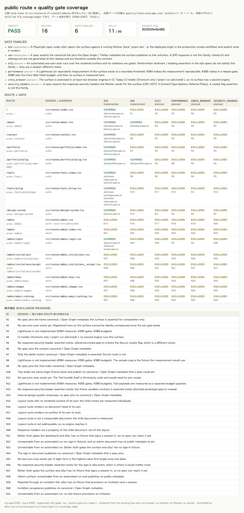

# 公開 route × 品質ゲートのカバレッジ ledger（Issue #492）

> `quality/route-coverage.json` が「公開されている route roster」と「その
> route がどの品質ゲートの対象か」を 1 ファイルで保持し、
> `scripts/check-route-quality-coverage.mjs` が両者のずれを fail させる。
> この document はその gate の**検証記録**であり、gate 実行の仕様書では
> ない。



## before / after と合格基準

| | before (#492 の前) | after |
| --- | --- | --- |
| 公開 route roster | `src/routeTree.gen.ts` の生成物を読むしかなく、**比較される相手がいない** | `src/routes/**` の `createFileRoute('<id>')` 呼び出しから取得し、`quality/route-coverage.json` と機械的に突き合わせる |
| 新 route 追加時 | どの品質ゲートの対象にもならないことを誰も察觉できない | manifest エントリが無いと `pnpm run routes:quality:check` が fail（PR で「対象追加 / 正当な除外」を強制） |
| 対象漏れ（例: `/portfolio` の SEO metadata） | 仕様書にのみ暗黙。spec を消しても fail しない | `covered` の evidence は実ファイル、かつそのファイルが route path を単独で含む場合だけ成立（含まない場合 fail） |
| 除外の記録 | なし | 全 cell が `covered`（evidence 付き）か `excluded`（理由付き）。`TBD` のような placeholder は fail |

合格基準は **1 つ**で、`pnpm run routes:quality:check` の exit code が 0。
実測値（対象数）は 2026-10 時点で **公開 route 16 / gate family 6 / covered cell 11**。
これは gate 実行時の snapshot であり、route を追加すれば cell 数は増えるのが正常。
performance / a11y / cross_browser / security_headers の閾値（95 点、violation 0 件、
2 ブラウザ等）は **まだ存在しない**。値の gate を作るのは #384–#387 の担当であり、
本 Issue の合格基準には含まれない（性能・可視化・ゲートを混同しないための線引き）。

## 再現条件

| 項目 | 条件 |
| --- | --- |
| ブラウザ | **不要**。gate は `src/routes/**` / `quality/route-coverage.json` / `src/routeTree.gen.ts` / evidence file を read して文字列比較するのみ。Chromium が無くても同じ結果になる |
| ネットワーク | **不要**（0 回の fetch）。ローカルでも CI でも同一入力なら同一結果 |
| CPU / 負荷 | 依存なし。Node.js 起動を含めて約 0.2 秒（Apple Silicon ローカル実測、`real 0.11s` / `real 0.24s` の 3 連続実行）。並列実行による flaky 化はない |
| Runtime | Node.js `>=22.18`（`package.json#engines`、CI は 22.18 固定） |
| ソース SHA | レポートヘッダに `git rev-parse --short=12 HEAD` を出力する。gate 自体は SHA 非依存で、tree が同じなら**すべての 셀と verdict が同一**（HTML も `source sha` 行以外は byte 同一） |
| 依存 install | 不要（`pnpm install` 済みなら Node 標準モジュールのみ） |

再現手順:

```bash
pnpm run routes:quality:check            # gate 単体（exit code が合格基準）
pnpm run routes:quality:report           # .tmp/route-quality-report.html を再生成
pnpm run verify:route-quality-screenshot # 上記 HTML を WebP 化して docs/verification/quality/ へ
```

CI では `validate:fast` の静的チェック列（`architecture:check` と `tools:check` の間）で
同じコマンドが走ります。並び順は release-0-6-3 側の管轄なので、この gate は
「architecture:check と tools:check の間にある」という関係として記録しています
（`.github/workflows/ci.yml` の `validate` ジョブ = `validate:integration`）。
ブラウザ・ネットワーク・CPU 条件は上表のとおりで、CI と local で結果が変わる要素は
存在しない。

## gate が fail する条件

1. `src/routes/**` に route ファイルがあるのに manifest エントリが無い
   （= 新 route を追加した PR が対象追加 / 正当な除外をしていない）
2. manifest エントリの `source` に対応する route ファイルが無い（phantom）
3. エントリの `path` が route id から導出した公開 path と違う（rename 取りこぼし）
4. `src/routeTree.gen.ts` の id 集合が `src/routes/**` と一致しない（生成物の stale）
5. ある (route, gate family) が `covered` でも `excluded` でもない
6. `covered` の evidence が実在しない / family の `evidence_kind` に反する /
   そのファイルが route の probe path（dynamic route は `sample_path`）を
   **単独トークンとして**含まない（`/tools` は `/tools/prototype` の部分文字列なので
   成立しない: `page.goto('/tools/prototype')` だけがある spec は `/tools` の
   coverage を満たさない）
7. `excluded` に理由がない、または `TBD` などの placeholder
8. `state: planned` の family が `covered` を主張している
9. `state: implemented` の family が全 route で `excluded`（dead configuration）
10. `audience: public` かつ addressable な route に covered family が 0 件

## 1 ソースの定義

- roster の 1 ソースは `src/routes/**` の `createFileRoute('<id>')` 呼び出し。
  `__root.tsx`（`createRootRoute`）と route ファイルでない同居コンポーネント
  （`routes/design-system/DesignSystemPage.tsx` 等）は route として数えない。
- `path` は route id から導出する（`/admin/invitations_/accept` →
  `/admin/invitations/accept`、index の `/portfolio/` → `/portfolio`）。
- 対象（gate coverage）の 1 ソースは `quality/route-coverage.json`。
- **範囲外**: `/api/v1/**` は Hono の外部 HTTP boundary（`src/http/**`）が所有し、
  TanStack の file-route 契約ではない。`e2e/smoke.spec.ts` /
  `e2e/prod-smoke.spec.ts` が `/api/v1/health` / `db/ping` / `media/ping` を
  検証済みで、本 ledger の route roster には含まれない（別 obligation の話）。

## 未実装 family の扱い

`a11y` / `performance` / `cross_browser` / `security_headers` は `state: planned`
であり、現時点では全 route が `excluded` + 理由 を持つ。これは「意図的に未計測」を
明示する状態であり、監査可能な記録である。`planned` を `implemented` に上げるには
少なくとも 1 route に実 evidence が必要で、単に flag を変えるだけでは通らない
（dead configuration として fail する）。

## 関連 Issue との重複回避

- #384 / #385 / #386: Lighthouse 計測の再現性、release gate、CWV budget。
  本 Issue は「誰が対象か」を確定するだけで、計測も閾値も作らない。
- #387: 非 UI PR の画像付き検証の必須化。本 Issue の verification report は
  別軸（カバレッジ表）であり、#387 の UI 差分スクリーンショットとは用途が異なる。