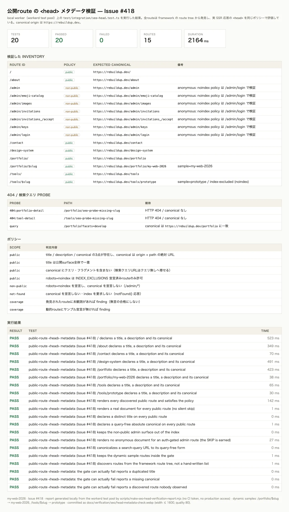

# 公開route の `<head>` メタデータ検証（Issue #418）

`docs/verification/seo/head-metadata-check.webp` はこのゲートの実行レポートのスクリーンショット。
Issue #418 が要求する `docs/verification/seo/head-metadata-check.png` のパスを、**拡張子のみ `.webp` に置換**して
commit している（PNG は WebP の約2倍サイズで、証拠としての価値が変わらないまま repository を膨らませるため）。



## 何が検証されるか

ゲートは「公開routeの title / description / canonical」を **実 SSR 応答** に対して評価する。
route inventory は手書きリストではなく、**framework が生成する route tree**（`src/routeTree.gen.ts`、
`src/routes/**` から TanStack Start の Vite plugin が毎実行で再生成する）から取得するため、
head metadata を書かないまま route を追加すると次の実行で必ず失敗する。

| surface | ポリシー |
| --- | --- |
| public（indexable） | `title` / `description` / `canonical` の3点が存在し、canonical は `https://rebuildup.dev` + path の絶対 URL。title は公開surface全体で一意 |
| non-public（`/admin/*`） | `robots: noindex` を宣言し、canonical を宣言しない |
| 404（`notFound()`） | canonical を宣言しない。HTTP 404 であること自体も assertion（応答が返らない場合も `not-found.not-404` で失敗） |
| 検索クエリ付きURL | `rel=canonical` にクエリ / フラグメントを含まない（`/portfolio?facets=develop` は `/portfolio` に寄る） |
| 取得失敗 | どの surface でも `observation.request-failed` で **失敗**。metadata の欠落として誤報告しない |

inventory は正規化後の **URL ごとに1件**（`src/routes/admin.tsx` の layout と `src/routes/admin.index.tsx` の
index route はどちらも `/admin` に正規化されるため1件に畳まれる。1つの URL は1回的 document 検証に過ぎない）。

## 2つの front-end（同じポリシーエンジン）

| | CI ゲート | live チェック / レポート |
| --- | --- | --- |
| 入口 | `test/integration/seo-head.test.ts` | `scripts/check-seo-head.mjs --live <baseUrl>` |
| データ取得 | `SELF.fetch`（local worker / workerd test pool） | 実サーバーへの HTTP GET |
| ポリシー | `scripts/seo-head-contract.mjs` | `scripts/seo-head-contract.mjs`（同一） |

`test/integration/seo-head.test.ts` は `pnpm run validate:fast` の `pnpm run test` 内で CI ごとに走る。
`scripts/check-seo-head.mjs` は手元で任意の origin を pointed して確認するためのもの。

## 再現手順

### CI ゲート（リポジトリローカル）

```bash
pnpm exec vitest run test/integration/seo-head.test.ts
```

期待結果: `Test Files 1 passed` / `Tests 20 passed`。workerd test pool 上で実行し、
D1 は `migrations/` と同じ形の schema を inlined 適用し、`/portfolio/$slug` の sample 行 1件を
投入する（`FIXTURE_PROJECT`）。secret は読まない（binding は test pool の dummy 値）。

### live チェック（任意の実サーバーに対して）

```bash
# 例: dev server / vite preview / 任意の origin
pnpm run seo:head:check -- --live http://localhost:5173
pnpm run seo:head:check -- --live http://localhost:5173 --html .tmp/seo-head-report.html
pnpm run seo:head:check -- --live http://localhost:5173 --json
```

期待結果: findings が 0 なら終了コード 0、各routeに PASS / FAIL / SKIP が明示される。
`/portfolio/$slug` は sample 行（`my-web-2026`）、`/tools/$slug` は sample（`prototype`）で検証されるため、
live 実行先の D1 に published 行が無いと `/portfolio/my-web-2026` は 404 になり finding になる。

### このスクリーンショットの再生成

```bash
pnpm run verify:seo-head-screenshot
```

`test/integration/seo-head.test.ts` を JSON reporter で実行し、結果を HTML 化
（`.tmp/seo-head-report.html`）してから、インストール済み chromium で撮影し sharp で
`resize({ width: 1600, withoutEnlargement: true })` + `webp({ quality: 80 })` へ変換する。
中間 PNG はメモリ内に留まり、commit されるのは WebP のみ。

## このゲートが見つけた実際の欠陥（Issue #418 で修正）

| route | 欠陥 | 修正 |
| --- | --- | --- |
| `/` | `description` と `canonical` が無い（root の fallback title `my-web-2026` のみ） | `src/routes/index.tsx` に `head()` を追加 |
| `/tools` | `canonical` が無い | `src/routes/tools.index.tsx` に canonical を追加 |
| `/tools/<slug>` | `canonical` が無い | `src/routes/tools.$slug.tsx` に canonical を追加（`noindex` は INDEX_EXCLUSIONS に宣言済み） |
| `/admin/*` | `robots` 宣言が無く、匿名で到達できる `/admin/login` が indexable | `src/routes/admin.tsx`（layout）に `robots: noindex, nofollow` |

## 誤検知を避ける設計

- title / description の長さ上限は意図的に広く取っている（title 100文字 / description 10–320文字）。
  SERP で切り詰められることを検出するもので、文面を批判するものではない。
- 検索クエリ付きURLは「同じ document」として title 重複判定から除外する
  （`/portfolio` と `/portfolio?facets=develop` は重複 title ではない）。
- 404 document は title 重複判定から除外する（`/portfolio/<不明slug>` と実在route が同じ title でも重複ではない）。
- admin の auth-gated 子route（匿名だと document が出ない）は **SKIP** として明示され、
  noindex policy は document が実際に描画される `/admin/login` で検証する。
  `/admin/invitations/accept` は token 必須の匿名ランディングページで、`token` 無しのリクエストは
  描画前に 500 で弾かれる（ゲートは token を持たないため document を見られない。token ありの document は
  layout の `noindex` を継承する）。SKIP の前提条件「匿名で 200 document を返さない」は
  `renders no anonymous document for an auth-gated admin route` の case で assert している。
- SKIP は finding にならないが、route は inventory に残り続け、観測ゼロのrouteは
  `inventory.unobserved` として失敗する。
- **取得できなかった route / probe は PASS にならない。** `--live` の対象 origin へ到達できない場合は
  各行が `FAIL / observation.request-failed`（status は `(not fetched)`）になり、終了コードは 1 になる。
  metadata の欠落（`public.title-missing` 等）として報告しないのは、document が存在しないから。