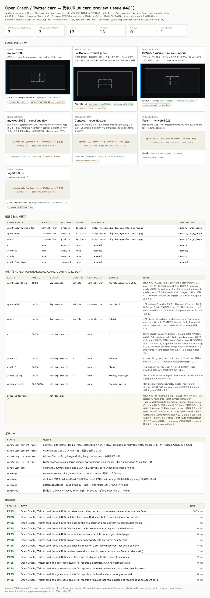

# 公開 surface の Open Graph / Twitter card 検証（Issue #421）

`docs/verification/seo/ogp-preview.webp` はこのゲートの実行レポートのスクリーンショット。
Issue #421 が要求する `docs/verification/seo/ogp-preview.png` のパスを、**拡張子のみ `.webp` に置換**して
commit している（PNG は WebP の約2倍サイズで、証拠としての価値が変わらないまま repository を膨らませるため）。



## 何が検証されるか

`src/editorial/social-card/contract.json` が宣言する **card 契約**を、実 SSR 応答に対して評価する。

| surface | 宣言 | 期待する card |
| --- | --- | --- |
| `/portfolio/$slug` | `implemented` / `article` / `content-first` | loader が解決した cover、無ければ `fallbackCard` |
| `/portfolio/` | `implemented` / `website` / `content-first` | 先頭の公開 project の cover、無ければ `fallbackCard` |
| `/about` | `implemented` / `profile` / `content-first` | 最初の experience project の cover、無ければ `fallbackCard` |
| `/`, `/contact`, `/tools/`, `/tools/$slug` | `not-implemented` / `none` | card 画像を**出さない**（出た瞬間に finding） |
| `/design-system` | `not-implemented` / `none`（`public: false`） | 同上 |

`content-first` の document が必ず満たすもの:

- `og:type` / `og:site_name` / `og:locale` / `og:title` / `og:description` / `og:url`（後者は origin 付き絶対 URL）
- `og:image` は「その surface 自身の media URL」か「`contract.json#fallbackCard` の URL」の**どちらか**
- `og:image:alt` は空でない、fallback card なら `og:image:width` / `og:image:height` が宣言値と一致
- `twitter:card=summary_large_image`、`twitter:image = og:image`、`twitter:title` / `twitter:description` が og 側と一致

### missing media の fallback（この Issue の主眼）

media row が無い project、R2 custom domain が未設定で `composeMediaUrl` が
`null` を返す project、alt text の無い media row — いずれも同じ fallback に落ち、
`og:image` に出るのは `https://rebuildup.dev/og/default-card.png`（1200×630、
`scripts/generate-og-fallback-card.mjs` が SVG から決定論的に生成、`--check` で
drift 検出）になる。**出力された URL そのもの**が `content` / `fallback` の証拠に
なるため、劣化はレポート上の 1 行として可視化される。「タグが無いから良い」
という推測を残す必要がない。

## 2つの front-end（同じポリシーエンジン）

| | CI ゲート | live チェック / レポート |
| --- | --- | --- |
| 入口 | `test/integration/ogp-card.test.ts` | `scripts/check-ogp-card.mjs --live <baseUrl>` |
| 宣言の網羅性 | `scripts/check-ogp-card.mjs`（coverage mode、`validate:fast` 入り） | 同左 |
| データ取得 | `SELF.fetch`（local worker / workerd test pool） | 実サーバーへの HTTP GET |
| ポリシー | `scripts/ogp-card-contract.mjs` | 同左（1 engine, 2 front-ends） |

engine は宣言そのものを持ち込まない。`contract.json` は Worker 側は
`src/editorial/social-card/contract.ts` が JSON module として読み、Node 側は
`fs` で同じファイルを読む。site name / locale / fallback card を 2 箇所に
書かないため。

## 記事（articles）について

Issue #421 は「公開作品と**記事**」を主題に挙げているが、この release の
route tree に記事 surface は存在しない（`src/routeTree.gen.ts` に
articles / journal / blog / notes の route が無い）。記事 route をこの Issue で
新設すると未完成の別 feature（content model・公開性境界・loader）に依存し、
受け入れ条件「未完成の他featureに依存させない」に反する。

そのため `contract.json#deferredSurfaces` に `articles` を**理由つきで宣言**し、
coverage gate が「記事 route が実在したら finding」を出すようにする
（無言の合格にしない）。記事 surface が追加されたら、その entry を削除して
`routes` に og:type 付きの entry を追加する。

## 再現手順

前提: Node 22.18 以上、pnpm 12.3.x。report のスクリーンショットを再現する場合のみ
Chromium が必要（`pnpm run e2e:install`）。

```bash
# 1. 宣言の網羅性（validate:fast にも入っている / pure Node・安い）
pnpm run ogp:card:check

# 2. 実 SSR HTML に対するゲート（workerd test pool）
pnpm exec vitest run test/integration/ogp-card.test.ts

# 3. engine と coverage の unit test（node --test）
node --test scripts/check-ogp-card.test.mjs

# 4. このディレクトリのレポート画像と、その元になる HTML
pnpm run verify:ogp-card-screenshot
```

### live チェック（任意の実サーバーに対して）

```bash
# 例: dev server / vite preview / 任意の origin
pnpm run ogp:card:check -- --live http://localhost:5173
pnpm run ogp:card:check -- --live http://localhost:5173 --json
```

期待結果: finding が 0 なら終了コード 0。各 surface に PASS / FAIL が明示され、
`image` 列に `content` / `fallback` / `none` が出る。取得失敗は skip ではなく FAIL。

## 環境依存の観測（重要）

`vitest.config.ts` は `MEDIA_PUBLIC_BASE_URL` を**意図的に未 binding** にする
（binding すると `composeMediaUrl` が URL を返し、loader test が無 binding の
分岐を検証できなくなるため）。したがって CI が実 SSR で観測するのは
**missing media の fallback 側の分岐**であり、レポートの fallback card 行が
CI で証明されている。

`content` 側の分岐は、composer の unit test（`card.test.ts`、両分岐と
negative control つき）と、本番 shaped の media URL を固定している既存の
`e2e/prod-portfolio.spec.ts` が担保する。local dev で content 分岐を見たい場合は
`MEDIA_PUBLIC_BASE_URL` を設定した状態で
`pnpm run ogp:card:check -- --live http://localhost:5173` を実行する。

## 画像が描写していないもの

- どの crawler が何を渲染するか。`og:*` に validation service は無く、
  Rich Results 式の verdict も無い。gate が判定するのは「我々が出した tag が
  宣言と一致しているか」まで。
- 本番の media 実体がその URL で到達可能であること。fallback については
  `public/og/default-card.png` が repository に commit された実 asset である
  ことだけを coverage gate が検証する（coverage gate が file 存在を検証）。
  fallback は same-origin の static assets なので Worker を経由しない。

## 画像

- `ogp-preview.webp` — Issue が要求する
  `docs/verification/seo/ogp-preview.png` の `.webp` 版（width 1200, quality 68）。
  中間 PNG はディスクに書かず、メモリ上の Buffer を `sharp` で WebP に
  再エンコードしている（`scripts/make-ogp-card-verification-report.mjs`）。
- レポートの各行は `test/integration/fixtures/ogp-card-snapshot.json` から読む。
  同ファイルは integration suite が実 SSR HTML と `toEqual` で照合している
  ため、画像は CI が検証していない document を描写し得ない。
- リモート media URL は `` として埋め込まず、URL をそのまま表示する
  （オフラインでも CI でも同じ描画になること優先）。