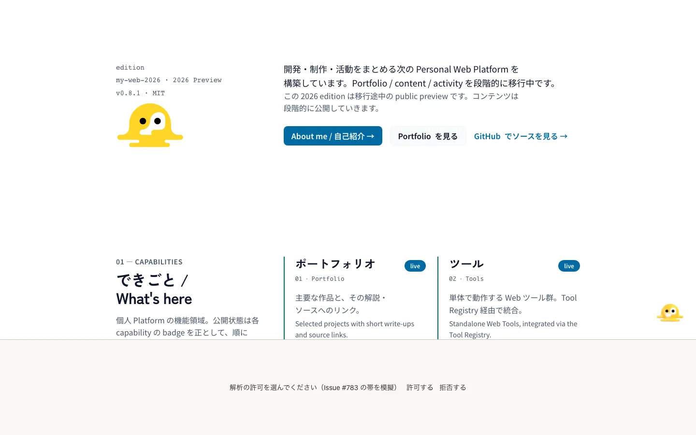
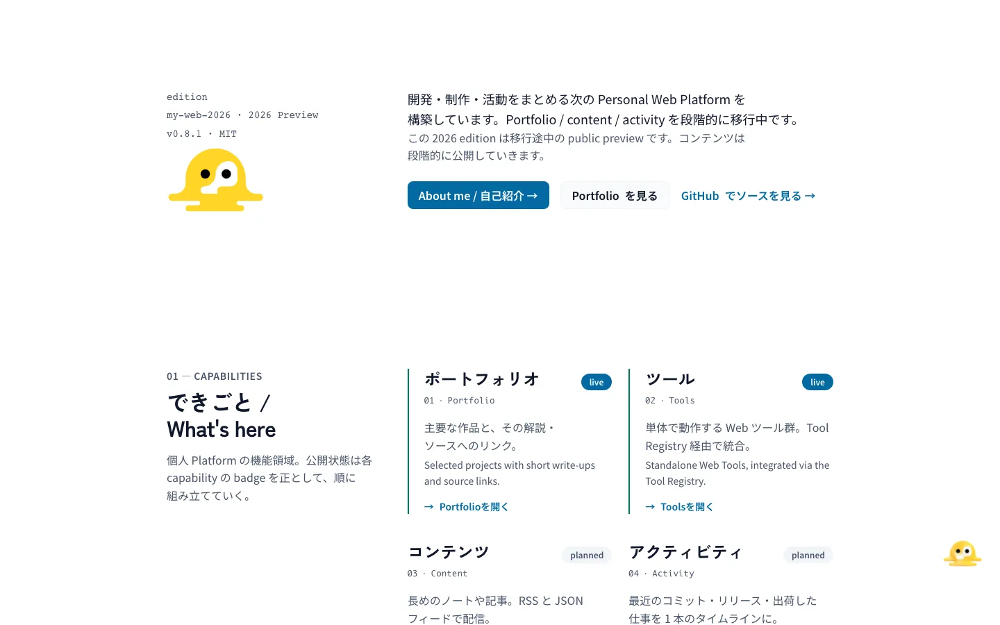
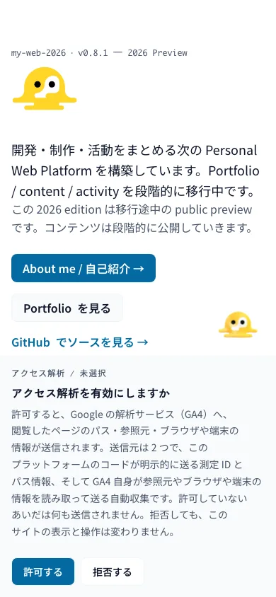
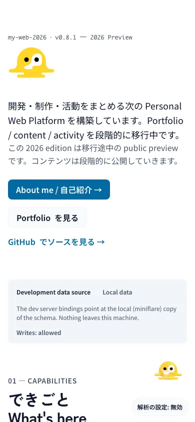
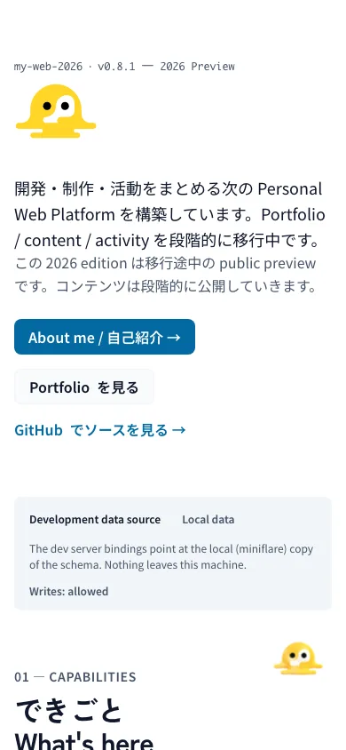

# Pet companion overlay — rendered verification (Issue #274)

浮遊レイヤーとして作り直した companion（Melty）を、実際のブラウザで動かして
撮影した記録。契約は [`docs/domain/pet-companion.md`](../../../domain/pet-companion.md)
§5.2–§5.9 が正本で、この文書はその契約が**画面でそうなっているか**だけを示す。

画像はすべて WebP。撮影スクリプトはこのリポジトリの `pnpm run dev` に対して
Chromium（Playwright の pinned build）で操作し、`sharp` で WebP に変換した。
PNG は中間ファイルとしてのみ存在し、commit しない。

## 撮影条件

| 条件 | 値 |
| --- | --- |
| 実行 | `pnpm run dev` → Vite。このセッションでは 3000 番が埋まっていたため **`http://127.0.0.1:3001/`**。owner の指示は `localhost:3000` だが、パスとビルドは同一 |
| ビューポート | 1440 × 900 CSS px、`deviceScaleFactor: 2`（全体図は記録用に 1440 幅へ縮小） |
| D1 | `pnpm run db:migrate:apply:local` を実行済み。未適用のローカル DB では `/about` の loader が `portfolio_unavailable` で落ち、ペットの確認ができない（この変更とは無関係な前提条件） |
| 失敗の検出 | `console` の `error` と `pageerror` を全工程で収集 → **0 件** |
| 再実行 | 撮影スクリプトは `.tmp/` の使い捨てで commit しない。§5.2 の数値と下の表が記録の正本 |

## 画像

### Home — 休憩

下端 72 px / 右端 24 px、0.62 倍（表示 59.5 × 64.5 px）。解析同意トグル
（下端 12 px・高さ 36 px）とは重ならない。

### Home — ポインタ接近

`look-left.webp` を表示し、同時に 0.62 倍 → 1.0 倍（96 × 104 px）へ移る。

### Home — ドラッグ中

`running-left.webp` + `petRun` アニメーション、`cursor: grabbing`。

### Home — スクロール

`look-down.webp`。移動はしない（走る絵は出さない）。

### Home — 再読み込み後

同じブラウザで `pet-position.v1`（比率）から復元。座標は 936, 504。

### Home — 文書末尾

固定オーバーレイの focus compensation（WCAG 2.2 SC 2.4.11）。`body` の
`padding-bottom` が `max(--analytics-consent-offset, --pet-overlay-offset)` に
なり、Home と `/about` では 176 px（= 休憩位置の下端 72 px + フレーム 104 px）が
文書末尾に確保される。**この余白はページの見た目を変える** — 装飾を固定で
浮かせる以上、footer の下に空きが増える。ここに写っているペットは、この
セッションでドラッグした位置が復元されたもので、footer のリンクに重なっている
（訪問者自身が置いた位置なので §5.2 の「初期位置だけ持ち上げる」の対象外）。

### /about

### ドラッグの座標検証

角ではない位置（比率 0.4 / 0.5）で掴み、40 × 30 px 動かしたとき、
掴んだ点と表示中心のずれは **1 px 以内**（0 → 0.4 px）。0.62 倍の実体に対する
掴み点はレイアウト座標へ換算しているので、拡大しても指の下から逃げない。

### reduced motion

## 測定値

| 項目 | 実測 |
| --- | --- |
| `position` / `pointer-events` | ルート `fixed` / `none`、スプライトボックス `auto` |
| 透明レイヤーの有無 | ボックスの外 6 px を `elementFromPoint` → 下の要素（`DD` / `SECTION`）。全画面の捕捉レイヤーは無い |
| レイアウトボックス | 96 × 104 px（0.62 倍で 59.5 × 64.5 px を描画） |
| `z-index` | 30 |
| `transform` を祖先に持つか | 無し（`fixed` がビューポート基準であることを確認） |
| `aria-hidden` | `true`。内部のフォーカス可能要素は **0** |
| 到着の挨拶 | 1.2 s 後に `idle-rest` へ戻る |
| ポインタ接近 | `look-left` + 1.0 倍 |
| ドラッグ | `running-left` + `petRun` |
| スクロール 600 px | `look-down` |
| 再読み込み | 936, 504 に復元 |
| reduced motion | `idle-rest` / 0.62 倍のまま、入力に対して不変 |
| 同意トグルとの重なり | 修正前 24 px → 修正後 **0 px**（1440 × 900） |
| focus compensation | `--pet-overlay-offset: 176px` を mount 時に publish、unmount で削除。`styles.css` の `:root { scroll-padding }` と `body { padding-bottom }` が `max()` で消費（`scripts/check-a11y-focus-visible.mjs` が PASS） |
| console error | 0 |

## Issue #783 — 同意面との重なり（2 ビューポート × 3 状態）

本節の撮影は別セッションの `pnpm run dev`（**3002 番**、3001 は他 worktree が
使用中）に対して行った。

Issue #783 は同意パネルを下辺全幅の帯にする。帯が未実装の本ブランチでは、
(a) は **帯を模擬**している（下辺 `fixed` の全幅ボックスを実測高で置き、
`AnalyticsConsent.tsx` と同じく `--analytics-consent-offset` に
`高さ + 12` を publish）。同じコンポーネントの `ResizeObserver` が値を
書き戻すため、測定中は模擬値を固定している。(b)(c) は**実物**の同意面を使う。

| ビューポート | 状態 | 同意面 rect | ペット rect | 重なり |
| --- | --- | --- | --- | ---: |
| 1440 × 900 | (a) 帯 198 px | y 702–900 | y 613.5–678, x 1356.5–1416 | **0 px²** |
| 1440 × 900 | (b) ピル 36 px | y 852–888 | y 763.5–828 | **0 px²** |
| 1440 × 900 | (c) 面なし | — | y 763.5–828 | 対象なし |
| 1440 × 900 | 実物の未選択パネル（264 px） | y 624–888, x 440–1000 | y 547.5–612 | **0 px²** |
| 390 × 844 | (a) 帯 341 px | y 503–844 | y 414.5–479, x 306.5–366 | **0 px²** |
| 390 × 844 | (b) ピル 36 px | y 796–832 | y 707.5–772 | **0 px²** |
| 390 × 844 | (c) 面なし | — | y 707.5–772 | 対象なし |
| 390 × 844 | 実物の未選択パネル（359 px） | y 473–832, x 12–378 | y 396.5–461 | **0 px²** |

| 状態 | `--analytics-consent-offset` | ペットの `bottom` | `--pet-overlay-offset` |
| --- | ---: | ---: | ---: |
| (a) 帯 1440 | 210 px | 222 px | 326 px |
| (b) ピル 1440 | 48 px | 72 px | 176 px |
| (c) 面なし 1440 | なし | 72 px | 176 px |
| (a) 帯 390 | 353 px | 365 px | 469 px |
| (b) ピル 390 | 48 px | 72 px | 176 px |
| (c) 面なし 390 | なし | 72 px | 176 px |
| 実物の未選択パネル 1440 | 276 px | 288 px | 392 px |
| 実物の未選択パネル 390 | 371 px | 383 px | 487 px |

実測値の生データは `.tmp/pet-consent/measurements.json`（6 状態）と、
未選択パネルの別プローブ出力（`.tmp/probe-panel.mjs`、commit しない）。

模擬ではない**現行の未選択パネル**でも同じ機構が働く（1440 で 264 px →
`bottom` 288 px、390 で 359 px → 383 px、重なり 0）。1440 ではパネルが
中央 560 px 幅なので、持ち上げが無くても水平には重ならなかった — 垂直の
退避は帯が全幅になったときに効く。

### 390 幅で帯が出たときの見え方（判断材料）

- ペットは下 707.5 px から **下 365 px**（上端 414.5 px）へ移る。844 px 中
  の上から約 49 %、画面のほぼ中央に来る。同じ高さ帯にはヒーローの CTA が
  並ぶ（実測 358.6 / 414.6 / 470.6 px 開始）が、ペットは x 306.5–366 の
  右端にあり、`a` / `button` との交差は **0 件**（実測）。
- 帯の上端 503 px に対して 24 px 空く。移動可能域は y 24–375 に縮むので、
  訪問者がスクロール上部へ運べばそのまま上に残る。
- この高さが邪魔なら「同意判断が未確定の間はペットを出さない」選択肢があるが、
  製品挙動の変更なので **owner 判断なしには実装しない**。

## 初期 JS 予算（`bundle:budget:check`）

ペットは装飾なので、`PetCompanion`（静的 489 B）だけをページが import し、
`PetSprite` は hydration 後の dynamic import（別チャンク **7,577 B**）にした。
`dist/client/bundle-graph.json` 上で `PetSprite` は dynamic chunk で、
クライアント entry の静的な閉包には入っていない。

| route | 変更前 initial JS | 変更後 initial JS | 差分 | cap | 余裕 |
| --- | ---: | ---: | ---: | ---: | ---: |
| `/` | 664,075 B（648.5 KiB） | **658,215 B**（642.8 KiB） | −5,860 B | 660,000 | 1,785 B |
| `/about` | 655,059 B（639.7 KiB） | **648,597 B**（633.4 KiB） | −6,462 B | 655,000 | 6,403 B |

- shell（`assets/index.js`）は 611.9 → 612.0 KiB。**ペットは共有 shell に
  入っていない**（両 route の route closure に入っていた）。`/about` の
  0.1 KiB 超過は、ペットが Home と `/about` の**両方**に置かれている
  設計（owner 指示）によるもので、全 route への漏れではない。
- `/` の +route は 36.6 → **30.8 KiB**。
- 予算 cap は **変更していない**（`quality/bundle-budget.json` はそのまま）。
- `src/editorial/pet/index.ts` は `PetSprite` を re-export しない（静的 edge を
  作らないため）。これが無いと `knip:check` が未使用 export として検出するので、
  baseline を増やさずこの削除で解消した。

## この記録が閉じていないこと

- **デスクトップ Chromium の 1 サイズのみ。** タッチドラッグ、モバイル幅、
  Safari / Firefox は撮っていない。`touch-action: none` と pointer capture を
  使っているが、実機タッチでの確認は別途必要。
- **スクリーンリーダーでの確認はしていない。** `aria-hidden` と
  フォーカス可能要素 0 は DOM の測定であり、読み上げの実測ではない。
- **12 秒の休憩復帰は撮っていない。** タイマーの値は `REST_AFTER_MS` と
  §5.3 が正本で、画面で測ったのは 1.2 s 時点の状態まで。
