# Pet companion overlay — rendered verification (Issue #274)

浮遊レイヤーとして作り直した companion（Melty）を、実際のブラウザで動かして
撮影した記録。契約は [`docs/domain/pet-companion.md`](../../../domain/pet-companion.md)
§5.2–§5.9 が正本で、この文書はその契約が**画面でそうなっているか**だけを示す。

画像はすべて WebP。撮影スクリプトはこのリポジトリの `pnpm run dev` に対して
Chromium（Playwright の pinned build）で操作し、`sharp` で WebP に変換した。
PNG は中間ファイルとしてのみ存在し、commit しない。

## 撮影条件

| 条件 | 値 |
| --- | --- |
| 実行 | `pnpm run dev` → Vite。このセッションでは 3000 番が埋まっていたため **`http://127.0.0.1:3001/`**。owner の指示は `localhost:3000` だが、パスとビルドは同一 |
| ビューポート | 1440 × 900 CSS px、`deviceScaleFactor: 2`（全体図は記録用に 1440 幅へ縮小） |
| D1 | `pnpm run db:migrate:apply:local` を実行済み。未適用のローカル DB では `/about` の loader が `portfolio_unavailable` で落ち、ペットの確認ができない（この変更とは無関係な前提条件） |
| 失敗の検出 | `console` の `error` と `pageerror` を全工程で収集 → **0 件** |
| 再実行 | 撮影スクリプトは `.tmp/` の使い捨てで commit しない。§5.2 の数値と下の表が記録の正本 |

## 画像

### Home — 休憩

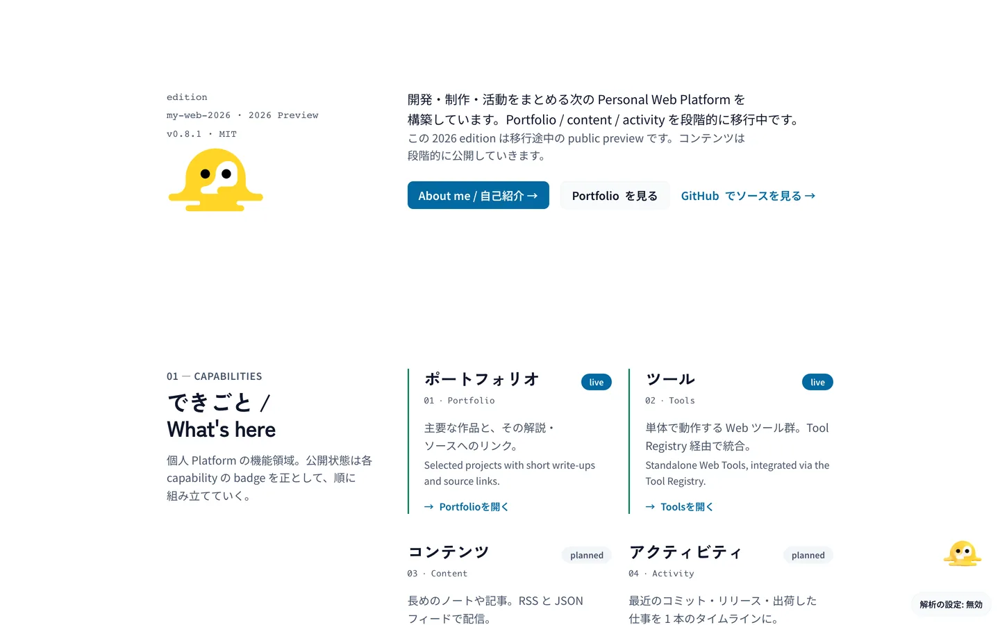

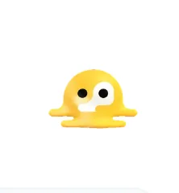

下端 72 px / 右端 24 px、0.62 倍（表示 59.5 × 64.5 px）。解析同意トグル
（下端 12 px・高さ 36 px）とは重ならない。

### Home — ポインタ接近

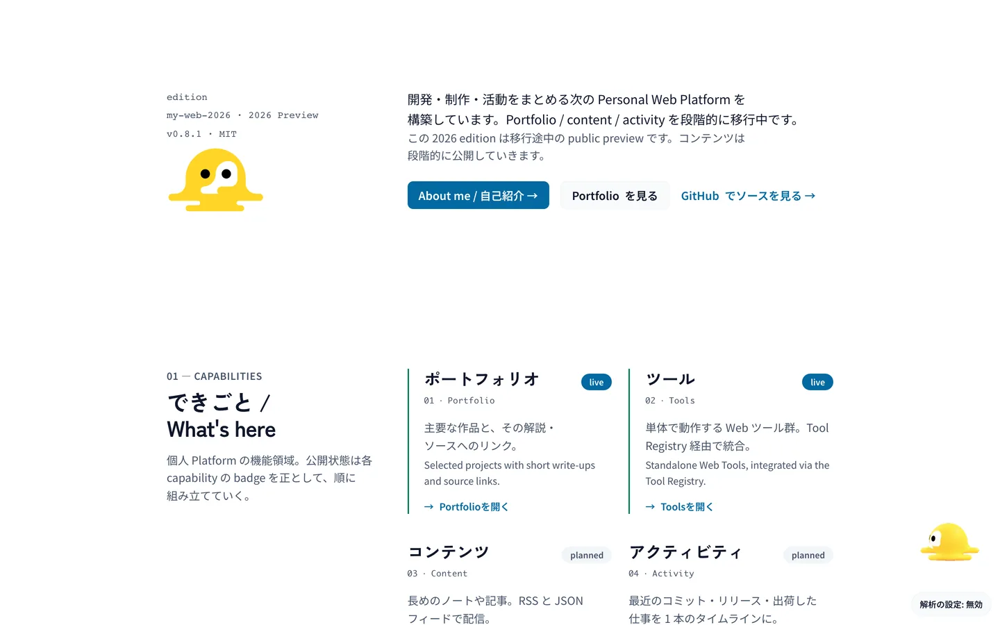

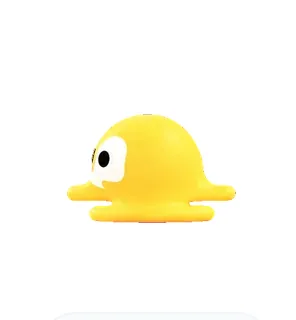

`look-left.webp` を表示し、同時に 0.62 倍 → 1.0 倍（96 × 104 px）へ移る。

### Home — ドラッグ中

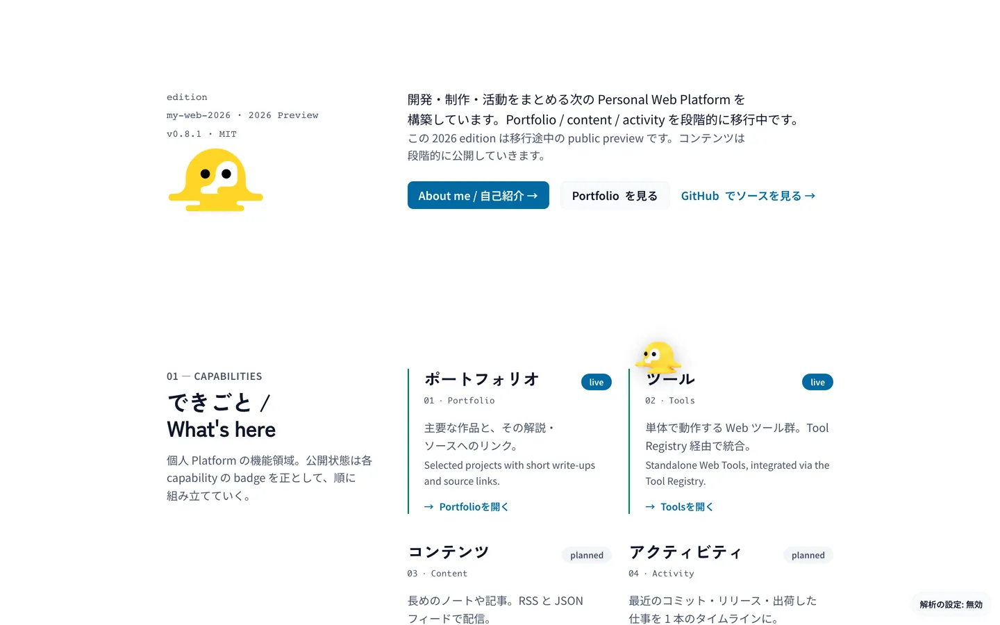

`running-left.webp` + `petRun` アニメーション、`cursor: grabbing`。

### Home — スクロール

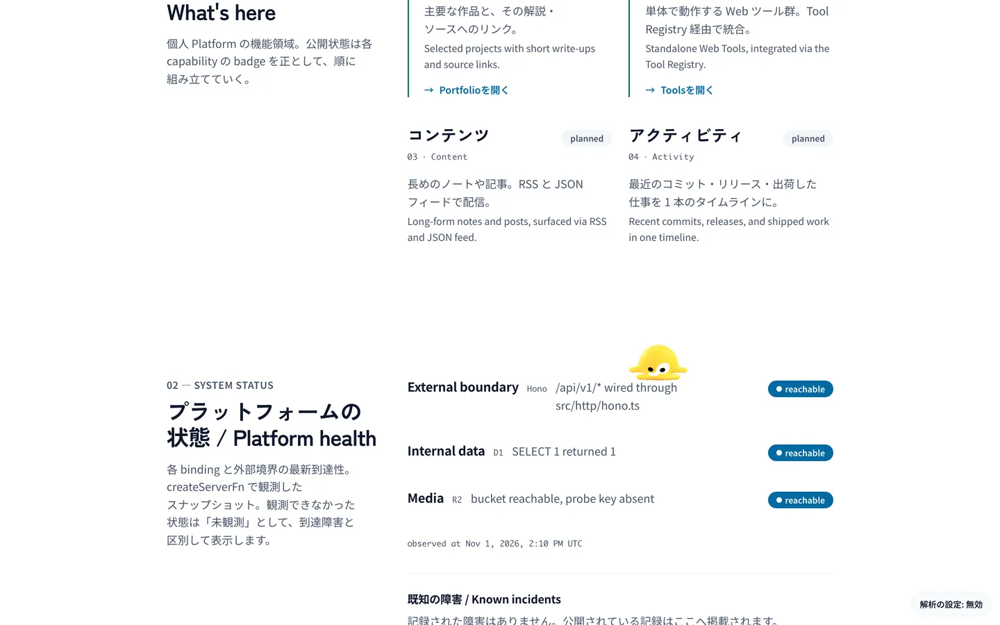

`look-down.webp`。移動はしない（走る絵は出さない）。

### Home — 再読み込み後

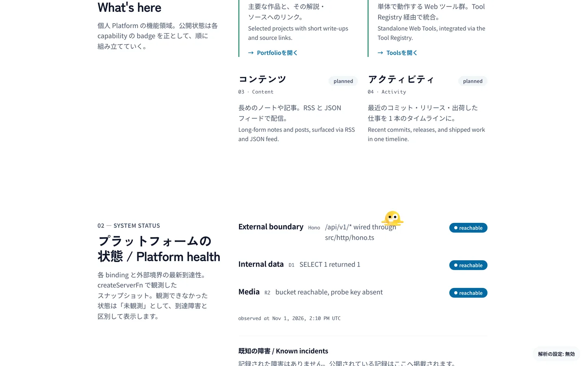

同じブラウザで `pet-position.v1`（比率）から復元。座標は 936, 504。

### Home — 文書末尾

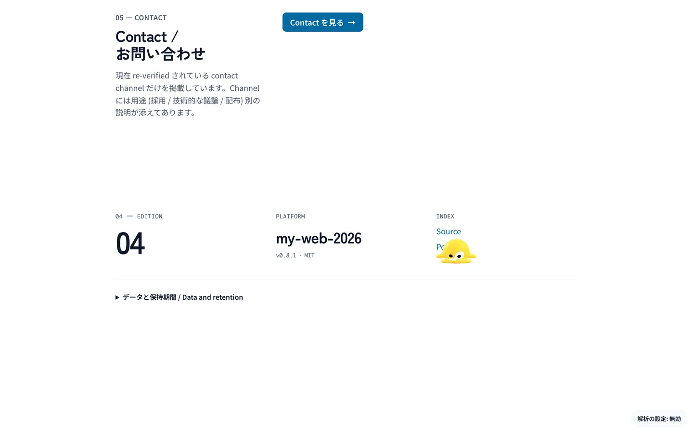

固定オーバーレイの focus compensation（WCAG 2.2 SC 2.4.11）。`body` の
`padding-bottom` が `max(--analytics-consent-offset, --pet-overlay-offset)` に
なり、Home と `/about` では 176 px（= 休憩位置の下端 72 px + フレーム 104 px）が
文書末尾に確保される。**この余白はページの見た目を変える** — 装飾を固定で
浮かせる以上、footer の下に空きが増える。ここに写っているペットは、この
セッションでドラッグした位置が復元されたもので、footer のリンクに重なっている
（訪問者自身が置いた位置なので §5.2 の「初期位置だけ持ち上げる」の対象外）。

### /about

### ドラッグの座標検証

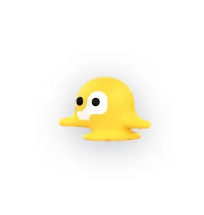

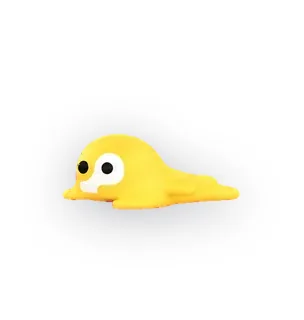

角ではない位置（比率 0.4 / 0.5）で掴み、40 × 30 px 動かしたとき、
掴んだ点と表示中心のずれは **1 px 以内**（0 → 0.4 px）。0.62 倍の実体に対する
掴み点はレイアウト座標へ換算しているので、拡大しても指の下から逃げない。

### reduced motion

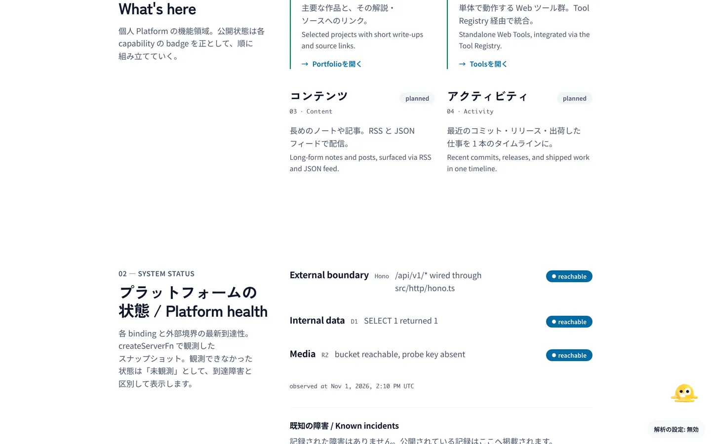

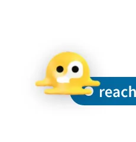

## 測定値

| 項目 | 実測 |
| --- | --- |
| `position` / `pointer-events` | ルート `fixed` / `none`、スプライトボックス `auto` |
| 透明レイヤーの有無 | ボックスの外 6 px を `elementFromPoint` → 下の要素（`DD` / `SECTION`）。全画面の捕捉レイヤーは無い |
| レイアウトボックス | 96 × 104 px（0.62 倍で 59.5 × 64.5 px を描画） |
| `z-index` | 30 |
| `transform` を祖先に持つか | 無し（`fixed` がビューポート基準であることを確認） |
| `aria-hidden` | `true`。内部のフォーカス可能要素は **0** |
| 到着の挨拶 | 1.2 s 後に `idle-rest` へ戻る |
| ポインタ接近 | `look-left` + 1.0 倍 |
| ドラッグ | `running-left` + `petRun` |
| スクロール 600 px | `look-down` |
| 再読み込み | 936, 504 に復元 |
| reduced motion | `idle-rest` / 0.62 倍のまま、入力に対して不変 |
| 同意トグルとの重なり | 修正前 24 px → 修正後 **0 px**（1440 × 900） |
| focus compensation | `--pet-overlay-offset: 176px` を mount 時に publish、unmount で削除。`styles.css` の `:root { scroll-padding }` と `body { padding-bottom }` が `max()` で消費（`scripts/check-a11y-focus-visible.mjs` が PASS） |
| console error | 0 |

## この記録が閉じていないこと

- **デスクトップ Chromium の 1 サイズのみ。** タッチドラッグ、モバイル幅、
  Safari / Firefox は撮っていない。`touch-action: none` と pointer capture を
  使っているが、実機タッチでの確認は別途必要。
- **スクリーンリーダーでの確認はしていない。** `aria-hidden` と
  フォーカス可能要素 0 は DOM の測定であり、読み上げの実測ではない。
- **12 秒の休憩復帰は撮っていない。** タイマーの値は `REST_AFTER_MS` と
  §5.3 が正本で、画面で測ったのは 1.2 s 時点の状態まで。
